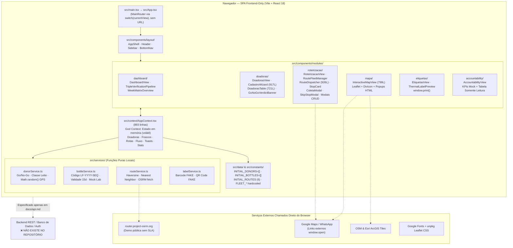
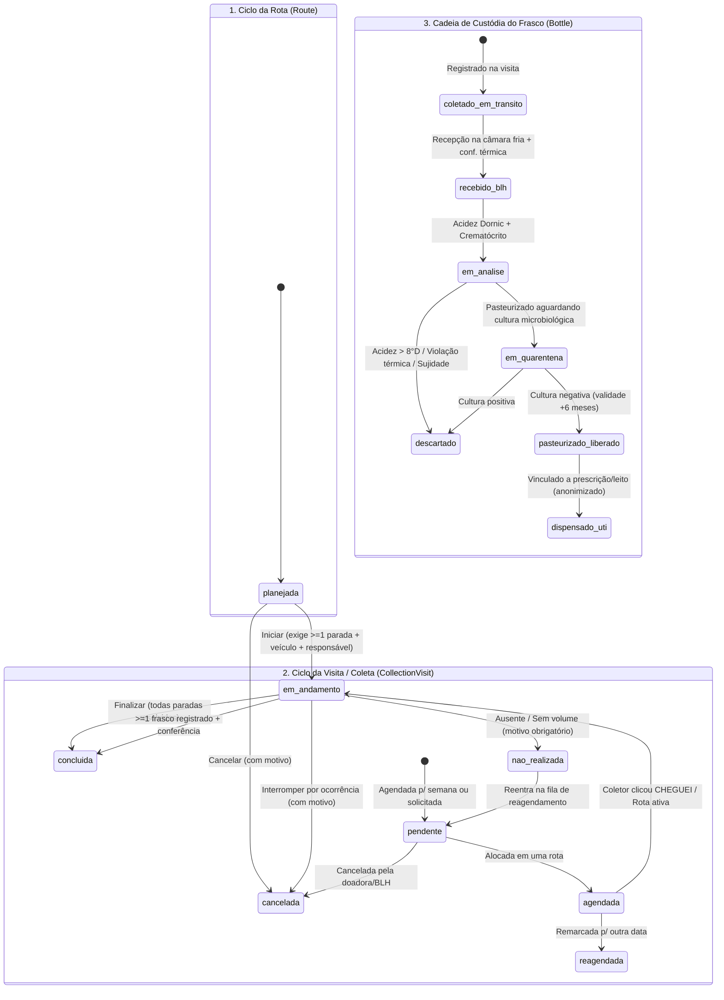
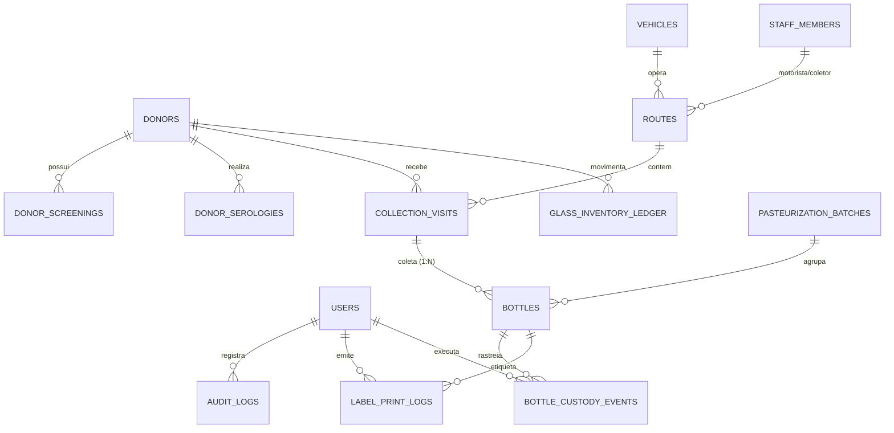
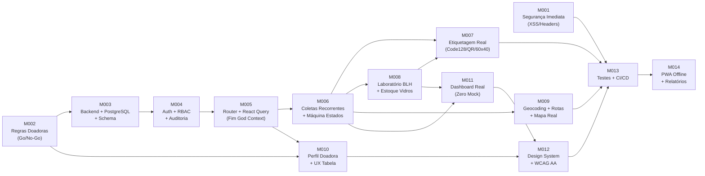

# PLANO DE EVOLUÇÃO — LEITFLOW (Banco de Leite Humano de Marília - SP)

> **Documento gerado a partir de auditoria técnica não destrutiva ponta a ponta.**
> - **Repositório auditado:** `LEITE-FLOW-banco-leite-marilia` (branch `main`, commit `3911de9`)
> - **Escopo inspecionado:** 100% da base de código (`49` arquivos `.ts/.tsx`, `9.235` linhas em `src/`), configurações (`package.json`, `vite.config.ts`, `tsconfig.json`, `tailwind.config.js`, `Dockerfile`, `vercel.json`, `.env.example`), documentação (`docs/`, `design-system/`, `README.md`) e ativos em `public/`.
> - **Data da auditoria:** 19/11/2026
> - **Status:** Aguardando validação e autorização para início da execução faseada. Nenhum arquivo existente foi modificado durante esta auditoria.

---

## SUMÁRIO EXECUTIVO

O **LeitFlow** (referenciado no código como **LEITE FLOW**) é atualmente um **protótipo funcional frontend-only (SPA)** construído em React 18, TypeScript, Vite, Tailwind CSS e Leaflet, focado na demonstração do fluxo operacional do Banco de Leite Humano (BLH) do Hospital Materno Infantil de Marília – SP.

A interface demonstra visão clara do domínio de Banco de Leite (triagem clínica Go/No-Go, zoneamento semanal de Marília, despacho multi-veículo, fluxo guiado de campo e 3 modelos visuais de etiqueta). Contudo, a auditoria do código real revelou **lacunas estruturais bloqueantes para operação real em saúde**:

1. **Inexistência de backend, banco de dados e até persistência local:** todos os dados residem apenas em `useState` no `src/context/AppContext.tsx` (iniciando com `INITIAL_DONORS = []` e `INITIAL_BOTTLES = []`). Um simples recarregamento da página (`F5`) apaga permanentemente todos os cadastros, coletas e alterações de rota.
2. **Inexistência de autenticação, autorização e proteção de dados sensíveis (LGPD):** não há login, perfis de acesso ou auditoria de quem executou cada operação, embora o sistema manipule dados sensíveis de saúde (CPF, Cartão SUS, sorologia HIV/VDRL/Hepatite, endereço residencial).
3. **Etiquetagem visualmente convincente, porém tecnicamente inoperante para leitura óptica:** embora `jsbarcode` conste no `package.json`, ela nunca é importada. O `src/services/labelService.ts` gera **código de barras e QR Code decorativos (falsos)** via hash simplista — ilegíveis por qualquer leitor óptico ou câmera — e o `@media print` não define o formato físico `60x40mm`.
4. **Bugs críticos de regra de negócio e integridade:**
   - Uma doadora que registra **1 única coleta na história** fica permanentemente marcada como `completed` em todas as rotas futuras (`donorBottles.length > 0`).
   - Ao editar uma doadora, **qualquer alteração** em `sorologia1/2/3` — inclusive atualizar de `pendente` para `normal` — **reprova e inativa automaticamente a doadora**.
   - As coordenadas geográficas das doadoras são geradas com `Math.random()` em torno do centro aproximado da zona, e **mudam aleatoriamente toda vez que o cadastro é editado**.
   - Campos clínicos e socioeconômicos coletados no wizard (incluindo `hepatite` e `infeccao`, peso do bebê, Apgar e datas dos exames) são **descartados silenciosamente** ao salvar.
   - Dados de telemetria (`-17.2°C`, `ANVISA ✓`, `Van 01`, estoque `142`, retorno `98.4%`) e resultados laboratoriais (`acidez: "3.6 °D"`, `crematocrito: "670 Kcal/L"`) são **hardcoded/simulados**.
5. **Vulnerabilidade de segurança comprovada (XSS):** `src/components/modules/mapa/InteractiveMapView.tsx` interpola diretamente `donorName`, `address` e `skipMotivo` em HTML bruto no `bindPopup` do Leaflet sem sanitização.
6. **Cobertura de testes automatizados igual a 0%:** não há suíte unitária, de integração ou E2E, nem linter configurado.

---

# SEÇÃO A — DIAGNÓSTICO GERAL E MAPA DA ARQUITETURA ATUAL (ETAPA 1)

## A.1 Estado Atual do Projeto

| Dimensão | Estado Comprovado no Código | Evidência Principal |
|---|---|---|
| **Tipo de aplicação** | SPA Frontend-only (sem servidor de API) | Ausência de pasta `backend/` ou `api/`; único `fetch()` chama OSRM público (`src/services/routeService.ts:212`) |
| **Persistência de dados** | **Nenhuma** (apenas memória RAM via `useState`) | `src/context/AppContext.tsx:100-114`; 0 ocorrências de `localStorage`/`IndexedDB` |
| **Banco de dados** | **Inexistente** (apenas modelo conceitual em markdown) | `docs/database.md` é documentação teórica; `src/data/initialDonors.ts` e `initialBottles.ts` são `[]` |
| **Autenticação / RBAC** | **Inexistente** | Acesso livre a todas as telas e ações em `src/App.tsx` |
| **Roteamento** | Estado local (`switch (currentView)`) sem URL | `src/App.tsx:11-30`; sem `react-router-dom` (apesar de `vercel.json` configurar rewrite SPA) |
| **TypeScript Build** | Compila sem erros (`tsc --noEmit` exit code `0`) | `tsconfig.json` com `strict: true`, mas `noUnusedLocals: false` e `noUnusedParameters: false` |
| **Testes e Linting** | **0 arquivos de teste**, sem ESLint/Prettier | `package.json` contém apenas scripts `dev`, `build`, `preview` |
| **Variáveis de Ambiente** | `.env.example` **não utilizado** | 0 ocorrências de `import.meta.env` em `src/` |

## A.2 Tecnologias e Dependências Identificadas

- **Frontend Core:** React `18.3.1`, React DOM `18.3.1`, TypeScript `5.6.3`, Vite `5.4.11` (`@vitejs/plugin-react` `4.3.4`).
- **Estilização e Ícones:** Tailwind CSS `3.4.16`, PostCSS `8.4.49`, Autoprefixer `10.4.20`, `clsx` `2.1.1`, `tailwind-merge` `2.5.5`, `lucide-react` `0.468.0`.
- **Mapas e Roteirização:** `leaflet` `1.9.4` (CSS carregado via CDN externa `unpkg.com` em `index.html:15`), tiles OpenStreetMap e Esri ArcGIS, traçado viário via API pública de demonstração OSRM (`router.project-osrm.org`).
- **Dependência instalada e NÃO utilizada (código morto):** `jsbarcode` `3.11.6` e `@types/jsbarcode` `3.11.4` (`0` imports em todo o projeto).
- **Deploy / Infraestrutura:** `vercel.json` (SPA rewrite) e `Dockerfile` (multi-stage `node:20-alpine` → `nginx:alpine`, porém sem `nginx.conf` customizado para headers de segurança ou SPA fallback).
- **Ativos estáticos fora da aplicação operacional:** `public/` inclui `pitch.html` (`61.3 KB`), `apresentacao-arquivos.html` (`24.8 KB`) e 5 imagens `.jpg` de apresentação somando **~3,76 MB** que são empacotadas junto com o build de produção.

## A.3 Mapa da Arquitetura Atual

## A.4 Diagnóstico de Maturidade por Funcionalidade

| Funcionalidade / Módulo | Funciona na Prática? | Conectado ao Backend? | Usa Mock / Hardcode? | Diagnóstico Técnico Real |
|---|:---:|:---:|:---:|---|
| **Cadastro de Doadoras (Wizard 5 etapas)** | Parcial | Não | Sim (GPS `Math.random()`) | Cria/edita em memória, mas descarta 7 campos do formulário, gera GPS aleatório, não valida CPF/SUS/duplicidade e tem bug crítico ao editar sorologia |
| **Tabela e Busca de Doadoras** | Parcial | Não | Não | Filtra, ordena e pagina, mas não reseta página ao filtrar, exibe só `sorologia1` e trata `pendente` como `Alterada` |
| **Gestão de Frota (CRUD Rotas)** | Parcial | Não | Sim (`FLEET_*` fixo) | Cria, edita, duplica e exclui rotas em memória; `code` duplica após exclusão; `duplicateRoute` viola unicidade de doadora/dia |
| **Montagem de Paradas (Dispatcher)** | Parcial | Não | Sim (`Meta ~150mL/parada`) | Drag-and-drop e reordenação funcionam em planejamento; porém métricas estimam distância sobre coordenadas aleatórias |
| **Execução de Coletas em Campo** | Quebrado p/ recorrência | Não | Sim (temp/lab/responsável) | Fluxo funciona na 1ª visita em memória, mas `isCollected = donorBottles.length > 0` quebra recorrência semanal; `observacao` e `frascosEntregues` são descartados |
| **Mapa Interativo (Leaflet + OSRM)** | Parcial | Apenas OSRM demo | Sim (telemetria + GPS fake) | Renderiza mapa e traçado OSRM, mas tem XSS em `bindPopup`, leak de unmount, telemetria fixa e não alterna multi-rotas no dia |
| **Etiquetagem e Impressão** | **Apenas visual** | Não | Sim (barcode/QR falsos) | Gera visual bonito em tela, mas **barcode e QR não são escaneáveis**, não há layout real 60×40mm, nem lote, nem histórico de impressão |
| **Dashboard Principal** | **Majoritariamente estático** | Não | Sim (telemetria + pipeline) | Exibe 5 contadores (sendo 1 com fallback/caption falso), barra de telemetria fixa e pipeline estático sem dados reais |
| **Controle de Frascos / Laboratório** | **Apenas UI / Mock** | Não | Sim (3 de 4 KPIs + laudos) | Estoque `142`, retorno `98.4%`, acidez `3.6 °D` e crematócrito `670 Kcal/L` são fixos; não existe UI para recepção, análise, pasteurização ou dispensação |
| **Autenticação, Perfis e Auditoria** | **Ausente** | Não | N/A | Não existe login, controle de sessão, RBAC ou trilha de auditoria |

## A.5 Pontos Positivos Identificados

1. **Conhecimento de domínio bem refletido na linguagem e fluxo:** o projeto já contempla conceitos reais do BLH de Marília (zoneamento de segunda a sexta, classificação biológica Colostro/Transição/Maduro, regra de validade de 15 dias para leite cru, distinção entre 3 etapas de etiqueta e soft delete de doadoras para preservar histórico).
2. **Base de código limpa, tipada e modularizada por domínio:** `src/components/modules/*`, `src/services/*` e `src/types/*` seguem boa separação inicial e compilam com TypeScript `strict: true` sem erros.
3. **Atenção inicial a ergonomia mobile:** presença de `BottomNav`, cards alternativos no mobile (`DoadorasTable`), botões com `min-h-[44px]` em `Button.tsx` e suporte a `prefers-reduced-motion` em `src/index.css`.
4. **Identidade visual clínica promissora em `tailwind.config.js`:** a paleta institucional verde-clínico (`#235347`), coral (`#cf6656`), âmbar (`#b87d28`) e a tríade tipográfica (`Fraunces` + `Plus Jakarta Sans` + `JetBrains Mono`) conferem seriedade hospitalar muito superior a templates genéricos.

## A.6 Principais Riscos

- **Risco Operacional Crítico (Perda Total de Dados):** uso em produção sem backend/persistência resulta em perda imediata de registros ao fechar aba, atualizar página ou trocar dispositivo.
- **Risco Sanitário e Clínico:** etiquetas com códigos de barras/QR ilegíveis, validade calculada da coleta (em vez da 1ª ordenha), laudos laboratoriais pré-preenchidos como aprovados (`3.6 °D`) na coleta, sorologia com default `'normal'` e permissão para imprimir etiqueta de UTI em frasco não pasteurizado podem causar **erro grave de rastreabilidade neonatal**.
- **Risco de Segurança e LGPD:** ausência de autenticação/RBAC + vulnerabilidade XSS em popups do mapa + exposição de dados sensíveis de saúde sem criptografia em trânsito/repouso ou trilha de auditoria.
- **Risco Logístico:** coordenadas geradas por `Math.random()` enviam motoristas para endereços errados ao clicar em "GPS / Trajeto" (`buildGoogleMapsSingleStopUrl` navega para `lat,lng` aleatório e ignora `address`!).

## A.7 Limitações desta Auditoria

Para transparência técnica, registra-se o que **não pôde ser verificado** nesta etapa não destrutiva:
1. **Teste físico de impressão térmica (Zebra/Argox/Elgin 60×40mm)** e leitura real por scanner óptico (embora a ilegibilidade do barcode/QR tenha sido comprovada matematicamente pela inspeção do código em `src/services/labelService.ts`).
2. **Validação em servidor de produção / rede hospitalar:** não há backend em execução, ambiente de banco de dados ou infraestrutura de hospedagem acessível para testes de carga, latência ou configuração de TLS/backup.
3. **Homologação normativa local do BLH Marília:** os requisitos citados baseiam-se na **RDC ANVISA nº 171/2006** e no Manual Técnico da **rBLH-BR (Fiocruz/MS)**; particularidades internas dos formulários/cadernos físicos do Hospital Materno Infantil de Marília deverão ser confirmadas com a coordenação de enfermagem antes da codificação final das etiquetas e laudos.

---

# ETAPA 2 — AUDITORIA VISUAL E EXPERIÊNCIA DO USUÁRIO (UX/UI)

## 2.1 Auditoria Tela por Tela

| Tela / Componente | Arquivo Principal | Diagnóstico Visual e Funcional |
|---|---|---|
| **Shell, Header, Sidebar, BottomNav** | `AppShell.tsx`, `Header.tsx`, `Sidebar.tsx`, `BottomNav.tsx` | **Problemas:** (1) `Header.tsx:74-83` exibe badge falso `Sensor: -17.2°C ANVISA ✓` com `animate-ping` estático. (2) `Sidebar.tsx:204-248` exibe `"Van 01"`, `"LF-2026"`, `"Fiorino"` e `"-17.2 °C"` hardcoded e tem **bug de binding na linha 245**: sob o rótulo `"Coletor(a):"` exibe `routeAssignment?.vehicleName` em vez de `collectorName`. (3) Navegação mistura visão de campo e visão administrativa no mesmo nível sem agrupamento nem URL real. (4) `BottomNav` esconde "Controle de Frascos" atrás de "Menu" e usa 6 colunas apertadas em telas de 360px. |
| **Dashboard Principal** | `DashboardView.tsx`, `TripleVerificationPipeline.tsx`, `WeekMatrixOverview.tsx` | **Problemas:** (1) Banner superior afirma `"Operação de Frota Ativa"`, `"Van 01 (Fiorino)"` e `"-17.2°C (Ideal)"` fixos. (2) Card de temperatura afirma `"Cadeia de frio < -10°C em 100%"` hardcoded. (3) `TripleVerificationPipeline` é puramente explicativo (zero números reais por nó). (4) Sem visão diária de coletas (agendadas, pendentes, concluídas, não realizadas, atrasadas), sem alertas operacionais (validade 15d, exames pendentes, temperatura fora da norma) e sem gráficos/filtros temporais. (5) Inicia como tela secundária (`AppContext.tsx:102` abre em `roteirizacao`). |
| **Doadoras (Cadastro & Gestão)** | `DoadorasView.tsx`, `CadastroWizard.tsx`, `DoadorasTable.tsx`, `GoNoGoVerdictBanner.tsx` | **Problemas:** (1) Formulário gigante de 5 etapas e tabela ocupam a mesma página vertical (scroll excessivo; ao abrir a aba para buscar uma doadora, o usuário precisa rolar toda a ficha de cadastro). (2) Sem modal/gaveta de Perfil Completo da Doadora. (3) Sem feedback de máscara/validação em tempo real para CPF, SUS e telefone. (4) Em `DoadorasTable.tsx:180-183`, exibe o aviso `"Tabela completa: Deslize para o lado ->"` no mobile (`sm:hidden`), mas no mobile a tabela `<table>` está oculta (`hidden md:block`) e são exibidos cards verticais! |
| **Roteirização (3 sub-abas)** | `RoteirizacaoView.tsx`, `RouteFleetManager.tsx`, `RouteDispatcher.tsx`, `StopCard.tsx`, Modais | **Problemas:** (1) Duas camadas de abas empilhadas dentro da mesma tela (`WeekDaySelector` → `Frota / Montar / Executar` → dentro de Montar há ainda `Paradas / Disponíveis`) geram carga cognitiva alta. (2) `CreateRouteModal.tsx` e `EditRouteModal.tsx` reimplementam portais manuais (`createPortal`) sem `Escape` para fechar nem `aria-modal`, ignorando o componente `Modal.tsx` existente, e disparam `window.alert()` nativo em validações. (3) Emoji `🏥` usado como ícone na timeline (`RoteirizacaoView.tsx:478,509` e `RouteDispatcher.tsx:595,751`). |
| **Mapa Interativo** | `InteractiveMapView.tsx` | **Problemas:** (1) Painel flutuante repete telemetria hardcoded `"Van 01"` e `"-17.2°C Frio"`. (2) Sem seletor de rota quando há 2+ veículos no mesmo dia. (3) Emojis (`🗺️`, `🏙️`, `🛰️`, `🏥`) nos botões de camada e marcador do hospital. (4) CSS inválido `ring: 4px solid #bae6fd;` em `L.divIcon`. (5) Checklist de chegada não persiste nem reseta por parada. |
| **Etiquetas dos Frascos** | `EtiquetasView.tsx`, `ThermalLabelPreview.tsx` | **Problemas:** (1) Sem busca/filtro na lista de frascos, sem seleção múltipla para impressão em lote, sem escolha de papel/tamanho (60×40mm vs A4). (2) Preview retrata proporção vertical incompatível com 60×40mm. (3) Botão "Imprimir Etiqueta" no topo permanece clicável mesmo quando `bottles.length === 0`. |
| **Controle de Frascos** | `AccountabilityView.tsx` | **Problemas:** (1) 3 dos 4 KPIs são fixos/fictícios. (2) Tabela sem busca, filtro, paginação ou ações de atualização laboratorial. (3) Todos os `statusPast` usam badge verde (`variant="success"`) e temperaturas sempre em verde, ocultando desvios sanitários. |

## 2.2 Proposta de Novo Dashboard Operacional

O Dashboard deve deixar de ser um "cartão institucional estático" e tornar-se um **Painel Operacional Diário + Gerencial**, organizado em 4 faixas com hierarquia clara:

1. **Faixa 1 — Barra de Contexto e Filtros Reais:** filtro de período (`Hoje`, `Esta Semana`, `Últimos 30 dias`, `Personalizado`), filtro por Zona e atalhos rápidos contextuais (`Nova Doadora`, `Montar Rota de Hoje`, `Receber Frascos`).
2. **Faixa 2 — Alertas Operacionais Prioritários (somente quando existirem):**
   - Frascos crus vencendo em `≤ 3 dias` (prazo ANVISA de 15 dias).
   - Registros com desvio térmico (`> -10°C`) ou acidez Dornic fora da faixa (`> 8°D`).
   - Doadoras com sorologia `Pendente` ou exame vencido (> 6 meses).
   - Coletas atrasadas ou paradas marcadas como `Não Realizadas` aguardando reagendamento.
3. **Faixa 3 — KPIs Operacionais Reais (sem números simulados):**
   - **Operação do Dia:** Coletas previstas hoje · Concluídas · Pendentes · Não realizadas/canceladas (com barra de progresso real por veículo ativo).
   - **Base de Doadoras:** Total cadastradas · Ativas & Aptas · Pendentes de laudo · Inaptas/Inativas.
   - **Produção Real:** Frascos coletados no período + Volume real coletado (mL / L) + Conformidade térmica real (`% ≤ -10°C`, exibindo `"Sem medições"` quando vazio, nunca `-17.2°C` falso).
4. **Faixa 4 — Visão Analítica e Logística:**
   - **Funil Vivo da Cadeia de Custódia (Nó 1 → Nó 2 → Nó 3):** substitui o texto estático de `TripleVerificationPipeline.tsx` por contadores reais clicáveis (`Coletados/Em Triagem` → `Em Análise/Pasteurização` → `Aprovados p/ Estoque` → `Dispensados UTI`).
   - **Distribuição Geográfica e Semanal:** `WeekMatrixOverview` enriquecida com rotas planejadas/ativas, volume por zona e taxa de atendimento por região.
   - **Série Temporal (gráfico enxuto):** volume coletado (mL) e coletas concluídas vs. não realizadas nas últimas 4 semanas.

## 2.3 Identidade Visual e Consolidação do Design System

**Inconsistências comprovadas no código atual:**
1. **Conflito de fonte da verdade:** `design-system/leiteflow/MASTER.md` especifica azul `#2563EB` + laranja `#EA580C` + Glassmorphism (SaaS genérico), contradizendo totalmente `tailwind.config.js` e `docs/design-system.md` (verde institucional `#235347` + coral `#cf6656` + âmbar `#b87d28`).
2. **Classes Tailwind v4 inexistentes no Tailwind v3.4.16 instalado:**
   - `shadow-xs`: **36 ocorrências** em `src/` (todas ignoradas pelo compilador CSS).
   - `py-0.2`: **4 ocorrências** (ignoradas).
   - `outline-hidden`: **1 ocorrência** (`Header.tsx:50`).
   - `bg-blh-slate-850`: **1 ocorrência** (`Sidebar.tsx:187`, token inexistente em `tailwind.config.js`).
3. **CSS duplicado:** `.pb-safe` está declarada duas vezes em `src/index.css` (linhas `130` e `147`).
4. **Componentes fora do padrão:** `CreateRouteModal`, `EditRouteModal` e `DeleteRouteConfirmModal` não usam `src/components/ui/Modal.tsx`, perdendo padronização de teclado (`Escape`), cabeçalho e acessibilidade.

**Diretriz do Design System consolidado:**
- **Manter e formalizar** a identidade clínica de `tailwind.config.js` (`#235347` primário institucional, `#16362e` escuro, `#eaf3f0` superfície ativa, `#cf6656` coral moderado, `#b87d28` âmbar de alerta, `#f4f7f6` fundo clínico, `Fraunces` apenas para títulos de página/documentos, `Plus Jakarta Sans` para UI/dados, `JetBrains Mono` para códigos de frasco, temperaturas e placas).
- **Arquivar ou substituir** `design-system/leiteflow/MASTER.md` para alinhar 100% aos tokens clínicos reais do BLH.
- **Criar biblioteca completa de primitivos em `src/components/ui/`:** adicionar `Input`, `Select`, `Textarea`, `Card`, `Tabs`, `Skeleton` (loading states), `ErrorBanner`, `ConfirmDialog` e `DataTable` padronizados; abolir `window.alert()` e emojis como ícones (substituir por `lucide-react`).

## 2.4 Reorganização da Navegação

Separação clara entre **Operação Diária**, **Gestão Clínica & Laboratório** e **Administração**, com URLs reais via `react-router-dom`:

- **Visão Geral:** `/dashboard` (Painel Operacional)
- **Operação Logística:**
  - `/rotas` (Frota, Planejamento e Execução de Campo)
  - `/mapa` (Mapa Operacional com seletor de Dia + Rota)
- **Gestão Clínica:**
  - `/doadoras` (Listagem, Busca, Perfil Completo e botão destacado "Nova Doadora" → `/doadoras/nova` ou drawer/página dedicada, separando busca de formulário)
- **Rastreabilidade & Laboratório BLH:**
  - `/etiquetas` (Emissão, Lote, Reimpressão e Histórico)
  - `/laboratorio` (Recepção, Acidez Dornic, Crematócrito, Pasteurização, Dispensação UTI e Estoque Real de Vidros — evolução de `AccountabilityView`)
- **Administração (restrito a perfil Coordenador/Admin):**
  - `/equipe-frota` (CRUD real de Veículos, Motoristas, Coletores e Usuários)
  - `/auditoria` (Log imutável de eventos críticos)

## 2.5 Responsividade e Acessibilidade (WCAG 2.1 AA)

Problemas encontrados no código:
- **Inputs sem associação programática (`htmlFor`/`id`):** quase todos os `<label>` em `CadastroWizard.tsx`, `ColetaModal.tsx`, `CreateRouteModal.tsx` e `EditRouteModal.tsx` não possuem `htmlFor`/`id` vinculados, quebrando leitores de tela e clique no rótulo.
- **Modais sem focus trap:** `Modal.tsx` escuta `Escape`, mas não gerencia foco ao abrir/fechar (`aria-labelledby` ausente); os 3 modais de rota sequer escutam `Escape`.
- **Elementos clicáveis não semânticos:** cards clicáveis em `WeekMatrixOverview.tsx:45`, `EtiquetasView.tsx:149`, `StopCard.tsx:44` e `InteractiveMapView.tsx:541` usam `
` sem `role="button"`, `tabIndex={0}` ou handler de teclado (`Enter`/`Space`).
- **Estados de foco removidos:** `Header.tsx:50` (`focus:outline-hidden`), `RouteFleetManager.tsx:270` (`outline-none`) e vários inputs em `CreateRouteModal`/`EditRouteModal` usam `outline-none` com anel muito sutil (`focus:ring-1`).
- **Mobile 360px–390px:** `BottomNav` com 6 colunas comprime labels; no `DoadorasTable.tsx:180`, o aviso `"Deslize para o lado ->"` é incoerente porque a vista mobile usa cards empilhados.

---

# ETAPA 3 — AUDITORIA E EVOLUÇÃO DO SISTEMA DE ETIQUETAGEM

Este é um dos módulos mais sensíveis do LeitFlow porque impacta diretamente a segurança biológica da UTI Neonatal.

## 3.1 Diagnóstico Comprovado do Sistema Atual

Arquivos inspecionados: `src/services/labelService.ts`, `src/services/bottleService.ts`, `src/components/modules/etiquetas/EtiquetasView.tsx`, `src/components/modules/etiquetas/ThermalLabelPreview.tsx`, `src/index.css` e `package.json`.

| Falha Comprovada | Evidência no Código | Impacto Operacional |
|---|---|---|
| **1. Código de Barras FALSO (não escaneável)** | `src/services/labelService.ts:4-31` gera barras via hash `hash * 31 + charCodeAt` sobre um array fixo `pattern = [2,1,1,2,3,...]`. `jsbarcode` (`package.json:13`) tem **0 imports**. | **Crítico:** nenhum leitor óptico do BLH consegue decodificar `LF-2026-XXXXXX`. |
| **2. QR Code FALSO (não escaneável)** | `src/services/labelService.ts:36-68` desenha 3 quadrados de canto e módulos pseudo-aleatórios `(r*19 + c*37 + hash) % 7` sem especificação ISO/IEC 18004, sem correção de erro Reed-Solomon e sem quiet zone. | **Crítico:** qualquer câmera/leitor 2D falha ao ler a etiqueta. |
| **3. Layout 60×40mm inexistente no CSS de impressão** | `src/index.css:162-186` não tem `@page { size: 60mm 40mm; margin: 0; }`. `ThermalLabelPreview.tsx:31` renderiza card vertical (`max-w-[430px]`, ~600px de altura = formato retrato). | **Alto:** ao imprimir em Zebra/Argox/Elgin 60×40mm (paisagem), o conteúdo é cortado ou reduzido a texto microscópico ilegível. |
| **4. Validade do leite cru calculada da coleta, não da 1ª ordenha** | `bottleService.ts:18-26,60-61` soma 15 dias a `now` (data da coleta da van), mas rotula na etiqueta `Data/Hora 1ª Coleta * Início da contagem` (`ThermalLabelPreview.tsx:99-104`). | **Crítico (Sanitário):** segundo a RDC ANVISA nº 171/2006, os 15 dias de validade do leite cru congelado contam da **data da primeira ordenha/extração**, não da passagem da van. |
| **5. Modelo de Pasteurização exibe validade de leite cru e aceita frasco não pasteurizado** | `ThermalLabelPreview.tsx:108-114` mostra `"Validade Leite Cru (15d)"` mesmo quando `labelType === 'pasteurizacao'`. `EtiquetasView.tsx` permite emitir etiqueta de UTI para frasco com `statusPast === 'Em Triagem'`. | **Crítico (Sanitário):** risco de rotular leite cru/não testado como leite pasteurizado pronto para UTI Neonatal. |
| **6. Temperatura exibe texto fixo `(< -10°C)` mesmo quando fora da norma** | `ThermalLabelPreview.tsx:128`: `{bottle.temp} °C (< -10°C)`. | **Alto:** se a caixa estiver a `-4°C`, imprime `-4 °C (< -10°C)`, induzindo erro de conferência. |
| **7. Dados laboratoriais mockados impressos na etiqueta** | `bottleService.ts:63-64` grava `acidez: "3.6 °D"` e `crematocrito: "670 Kcal/L"` no momento da coleta em casa. | **Crítico (Sanitário):** imprime resultado laboratorial fictício como se fosse laudo real. |
| **8. Sequência de código propensa a colisão** | `AppContext.tsx:337`: `const seqIndex = bottles.length + 123;` (apenas em memória; reinicia ao recarregar). | **Alto:** duplicidade garantida entre sessões/dispositivos. |
| **9. Sem data de nascimento do bebê na etiqueta inicial** | `README.md:51` promete data de nascimento do bebê na Etiqueta 1, mas `Bottle` e `ThermalLabelPreview` não têm esse campo. | **Médio:** divergência entre especificação e implementação (além de ser dado essencial para conferir idade gestacional/classificação). |
| **10. Zero controle de impressão, lote ou reimpressão** | `EtiquetasView.tsx:25-27` apenas chama `window.print()`. Não grava log de emissão, usuário, motivo de reimpressão, nem cancelamento de etiqueta. Bug adicional em `EtiquetasView.tsx:23`: `isLabelConfirmed` não reseta ao trocar de frasco. | **Alto:** etiqueta é apenas um desenho transitório, sem vínculo auditável. |

## 3.2 Diferenciação: Requisitos Sanitários Oficiais vs. Recursos Opcionais

> *Referência normativa: RDC ANVISA nº 171/2006 (Regulamento Técnico para o Funcionamento de Bancos de Leite Humano) e Manual Técnico da rBLH-BR (Fiocruz/MS). Confirmar formulários locais com a coordenação técnica do BLH Marília.*

### Requisitos Sanitários / Regulatórios Essenciais na Rotulagem
- **Frasco de Leite Humano Ordenhado Cru (LHO — Coleta / Pré-estocagem):**
  - Identificação inequívoca da doadora (código único da doadora; nome completo apenas quando exigido internamente no rótulo primário de recebimento e protegido fora da UTI).
  - **Data e hora da 1ª ordenha/extração** (marco real de início da validade de 15 dias a `≤ -3°C` / ideal `≤ -10°C` conforme protocolo BLH).
  - Data de validade calculada corretamente a partir da 1ª ordenha.
  - Tipo/classificação do leite conforme fase de lactação (`Colostro`, `Transição`, `Maduro` — e indicação de prematuridade quando aplicável).
  - Volume (mL) e condições de conservação/recepção (temperatura aferida + conformidade).
- **Frasco de Leite Humano Ordenhado Pasteurizado (LHOP — Estoque Pós-pasteurização / UTI):**
  - **Anonimização da doadora** (apenas código rastreável do frasco/lote e código interno da doadora, nunca nome completo exposto na UTI).
  - Código único do frasco/lote de pasteurização.
  - Data da pasteurização e **nova data de validade** (até 6 meses congelado, conforme RDC 171/2006).
  - **Resultados reais de controle de qualidade:** Acidez Dornic (`≤ 8°D`), Crematócrito (`Kcal/L`) e aprovação microbiológica (liberação após quarentena).
  - Classificação do leite e volume dispensado.

### Recursos Operacionais Opcionais (Alto Valor Agregado)
- **Code 128 real** (`jsbarcode` já instalada) contendo exclusivamente o código opaco único (ex.: `LF-2026-000123`) — **sem dados pessoais no código de barras**.
- **QR Code real (ISO/IEC 18004, nível de correção M ou Q)** com payload mínimo não-PII (ex.: `{"v":1,"code":"LF-2026-000123"}` ou URL interna autenticada), permitindo leitura rápida na recepção do BLH sem vazar dados pessoais caso lido por terceiros.
- **Suporte nativo a ZPL/EPL** (para impressoras térmicas Zebra/Argox/Elgin) e **geração de PDF vetorial** (etiqueta individual 60×40mm, 100×50mm e folha A4 multi-etiquetas em lote).

## 3.3 Arquitetura Alvo de Etiquetagem e Rastreabilidade

1. **Identificação Única Atômica (Backend/DB):** tabela `bottles` com `code VARCHAR(24) UNIQUE NOT NULL` gerado por sequência transacional anual no PostgreSQL (`LF-YYYY-NNNNNN` + dígito verificador opcional, ex.: `LF-2026-000123-7`). Impossível duplicar mesmo em uso simultâneo.
2. **Gate Sanitário de Modelo de Etiqueta:**
   - Modelo 1 (`coleta`) e Modelo 2 (`estocagem`): liberados para frascos coletados.
   - Modelo 3 (`pasteurizacao` / UTI): **bloqueado** enquanto `statusPast !== 'Pasteurizado'` e `'Dispensado'` ou enquanto `acidezDornic`, `crematocrito` e `microbiologiaAprovada` não estiverem formalmente registrados pelo laboratório.
3. **Ciclo de Vida da Etiqueta (`label_prints`):**
   - Cada emissão/reimpressão gera um registro imutável: `id`, `bottle_id`, `label_type`, `copy_number` (`1ª via`, `2ª via — Reimpressão`), `format` (`60x40mm`, `100x50mm`, `A4_BATCH`, `ZPL`), `printed_by_user_id`, `printed_at`, `reason` (obrigatório a partir da 2ª via), `status` (`valid` | `voided`), `void_reason`.
4. **Impressão Profissional:**
   - Preview em escala real 1:1 com alternância de formato (`60×40mm` térmico paisagem compacto vs. `100×50mm` vs. `Folha A4`).
   - Impressão em lote por rota ou seleção múltipla (ex.: imprimir todas as etiquetas da rota de Segunda-feira de uma vez ou etiquetas de um lote de pasteurização).
   - Exportação em PDF vetorial (ex.: via `@react-pdf/renderer` ou endpoint backend com `pdfkit`) eliminando distorções de margens do `window.print()` entre navegadores.

---

# ETAPA 4 — AUDITORIA DO MÓDULO DE DOADORAS

Arquivos inspecionados: `DoadorasView.tsx`, `CadastroWizard.tsx`, `DoadorasTable.tsx`, `GoNoGoVerdictBanner.tsx`, `donorService.ts`, `types/donor.ts`.

## 4.1 Problemas Comprovados

1. **Bug Crítico na Regra de Edição de Sorologia (`src/services/donorService.ts:140-163`):**
   - `hasSorologiaChanged` compara `!==` para qualquer valor. Se uma doadora cadastrada como `pendente` recebe exame negativo (`normal`), o sistema executa `if (sorologiaChanged) { aptidao = 'Inapta'; statusCadastro = 'inativa'; }` — **bloqueando uma doadora saudável!** A regra deveria inaptar apenas quando houver resultado `'alterada'`, reavaliando `evaluateGoNoGo` corretamente quando passa de `'pendente'` para `'normal'`.
2. **Descarte Silencioso de Dados Clínicos e Socioeconômicos (`src/services/donorService.ts:92-135,150-205` e `CadastroWizard.tsx:66-107`):**
   - `DonorFormData` coleta `renda`, `pesoBebe`, `apgar`, `malformacao`, `intercorrencias` (`infeccao`, `hipertensao`, `diabetes`, `hepatite`), `soro1Data`, `soro2Data`, `soro3Data`. **Nenhum desses campos existe em `Donor`!** Todos são perdidos ao salvar, e ao abrir a edição `donorToFormData` preenche valores padrão falsos (`renda: 'De 1 a 3 salários mínimos'`, datas com `hoje`). Além disso, marcar `hepatite: true` não dispara nenhuma contraindicação no `evaluateGoNoGo`.
3. **Padrão Perigoso na Etapa 5 — Sorologia (`CadastroWizard.tsx:58-62,842-849`):**
   - Os 3 exames começam com default `'normal'` (Não Reagente) e **nem oferecem a opção `'pendente'`** no `<select>`. Se o operador apenas clicar em "Próxima Etapa" até o fim, aprova uma doadora sem exame conferido! O default seguro (fail-safe) deve ser `'pendente'`.
4. **Geolocalização Falsa e Instável (`donorService.ts:98-99,168-169`):**
   - Usa `baseCoords + (Math.random() - 0.5) * 0.015` (raio aleatório de ~1,6 km) e grava `bairro: "Marília"` hardcoded. Ao editar qualquer campo da doadora (ex.: telefone), novas coordenadas aleatórias são sorteadas, deslocando o pin no mapa e alterando rotas!
5. **Heurística Frágil para Tatuagem/Transfusão (`donorService.ts:59-63`):**
   - Campo em texto livre testado com `tat.includes(currentYear) || tat.includes("mes")` gera falsos positivos ("fiz há 24 meses") e falsos negativos ("10/2025" avaliado em 02/2026). Além disso, `transfusao` (coletado na Etapa 2 com aviso de carência de 12 meses na linha 635) **nem sequer é verificado** em `evaluateGoNoGo`!
6. **Inconsistência no Veredito Pós-Edição (`CadastroWizard.tsx:226-229,248-250`):**
   - Passa o objeto `editingDonor` antigo e o resultado bruto de `evaluateGoNoGo(formData)` para `onSubmitted`, exibindo no `GoNoGoVerdictBanner` um veredito que contradiz o estado realmente salvo por `updateDonorFromForm`.
7. **Ausência de Validações de Formato e Prevenção de Duplicidade:**
   - Aceita CPF inválido, Cartão SUS com menos/mais de 15 dígitos, telefone inválido, data do parto no futuro ou data de nascimento posterior ao parto.
   - Permite cadastrar múltiplas doadoras com exatamente o mesmo CPF, CNS ou nome + data de nascimento.
8. **Bugs na Listagem (`DoadorasTable.tsx`):**
   - Paginação não volta para página `1` ao alterar filtros/busca (`lines 37-43,91-95`), podendo exibir página vazia com contagem quebrada.
   - Coluna Sorologia (`lines 273,439-445`) e Modal de Laudo (`line 606`) verificam **apenas `sorologia1`** e exibem `'Alterada'` mesmo se o valor for `'pendente'`.
   - Ausência de visualização de **Perfil Completo da Doadora** (dados cadastrais, endereço geocodificado, histórico de exames sorológicos com datas, histórico completo de coletas/frascos, saldo de vidros em posse e linha do tempo de alterações).
   - Botão "Rota" (`navigateToDonorRoute`) redireciona para a aba de roteirização, mas não verifica se a doadora está alocada em alguma rota do dia.

## 4.2 Melhorias Propostas para o Módulo de Doadoras

- Separar a **Listagem/Gestão de Doadoras** (tela principal limpa com busca, filtros, exportação controlada e botão "Nova Doadora") do **Formulário de Cadastro/Edição** (rota dedicada ou drawer amplo), eliminando a rolagem extensa.
- Criar **Perfil Completo da Doadora (`/doadoras/:id`)** com abas: *Resumo & Contato*, *Triagem & Sorologias (histórico com datas e validade)*, *Histórico de Coletas & Frascos*, *Controle de Vidros* e *Auditoria*.
- Estruturar endereço em campos próprios (`CEP` com consulta ViaCEP opcional, `logradouro`, `número`, `complemento`, `bairro`, `zona`, `referência`, `lat/lng` validados + ajuste manual do pin no mapa).
- Substituir texto livre de tatuagem e transfusão por campos estruturados (`possui: boolean`, `dataUltimoProcedimento: date`) com cálculo exato `< 365 dias`.
- Implementar validação rigorosa (front + back com Zod): algoritmo de dígito verificador de CPF e Cartão SUS (CNS), máscara de telefone, coerência de datas e checagem de duplicidade (`UNIQUE` parcial em `cpf` e `sus` no banco).
- Implementar **proteção de dados sensíveis por perfil (RBAC)**: motorista/coletor visualiza apenas nome, telefone, endereço, equipamento e observações logísticas — **nunca CPF, renda familiar, sorologias ou histórico clínico detalhado**.

---

# ETAPA 5 — AUDITORIA DO MÓDULO DE COLETAS

Arquivos inspecionados: `RoteirizacaoView.tsx`, `ColetaModal.tsx`, `SkipStopModal.tsx`, `StopCard.tsx`, `AppContext.tsx`, `bottleService.ts`, `AccountabilityView.tsx`.

## 5.1 Problemas Comprovados no Fluxo de Coletas

1. **Bug Crítico de Modelagem — Doadora "Coletada para Sempre" (`AppContext.tsx:211-212` e `RouteFleetManager.tsx:98,300`):**
   - `const isCollected = donorBottles.length > 0;` verifica se existe *qualquer* frasco vinculado à `doadoraId` em todo o sistema, sem filtrar por `routeId`, `visitId` ou data. Em uma operação semanal real, na segunda semana a doadora já aparece concluída automaticamente, impedindo novas coletas!
2. **Campos Coletados no Modal Descartados (`ColetaModal.tsx:33,36-37,53` + `bottleService.ts:41-67`):**
   - `frascosEntregues` (frascos vazios esterilizados deixados com a mãe) e `observacao` são coletados na UI mas **ignorados** por `createBottleFromCollection`. O estado `condicao` (`ColetaModal.tsx:36`) nem sequer é utilizado no JSX.
   - `ColetaModal` só permite registrar **1 frasco por parada**, enquanto na prática uma doadora frequentemente entrega **2 a 6 frascos congelados** em uma única visita semanal!
3. **Ausência de Data da 1ª Ordenha no Registro de Coleta (`ColetaModal.tsx`):**
   - O coletor não informa a data da primeira ordenha anotada no frasco pela doadora, impossibilitando calcular corretamente a validade de 15 dias do leite cru.
4. **Responsável Hardcoded (`bottleService.ts:66`):**
   - Grava `Equipe LEITE FLOW ${donor.zona} (Matr. 3891)` ignorando `routeAssignment.collectorName`, `routeAssignment.driverName` e o usuário autenticado.
5. **Bug no Avanço de Parada (`AppContext.tsx:365`):**
   - `advanceToNextStop` filtra `!s.collected && s.donorId !== activeStopDonorId`, esquecendo `!s.skipped`. Pode direcionar a van para uma parada já marcada como não realizada.
6. **Transições Inválidas de Status (`EditRouteModal.tsx:139-148`):**
   - Permite mudar livremente uma rota de `completed` de volta para `planning` ou para `canceled`, ou ativar uma rota vazia (`donorIds.length === 0`) via modal de edição, sem validação de máquina de estados nem registro de motivo/auditoria.
7. **Sem Separação entre Solicitação/Agendamento de Coleta e Rota:**
   - Não existe entidade de **Solicitação / Agendamento de Coleta** (ex.: doadora avisa que tem frascos prontos, reagendamento após ausência, coleta de urgência, ou coletas atrasadas > 10 dias sem recolhimento).

## 5.2 Máquina de Estados Proposta (Coerente com Operação de BLH)

Devem existir **3 máquinas de estados independentes e vinculadas**, impedindo transições inválidas no backend:

**Regras de integridade garantidas pelo backend:**
- Impossível concluir uma visita sem registrar pelo menos 1 frasco (ou registrá-la como `nao_realizada` com motivo).
- Suporte a **N frascos por visita de coleta** (`1:N` entre `CollectionVisit` e `Bottle`), mais registro de **frascos vazios entregues** abatendo do estoque real do hospital e somando ao saldo da doadora.
- Impossível iniciar rota sem veículo, motorista, coletor responsável e ao menos 1 parada.
- Impossível duplicar a mesma doadora em duas visitas ativas na mesma data/rota (`UNIQUE` constraint).

---

# ETAPA 6 — AUDITORIA DE ROTEIRIZAÇÃO E LOGÍSTICA

Arquivos inspecionados: `src/services/routeService.ts`, `src/constants/zones.ts`, `src/constants/blh.ts`, `src/data/initialRoutes.ts`, `src/components/modules/roteirizacao/*`, `src/components/modules/mapa/InteractiveMapView.tsx`.

## 6.1 Diagnóstico Técnico da Roteirização Atual

1. **Base Geográfica Inexistente (Problema Raiz):**
   - `donorService.ts` gera `lat/lng` aleatórios dentro da zona. Portanto, **todo o cálculo de distância, otimização Nearest Neighbor, traçado OSRM e link de navegação GPS do Google Maps opera sobre pontos fictícios!**
   - Pior: `buildGoogleMapsSingleStopUrl(lat, lng, address)` (`routeService.ts:175-177`) recebe `address`, **ignora `address`** e abre o Google Maps apontando para o `lat,lng` aleatório!
2. **Inconsistência de Métricas entre Telas:**
   - `routeService.ts:38-52` inclui ida + volta ao Hospital Materno Infantil (`LEITE_FLOW.coords` no início e no fim).
   - `RouteFleetManager.tsx:110-118` calcula distância **sem o retorno ao hospital**, exibindo quilometragem diferente da tela `RouteDispatcher` e do `InteractiveMapView` para a mesma rota!
   - `routeService.ts:25` soma `skipped` em `completedStops`, distorcendo a taxa de sucesso real das coletas.
3. **Limitações do Algoritmo de Otimização Atual:**
   - `optimizeDonorIdsNearestNeighbor` usa apenas guloso (Nearest Neighbor) sobre distância geodésica Haversine × fator fixo `1.35`. Em áreas urbanas com rodovias, linhas férreas e vales (como Marília — SP-294 / SP-333 dividindo bairros e distritos como Maracá/Padre Nóbrega), o guloso Haversine frequentemente produz cruzamentos de rota subótimos.
   - Não considera a **capacidade térmica do veículo** (`FLEET_VEHICLES` define `capacityBottles: 24 / 16 / 10`, mas o sistema nunca usa esse atributo!), nem **prioridade clínica** (ex.: leite próximo de vencer 15 dias) nem **janela de disponibilidade da doadora** (manhã/tarde).
4. **Dependência Frágil de Serviço Público sem SLA:**
   - `fetchDrivingRouteGeometry` (`routeService.ts:207`) chama diretamente `https://router.project-osrm.org/route/v1/driving/...` a partir do navegador do usuário. Esse servidor é mantido apenas para demonstração (possui rate-limit, instabilidade e termos de uso que proíbem dependência em produção).
   - OSRM retorna `distance` e `duration` viários reais no JSON (`data.routes[0].distance`, `data.routes[0].duration`), mas o código **ignora** esses valores reais e continua exibindo a estimativa Haversine × 1.35!
5. **Falhas de Gestão Multi-Rota:**
   - `AppContext.tsx:541-542,630-631`: geração de código `ROT-${routes.length + 1}` cria códigos duplicados após exclusão de qualquer rota.
   - `AppContext.tsx:626-656`: `duplicateRoute` copia `donorIds` para o mesmo dia, criando conflito imediato de alocação.
   - `InteractiveMapView.tsx` não possui seletor de rota quando há múltiplas vans no mesmo dia e não trata `window.open` com limite de waypoints do Google Maps (URLs com > 9 waypoints truncam silenciosamente no mobile).
   - `FLEET_VEHICLES`, `FLEET_DRIVERS` e `FLEET_COLLECTORS` estão hardcoded em `src/data/initialRoutes.ts` (sem CRUD de frota e equipe).

## 6.2 Evolução Logística Proposta (Pragmática e Integrada a Dados Reais)

1. **Geocodificação Real com Fallback Assistido:**
   - Ao cadastrar/editar endereço da doadora, o backend consulta serviço de geocodificação (Nominatim auto-hospedado/com cache + ViaCEP ou Google Geocoding/OpenRouteService com chave no servidor), salva `lat`, `lng`, `geocode_status` (`verified` | `approximate` | `failed`) e `geocode_provider`.
   - Na UI, exibir mini-mapa com **pino arrastável** para o operador confirmar/corrigir visualmente o ponto exato (fundamental para Zona Rural/Maracá e novos loteamentos).
   - Caso a geocodificação falhe, sinalizar alerta visual claro no cadastro e na montagem de rota, e no link do Google Maps usar o endereço completo como fallback em vez de coordenadas falsas.
2. **Proxy de Roteirização Viária no Backend + Algoritmo Aprimorado:**
   - Mover chamadas de roteirização para o backend (`/api/v1/routes/:id/optimize` e `/geometry`) com cache persistente em banco/Redis e provedor configurável (instância OSRM própria para o Estado de SP, OpenRouteService ou Google Routes API).
   - **Otimização em 2 estágios:** (1) Matriz de distância/tempo viário real (ou Haversine como fallback offline) → (2) **Nearest Neighbor + melhoria local 2-opt** (reduz cruzamentos em 10–25% com custo computacional de milissegundos para até 50 paradas por rota), respeitando paradas fixadas/prioritárias (leite vencendo em breve ou janela de horário).
   - Usar a **distância e o tempo reais retornados pelo motor viário** (+ tempo médio configurável de atendimento por parada, ex.: 10 min) de forma única em todas as telas (`RouteFleetManager`, `RouteDispatcher`, `InteractiveMapView`).
3. **Capacidade, Agrupamento e Acompanhamento Real:**
   - Exibir alerta de ocupação do veículo (`paradas / frascos estimados` vs `vehicle.capacityBottles`) e permitir **divisão automática por zona/proximidade** quando um dia exceder a capacidade de 1 veículo (ex.: clustering simples por quadrante/K-means geográfico para 2 vans).
   - Registrar timestamps reais em cada parada (`started_at`, `arrived_at`, `completed_at`, `skipped_at`) para medir tempo real de rota e alimentar o dashboard com indicadores confiáveis.

---

# ETAPA 7 — AUDITORIA DO BACKEND E DAS APIs

## 7.1 Diagnóstico Atual

- **Backend inexistente:** o repositório não contém servidor HTTP, rotas REST, controllers, middlewares, ORM, camada de autenticação ou documentação OpenAPI executável.
- **Documentação descolada da realidade:** `docs/api.md` descreve 10 endpoints conceituais (`/api/doadoras`, `/api/frascos`, `/api/rotas`), mas nenhum existe em código; `.env.example` declara `VITE_API_BASE_URL="http://localhost:3333/api"`, que nunca é referenciado.
- **God Context no Frontend (`src/context/AppContext.tsx` — 893 linhas):** concentra estado de doadoras, frascos, rotas, fluxo guiado de campo, edição de cadastro, toasts e cálculos agregados. Qualquer atualização de toast ou seleção de parada provoca re-render amplo nos consumidores do contexto.
- **Regras de negócio misturadas em componentes:** cálculos de idade do bebê, classificação de leite (`RouteDispatcher.tsx:842-844` duplica `calculateMilkClass`), cálculo de distância (`RouteFleetManager.tsx:110-118` duplica `routeService.ts`) e validação de transição de status estão espalhados pelos arquivos TSX.

## 7.2 Arquitetura Backend Recomendada (Enxuta, Tipada e Escalável)

Sem criar complexidade desnecessária (nada de microsserviços ou mensageria pesada para a escala de um BLH municipal), recomenda-se um **Monólito Modular em Node.js + TypeScript** (mesma linguagem do frontend, facilitando manutenção pela equipe):

- **Stack sugerida:** **Fastify** (ou Express + TypeScript) + **Zod** (validação de DTOs e tipagem ponta a ponta) + **Prisma ORM** (ou Drizzle) + **PostgreSQL** + **Swagger/OpenAPI (`@fastify/swagger`)** gerado automaticamente a partir dos schemas.
- **Estrutura de camadas (`backend/src/`):**
  - `routes/` → definição de endpoints versionados (`/api/v1/...`), schemas Zod e guards de permissão.
  - `controllers/` → tradução HTTP ↔ casos de uso (sem regra de negócio).
  - `services/` → regras de negócio (Go/No-Go, máquina de estados de coleta/rota/frasco, gerador de código único, otimização de rota, controle de etiquetas).
  - `repositories/` → acesso ao banco via ORM com transações ACID.
  - `middlewares/` → autenticação JWT/Cookie HttpOnly, autorização RBAC, rate-limiting, sanitização, request-id e tratamento centralizado de erros (RFC 7807 `application/problem+json`).
  - `integrations/` → adapters isolados para Geocoding e Routing (OSRM/ORS/Google) com timeout, retry e circuit breaker.
  - `observability/` → logs estruturados (`pino`) com **redação automática (masking)** de campos sensíveis (`cpf`, `sus`, `password`, `authorization`, `sorologia`).

## 7.3 Contrato de API REST Proposto (`/api/v1`)

| Domínio | Endpoints Essenciais | Paginação / Validação / RBAC |
|---|---|---|
| **Auth** | `POST /auth/login`, `POST /auth/refresh`, `POST /auth/logout`, `GET /auth/me`, `PATCH /auth/password` | Rate-limit em login; refresh token rotativo em cookie `HttpOnly` |
| **Doadoras** | `GET /donors`, `POST /donors`, `GET /donors/:id`, `PATCH /donors/:id`, `PATCH /donors/:id/status`, `POST /donors/:id/serologies`, `GET /donors/:id/history` | Paginação cursor/offset; projeção de campos por perfil (coletor não recebe PII clínica) |
| **Frota & Equipe** | `GET/POST/PATCH /vehicles`, `GET/POST/PATCH /staff` | Restrito a Coordenação/Admin |
| **Rotas** | `GET /routes?date=&status=`, `POST /routes`, `GET /routes/:id`, `PATCH /routes/:id`, `DELETE /routes/:id`, `POST /routes/:id/optimize`, `POST /routes/:id/start`, `POST /routes/:id/finish`, `GET /routes/:id/geometry` | Transições via endpoints de ação dedicados (impede bypass de máquina de estados) |
| **Visitas / Coletas** | `GET /visits?date=&status=`, `POST /visits`, `PATCH /visits/:id/arrive`, `POST /visits/:id/complete` (aceita 1..N frascos + vidros entregues), `POST /visits/:id/skip` | Transação única cria frascos, atualiza estoque de vidros e marca visita |
| **Frascos & Lab** | `GET /bottles`, `GET /bottles/by-code/:code`, `PATCH /bottles/:id/receive`, `PATCH /bottles/:id/lab-analysis`, `PATCH /bottles/:id/pasteurize`, `PATCH /bottles/:id/dispense`, `PATCH /bottles/:id/discard` | Validação de pré-condições sanitárias em cada etapa |
| **Etiquetas** | `POST /labels/preview`, `POST /labels/print` (individual ou lote, retorna PDF/ZPL e grava log), `GET /bottles/:id/labels`, `PATCH /labels/:printId/void` | Auditoria obrigatória de reimpressão e bloqueio de etiqueta UTI para leite não liberado |
| **Dashboard & Auditoria** | `GET /dashboard/summary?from=&to=&zone=`, `GET /dashboard/alerts`, `GET /audit-logs` | Agregações reais em SQL (sem valores hardcoded) |

## 7.4 Refatoração Complementar no Frontend

- Quebrar `src/context/AppContext.tsx` (893 linhas) em camada de dados assíncrona com **TanStack Query (React Query)** (cache, loading states, retry, invalidação por domínio, sincronização otimista) + contextos leves apenas para `AuthContext`, `ToastContext` e estado de UI local.

---

# ETAPA 8 — AUDITORIA DO BANCO DE DADOS

## 8.1 Diagnóstico do Modelo Atual (`docs/database.md` + `src/types/*`)

Como não há banco implementado, a auditoria avaliou a modelagem proposta em `docs/database.md` e nas interfaces TypeScript em `src/types/`:

1. **Redundância e Desnormalização Insegura:** `Bottle` replica `doadoraNome` e `zona` (`src/types/bottle.ts:17-18`). Se a doadora corrigir o nome ou mudar de zona, os frascos ficam divergentes; ao mesmo tempo, não grava o *snapshot* de endereço da visita onde o leite foi coletado.
2. **Relacionamentos Faltantes ou Incorretos:**
   - `docs/database.md` desenha `Collection 1:1 Bottle` — **incorreto para o domínio real**, pois uma visita domiciliar coleta múltiplos frascos (`1:N`).
   - `RouteAssignment` guarda `donorIds: number[]` em array solto (sem tabela associativa `route_stops` / `collection_visits`), impedindo rastrear `arrived_at`, `completed_at`, `bottles_delivered`, histórico por data real (hoje só existe `WeekDay` genérico `'Segunda'`, sem data de calendário `YYYY-MM-DD`!).
   - `Bottle` não tem chave estrangeira para `collection_visit_id` nem para `route_id`.
3. **Armazenamento Inadequado de Tipos:**
   - `acidez: "3.6 °D"` e `crematocrito: "670 Kcal/L"` armazenados como `string` com unidade embutida (`types/bottle.ts:27-28`), impedindo validação numérica (`CHECK acidez <= 8.0`), média ou filtros SQL!
   - `dataHoraColeta` e `validadeCru` armazenados como strings formatadas `"dd/mm/yyyy hh:mm"` (`bottleService.ts:18-39`), quebrando ordenação cronológica e comparações de vencimento.
   - `tatuagem` e `transfusao` como strings livres em vez de data estruturada.
4. **Ausência de Entidades Essenciais:** sem tabelas para `users`, `vehicles`, `staff_members`, `donor_serologies` (histórico periódico de exames), `pasteurization_batches` (lotes de pasteurização), `bottle_custody_events` (histórico de mudanças de status), `label_print_logs` (auditoria de impressão/reimpressão), `glass_jar_inventory_movements` (controle real de estoque de vidros) e `audit_logs`.

## 8.2 Modelo Relacional Proposto (PostgreSQL)

### Principais Tabelas, Restrições e Índices Recomendados

- **`donors`**: `id (UUID/BIGSERIAL PK)`, `code (UNIQUE ex: DOAD-0001)`, `full_name`, `baby_name`, `baby_birth_date (DATE NOT NULL)`, `sus_card (CHAR(15) UNIQUE)`, `cpf (CHAR(11) UNIQUE)`, `birth_date`, `phone`, `cep`, `street`, `number`, `complement`, `neighborhood`, `zone`, `lat (NUMERIC(9,6))`, `lng (NUMERIC(9,6))`, `geocode_status`, `aptidao_status`, `registration_status`, `inapt_reason`, `created_at`, `updated_at`, `deleted_at`.
  - *Índices:* `idx_donors_zone_status (zone, aptidao_status, registration_status)`, `idx_donors_name_trgm` (busca rápida).
- **`donor_screenings`**: histórico versionado de triagens (vacinas, data da última tatuagem/transfusão, tabagismo, álcool, medicação, saneamento, equipamento, extração, contaminação cruzada, intercorrências clínicas como hepatite/infecção, peso do bebê, Apgar, avaliado por `user_id` em `evaluated_at`).
- **`donor_serologies`**: `id`, `donor_id (FK)`, `sample_number`, `exam_date (DATE)`, `result ('normal' | 'alterada' | 'pendente')`, `valid_until (DATE)`, `recorded_by (FK users)`.
- **`routes`**: `id`, `code (UNIQUE por ano/dia)`, `name`, `scheduled_date (DATE NOT NULL)`, `week_day`, `zone`, `shift`, `vehicle_id (FK)`, `driver_id (FK)`, `collector_id (FK)`, `status`, `planned_distance_km`, `planned_duration_min`, `started_at`, `completed_at`, `notes`, `created_by`.
  - *Índices:* `idx_routes_date_status (scheduled_date, status)`.
- **`collection_visits`** (substitui `donorIds[]` + `skippedStops[]`): `id`, `route_id (FK nullable p/ agendamento prévio)`, `donor_id (FK)`, `scheduled_date (DATE)`, `stop_order (INT)`, `status`, `address_snapshot`, `lat_snapshot`, `lng_snapshot`, `arrived_at`, `completed_at`, `skipped_at`, `skip_reason`, `empty_jars_delivered (INT DEFAULT 0)`, `notes`.
  - *Restrição:* `UNIQUE (route_id, donor_id)` impedindo parada duplicada na mesma rota.
- **`bottles`**: `id`, `code (VARCHAR(24) UNIQUE NOT NULL)`, `donor_id (FK)`, `collection_visit_id (FK)`, `pasteurization_batch_id (FK nullable)`, `volume_ml (INT CHECK > 0 AND <= 2000)`, `collection_temp_c (NUMERIC(4,1))`, `first_expression_at (TIMESTAMPTZ NOT NULL)`, `collected_at (TIMESTAMPTZ NOT NULL)`, `raw_expires_at (DATE NOT NULL)`, `milk_class ('C'|'T'|'M')`, `custody_status`, `dornic_acidity (NUMERIC(4,2) CHECK >= 0)`, `crematocrit_kcal_l (INT CHECK > 0)`, `microbiology_passed (BOOLEAN)`, `pasteurized_at (TIMESTAMPTZ)`, `pasteurized_expires_at (DATE)`, `uti_recipient_ref`, `discard_reason`, `collected_by_user_id (FK)`.
  - *Índices:* `idx_bottles_status_expires (custody_status, raw_expires_at)`, `idx_bottles_donor (donor_id, collected_at DESC)`.
- **`bottle_custody_events`**, **`label_print_logs`**, **`glass_inventory_ledger`** e **`audit_logs`**: tabelas **append-only** (sem `UPDATE`/`DELETE` pela aplicação) garantindo rastreabilidade reversa completa.

### Estratégia de Migração e Backup
- Como hoje **não existem dados persistidos em banco** (`INITIAL_DONORS = []`, `INITIAL_BOTTLES = []`), a migração inicial é limpa via **Prisma Migrate** (versionado em Git), com script de `seed` contendo apenas usuários administrativos iniciais e cadastro-base de zonas/frota (sem dados fictícios de pacientes em produção).
- **Backup recomendado em produção:** `pg_dump` automatizado diário criptografado (AES-256/GPG) com retenção 7 dias diários / 4 semanas semanais / 12 meses mensais em storage externo + teste mensal de restauração + WAL archiving (PITR) se hospedado em PostgreSQL gerenciado.

---

# ETAPA 9 — SEGURANÇA E LGPD

> **Nota de Escopo:** Os itens abaixo representam **recomendações técnicas de segurança da informação e privacidade por design (Privacy by Design)** à luz da Lei nº 13.709/2018 (LGPD). Eles **não constituem parecer jurídico** nem atestam conformidade legal automática — a adequação legal formal exige validação pelo encarregado de dados (DPO) e assessoria jurídica da instituição hospitalar (Hospital Materno Infantil / Prefeitura / Secretaria de Saúde de Marília).

## 9.1 Vulnerabilidades e Lacunas Comprovadas no Código Atual

| Severidade | Falha Comprovada | Localização no Código | Risco |
|---|---|---|---|
| **Crítica** | **XSS (Cross-Site Scripting) em popups do mapa** | `src/components/modules/mapa/InteractiveMapView.tsx:282-296` | Interpolação direta de `stop.donorName`, `stop.address` e `stop.skipMotivo` em HTML cru no `L.marker.bindPopup(...)`. Permite execução de JS arbitrário no browser de outros usuários (e roubo de sessão quando houver auth). |
| **Crítica** | **Ausência total de Autenticação e Controle de Acesso (RBAC)** | Todo o projeto (`src/App.tsx`, `src/context/AppContext.tsx`) | Qualquer pessoa com acesso à URL acessa, altera ou inativa cadastros clínicos, sorologias e etiquetas. |
| **Alta** | **Exposição excessiva de dados sensíveis de saúde** | `DoadorasTable.tsx`, `CadastroWizard.tsx`, `ThermalLabelPreview.tsx`, `AppContext.tsx` | CPF, Cartão SUS, sorologia (HIV, VDRL, Hepatite), renda familiar e endereço são carregados sem controle de perfil; etiquetas de coleta e estocagem exibem nome completo sem política de acesso. |
| **Média** | **Tabnabbing / `window.open` sem `noopener,noreferrer`** | `InteractiveMapView.tsx:363,368`, `RoteirizacaoView.tsx:75`, `StopCard.tsx:20` | Abertura de links externos sem flags `'noopener,noreferrer'`. |
| **Média** | **Dependência de CDN externa para CSS crítico** | `index.html:15` (`unpkg.com/leaflet@1.9.4/dist/leaflet.css`) | Apesar de `leaflet` já estar em `node_modules`, o CSS é carregado de CDN externa (risco de indisponibilidade em rede hospitalar restrita e risco de supply-chain). Deve ser importado localmente via `import 'leaflet/dist/leaflet.css'`. |
| **Média** | **Headers de segurança ausentes no deploy** | `Dockerfile` (nginx padrão) e `vercel.json` | Ausência de `Content-Security-Policy (CSP)`, `X-Content-Type-Options: nosniff`, `X-Frame-Options: DENY`, `Referrer-Policy`, `Strict-Transport-Security`. |
| **Média** | **Vazamento potencial de PII em URLs / WhatsApp** | `routeService.ts:182-186` | `buildWhatsAppUrl` funciona adequadamente sem expor dados clínicos, mas precisa manter a garantia de nunca incluir diagnóstico/sorologia em mensagens externas; além disso, futuros endpoints nunca devem trafegar CPF/SUS em query string de URL (que ficam em logs de proxy). |

## 9.2 Diretrizes Técnicas de Segurança e LGPD para o Backend/Frontend

1. **Autenticação e Sessão:** senhas com **Argon2id** (ou `bcrypt` cost ≥ 12), JWT de curta duração (`15 min`) + Refresh Token rotativo em cookie `HttpOnly`, `Secure`, `SameSite=Lax`, revogação de sessão no logout e bloqueio contra força bruta (`rate-limit` por IP/usuário).
2. **Matriz RBAC (Princípio do Menor Privilégio):**
   - `ADMIN`: gestão de usuários, frota, auditoria e configurações.
   - `COORDENADOR_BLH` / `ENFERMEIRA`: cadastro completo de doadoras, triagem clínica, gestão de rotas, relatórios e auditoria.
   - `COLETOR_CAMPO` / `MOTORISTA`: visualização apenas das rotas atribuídas ao seu dia, dados logísticos da parada (nome, telefone, endereço, equipamento), registro de coleta/ocorrência e impressão de Etiqueta 1 — **sem acesso a CPF, renda, laudos sorológicos detalhados ou exclusão de registros**.
   - `LABORATORIO`: recepção de frascos, lançamento de Acidez Dornic, Crematócrito, pasteurização, emissão de Etiqueta 2 e 3 (anonimizada) e dispensação UTI.
3. **Minimização e Proteção de Dados Sensíveis (Art. 5º II e Art. 6º III LGPD):**
   - Remover ou tornar opcional a coleta de **faixa de renda familiar** (`CadastroWizard.tsx:688`), a menos que formalmente justificada por finalidade assistencial/estatística do BLH.
   - Mascarar CPF/CNS na listagem (`***.***.123-45`) exibindo completo apenas sob ação explícita auditada (`AUDIT_LOG: VIEW_SENSITIVE_DONOR_DATA`).
   - Códigos de barras e QR Codes nas etiquetas devem conter **exclusivamente o código opaco do frasco** (`LF-2026-000123`), jamais nome, CPF ou diagnóstico.
   - Termo de Consentimento / Ciência da Doadora registrado com data/versão no cadastro (`consent_accepted_at`, `consent_version`).
4. **Proteção contra Injeção e XSS:**
   - Queries parametrizadas exclusivamente via ORM (Prisma/Drizzle) — zero concatenação de SQL.
   - Validação estrita de payloads com Zod + sanitização de HTML no mapa (construir nós DOM com `document.createElement` + `textContent` em vez de template strings HTML no `bindPopup`).
5. **Segredos e Logs:**
   - Variáveis sensíveis (`DATABASE_URL`, `JWT_SECRET`, chaves de API de mapa/geocoding) apenas no backend via `.env` fora do Git; frontend nunca deve conter chaves privadas.
   - Logs estruturados sem dados pessoais (PII redaction) e retenção definida com base na legislação sanitária hospitalar (prontuários/rastreabilidade de hemoderivados e leite humano possuem prazos legais específicos de guarda que prevalecem sobre exclusão física — por isso a anonimização/inativação lógica é tecnicamente adequada).

---

# ETAPA 10 — TESTES E QUALIDADE

## 10.1 Diagnóstico Atual

- **Cobertura atual: 0%** (`0` arquivos `*.test.*` ou `*.spec.*`).
- **Qualidade estática incompleta:** sem ESLint, sem Prettier, sem pre-commit hooks, e `tsconfig.json` desativa `noUnusedLocals` e `noUnusedParameters` (permitindo código morto como `condicao` em `ColetaModal.tsx:36`, `Heart` em `Header.tsx:2`, `Milk`/`HeartHandshake` em `Sidebar.tsx`, etc.).
- **Sem pipeline CI:** não há `.github/workflows` validando build, tipagem e testes antes de merge/deploy.

## 10.2 Estratégia de Testes Proposta

| Camada | Ferramenta Sugerida | Escopo Obrigatório (Casos Críticos do Domínio) |
|---|---|---|
| **Unitários (Domínio)** | **Vitest** | (1) `evaluateGoNoGo`: todas combinações de sorologia (`normal`, `pendente`, `alterada`), edição `pendente → normal` (não pode inaptar!), tatuagem/transfusão `< 365 dias` vs `≥ 365 dias`, hepatite, tabagismo, álcool, água potável. (2) `calculateMilkClass` e cálculo de validade (15 dias da 1ª ordenha; 6 meses da pasteurização). (3) `routeService`: Haversine, Nearest Neighbor + 2-opt, métricas com ida e volta, separação `completed` vs `skipped`. (4) Gerador de código único e validação de CPF/CNS. |
| **Integração (Backend + DB)** | **Vitest + Supertest + PostgreSQL Testcontainer** | (1) CRUD completo e restrições `UNIQUE` (doadora duplicada, parada duplicada, código de frasco único). (2) Máquina de estados de Rota, Visita e Frasco (testar bloqueio de transições inválidas). (3) RBAC: garantir que `COLETOR_CAMPO` recebe `403` em endpoints administrativos e não recebe CPF/sorologia no JSON. (4) Bloqueio de impressão de Etiqueta 3 para frasco não pasteurizado. |
| **Componentes & UI** | **Vitest + Testing Library** | (1) `DoadorasTable`: reset de paginação ao filtrar, exibição correta das 3 sorologias. (2) `ThermalLabelPreview`: renderização real de SVG Code128 e QR Code decodificáveis + alerta visual quando `temp > -10°C`. (3) `InteractiveMapView`: teste de regressão XSS garantindo que `` é renderizado como texto literal. |
| **E2E (Fluxos Completos)** | **Playwright** | (1) Login → Cadastrar Doadora → Alocar em Rota → Iniciar Rota → Cheguei → Registrar 2 frascos → Confirmar e imprimir etiqueta → Finalizar Rota → Recarregar página (`F5`) e verificar persistência. (2) Fluxo Laboratorial: Receber frasco → Lançar Acidez/Crematócrito → Pasteurizar → Imprimir Etiqueta UTI anonimizada. |
| **CI/CD Gate** | **GitHub Actions** | Rodar `lint` + `tsc --noEmit` + `test:unit` + `test:integration` + `build` em todo Push/PR para `main`. |

---

# ETAPA 11 — OPORTUNIDADES DE EVOLUÇÃO (AVALIAÇÃO DE VIABILIDADE)

Funcionalidades futuras avaliadas sob a ótica de **impacto real na operação do BLH Marília** (não implementadas nesta etapa):

| Oportunidade | Problema Real que Resolve | Relevância Operacional | Viabilidade / Pré-requisito |
|---|---|:---:|---|
| **1. Modo Offline-First / PWA para Coletores em Campo** | Perda de sinal de internet na Zona Rural (Maracá, Avencas, Rosália) trava o registro da coleta no celular. | **Altíssima** | Alta (Service Worker + fila IndexedDB sincronizada com backend). |
| **2. Alertas de Validade de 15 dias e Sorologia Vencendo** | Descarte evitável de leite cru congelado por esquecimento ou coleta sem exame vigente. | **Altíssima** | Alta (cron/query diária no backend + painel de alertas no Dashboard). |
| **3. Módulo Laboratorial Completo (Cadernos 2 e 3)** | Elimina planilhas paralelas para Acidez Dornic, Crematócrito, lote de pasteurização e dispensação à UTI. | **Altíssima** | Alta (extensão direta da tabela `bottles` e `pasteurization_batches`). |
| **4. Gestão Real de Estoque de Frascos de Vidro** | Controla saldo real de vidros esterilizados no hospital vs. em posse de cada doadora e taxa real de retorno/quebra. | **Alta** | Alta (ledger `glass_inventory_ledger` atualizado na entrega e coleta). |
| **5. Relatórios Gerenciais & Exportação (rBLH-BR / MS)** | Facilita prestação de contas mensal (volume coletado, pasteurizado, dispensado, nº de doadoras e receptores) em PDF/CSV. | **Alta** | Alta (queries agregadas no PostgreSQL + exportador). |
| **6. Leitura de Etiqueta por Câmera/Scanner no Recebimento** | Ao voltar da van, o técnico bipa o QR/Code128 do frasco para dar entrada instantânea no laboratório sem erro de digitação. | **Alta** | Alta (após corrigir barcode/QR reais; usa leitor USB como teclado ou `html5-qrcode`). |
| **7. Painel Mobile Simplificado Exclusivo do Coletor** | Reduz distrações administrativas para o motorista/coletor no carro (apenas "Minha Rota de Hoje" + GPS + Cheguei + Coleta). | **Alta** | Alta (baseado no RBAC `COLETOR_CAMPO`). |
| **8. Confirmação Prévia via WhatsApp (Template Semi-automático)** | Reduz viagens perdidas ("doadora ausente / sem frascos cheios"), otimizando combustível e tempo da van. | **Média-Alta** | Média (inicialmente via links inteligentes; futuramente WhatsApp Cloud API). |
| **9. Reagendamento Inteligente de Paradas Não Realizadas** | Garante que doadoras puladas não sejam esquecidas e possam ser encaixadas no próximo roteiro. | **Média-Alta** | Alta (fila de pendências ligada à entidade `CollectionVisit`). |
| **10. Telemetria Real de Temperatura (IoT / Datalogger)** | Substitui medição manual da caixa térmica por leitura de sensor Bluetooth/USB ou registro fotográfico do termômetro. | **Média (Futuro)** | Depende de aquisição de hardware pelo hospital; hoje deve exigir apenas aferição manual real e nunca exibir `-17.2°C` fictício. |

---

# SEÇÃO B — TABELA DE PROBLEMAS IDENTIFICADOS (COMPROVADOS NO CÓDIGO)

| ID | Módulo | Problema Comprovado (com Evidência Real) | Impacto | Prioridade |
|---|---|---|---|---|
| **P001** | Arquitetura / Dados | Inexistência de backend, banco de dados e persistência local (`AppContext.tsx:100-114`); reload (`F5`) apaga 100% dos dados | Crítico | **P0 — Crítica** |
| **P002** | Segurança | Ausência total de autenticação, controle de sessão e autorização por perfil (RBAC) em sistema com dados sensíveis de saúde | Crítico | **P0 — Crítica** |
| **P003** | Segurança / Mapa | Vulnerabilidade XSS em `InteractiveMapView.tsx:282-296` via interpolação direta de `donorName`, `address` e `skipMotivo` em HTML do `bindPopup` | Crítico | **P0 — Crítica** |
| **P004** | Etiquetagem | Código de barras e QR Code são **falsos/decorativos** (`labelService.ts:4-68`); `jsbarcode` está no `package.json` mas tem `0` imports | Crítico | **P0 — Crítica** |
| **P005** | Coletas / Rotas | Parada marcada como coletada por `donorBottles.length > 0` (`AppContext.tsx:211-212`, `RouteFleetManager.tsx:98`), quebrando coletas recorrentes da mesma doadora | Crítico | **P0 — Crítica** |
| **P006** | Doadoras | Edição de sorologia reprova e inativa a doadora para **qualquer** mudança (`donorService.ts:159-163`), inclusive `pendente → normal` | Crítico | **P0 — Crítica** |
| **P007** | Etiquetagem / Coletas | Validade do leite cru (15 dias) é calculada a partir da data da coleta e não da data da 1ª ordenha (`bottleService.ts:18-26,60-61`) | Crítico | **P0 — Crítica** |
| **P008** | Etiquetagem / Lab | `bottleService.ts:63-64` grava laudos falsos (`acidez: "3.6 °D"`, `crematocrito: "670 Kcal/L"`) na coleta; `EtiquetasView` permite imprimir Etiqueta UTI (Modelo 3) para frasco ainda `'Em Triagem'` | Crítico | **P0 — Crítica** |
| **P009** | Doadoras / Logística | Coordenadas `lat/lng` geradas por `Math.random()` (`donorService.ts:98-99,168-169`) e resorteadas a cada edição; `bairro` fixo `"Marília"`; GPS navega para ponto falso (`routeService.ts:176`) | Crítico | **P0 — Crítica** |
| **P010** | Doadoras | Etapa 5 de `CadastroWizard.tsx:58-62,842-849` inicia sorologias como `'normal'` por padrão e omite a opção `'pendente'` (falha de segurança clínica) | Alto | **P1 — Alta** |
| **P011** | Doadoras | Descarte silencioso de 7 campos do formulário (`renda`, `pesoBebe`, `apgar`, `malformacao`, `intercorrencias` incluindo `hepatite`, datas das sorologias) ao criar/editar (`donorService.ts:92-205`) | Alto | **P1 — Alta** |
| **P012** | Doadoras | Regra de tatuagem baseada em substring frágil (`donorService.ts:59-63`) e regra de transfusão (< 12 meses) não implementada em `evaluateGoNoGo` | Alto | **P1 — Alta** |
| **P013** | Etiquetagem | Ausência de `@page` 60×40mm (`index.css:162-186`), layout vertical incompatível com etiqueta térmica, modelo 3 exibe validade de leite cru (15d), temperatura imprime `(< -10°C)` fixo mesmo se fora da norma | Alto | **P1 — Alta** |
| **P014** | Etiquetagem | Sem histórico de impressão/reimpressão, sem impressão em lote/PDF/ZPL, sem controle de etiquetas anuladas; `isLabelConfirmed` não reseta (`EtiquetasView.tsx:23`); `seqIndex = bottles.length + 123` gera colisão | Alto | **P1 — Alta** |
| **P015** | Coletas | `ColetaModal.tsx` registra apenas 1 frasco por visita e descarta `frascosEntregues` e `observacao`; `responsavel` hardcoded em `bottleService.ts:66` | Alto | **P1 — Alta** |
| **P016** | Laboratório / Accountability | 3 de 4 KPIs são mockados (`inventoryStock=142`, `bottlesWithMothers=apt*4`, `returnRate=98.4%`); não existe UI nem serviço para recepção, acidez, crematócrito, pasteurização ou dispensação UTI | Alto | **P1 — Alta** |
| **P017** | Roteirização | `router.project-osrm.org` (servidor público de demonstração sem SLA) chamado direto do browser e seus `distance/duration` reais são ignorados (`routeService.ts:207-227`) | Alto | **P1 — Alta** |
| **P018** | Roteirização | `duplicateRoute` copia `donorIds` no mesmo dia (`AppContext.tsx:634-644`), `codeNumber = routes.length + 1` gera `ROT-XX` duplicados após exclusão, e `EditRouteModal` permite transições inválidas de status | Alto | **P1 — Alta** |
| **P019** | Roteirização | `advanceToNextStop` não exclui paradas `skipped` (`AppContext.tsx:365`); `calculateRouteMetrics` conta `skipped` como `completedStops` (`routeService.ts:25`) | Alto | **P1 — Alta** |
| **P020** | Roteirização | `RouteFleetManager.tsx:110-118` calcula distância sem volta ao hospital (diverge de `routeService.ts`); `capacityBottles` de `FLEET_VEHICLES` nunca é verificado | Médio | **P1 — Alta** |
| **P021** | Doadoras | Ausência de validação de CPF, Cartão SUS (15 dígitos), telefone, datas futuras e duplicidade de cadastro | Alto | **P1 — Alta** |
| **P022** | Dashboard / Telemetria | Dados fictícios exibidos como tempo real: `-17.2°C`, `ANVISA ✓`, `Van 01`, `Operação de Frota Ativa`, `100% cadeia de frio` (`Header.tsx:81`, `Sidebar.tsx:205-226`, `DashboardView.tsx:24,60-64,124`, `InteractiveMapView.tsx:563-568`) | Alto | **P1 — Alta** |
| **P023** | Layout / Sidebar | Bug de binding em `Sidebar.tsx:242-246`: exibe `routeAssignment?.vehicleName` sob o rótulo `"Coletor(a):"` em vez de `collectorName` | Médio | **P1 — Alta** |
| **P024** | Qualidade / Testes | Cobertura de testes automatizados = `0%`; ausência de ESLint/Prettier e CI; `tsconfig.json` permite variáveis/parâmetros não utilizados | Alto | **P1 — Alta** |
| **P025** | Arquitetura Frontend | Ausência de roteamento por URL (`src/App.tsx:11-30`), impossibilitando botão Voltar, deep-links e persistência de rota no refresh | Médio | **P2 — Média** |
| **P026** | Arquitetura Frontend | `AppContext.tsx` (893 linhas) atua como God Context monolítico; lógica de domínio duplicada em componentes (`RouteDispatcher.tsx:842`, `RouteFleetManager.tsx:110`) | Médio | **P2 — Média** |
| **P027** | Doadoras | Bugs em `DoadorasTable.tsx`: paginação não reseta ao filtrar; sorologia exibe apenas `sorologia1` e confunde `pendente` com `Alterada`; aviso `"Deslize para o lado"` no mobile incoerente com cards | Médio | **P2 — Média** |
| **P028** | Doadoras | Banner `GoNoGoVerdictBanner` recebe objeto `editingDonor` antigo após edição (`CadastroWizard.tsx:227-229`) podendo contradizer o toast de bloqueio | Médio | **P2 — Média** |
| **P029** | Mapa | Vazamento de memória/cleanup ausente no `useEffect` do Leaflet (`InteractiveMapView.tsx:160-359`); sem seletor multi-rotas; checklist local nunca salvo nem resetado; CSS inválido `ring:` na linha `266` | Médio | **P2 — Média** |
| **P030** | UX / UI / DS | Conflito entre `design-system/leiteflow/MASTER.md` (azul/laranja) e `tailwind.config.js` (verde clínico); 42 ocorrências de classes Tailwind inexistentes (`shadow-xs` ×36, `py-0.2` ×4, `outline-hidden` ×1, `blh-slate-850` ×1) | Médio | **P2 — Média** |
| **P031** | UX / Acessibilidade | Inputs sem `htmlFor`/`id`, `
` sem teclado, 3 modais sem `Modal.tsx`/`Escape`, uso de `window.alert()` (×4), `window.open` sem `noopener,noreferrer` | Médio | **P2 — Média** |
| **P032** | Infraestrutura / Deploy | `.env.example` não utilizado (`0` leituras de `import.meta.env`); `Dockerfile` sem `nginx.conf` (SPA fallback + headers de segurança); Leaflet CSS via CDN externa; ~3,76 MB de imagens de apresentação em `public/` | Médio | **P2 — Média** |
| **P033** | Dashboard | Ausência de indicadores reais de coletas do dia (agendadas, pendentes, concluídas, atrasadas, canceladas), filtros temporais, alertas operacionais e gráficos | Médio | **P2 — Média** |
| **P034** | Doadoras | Ausência de tela/drawer de Perfil Completo da Doadora com histórico de coletas, sorologias e saldo de frascos; wizard e tabela empilhados na mesma página | Médio | **P2 — Média** |
| **P035** | CSS / UI | `.pb-safe` duplicada em `src/index.css:130,147`; emojis usados como ícones na UI (`🏥`, `🗺️`, `📍`, `📅`, `🕐`, `🎉`, `🚐`, `⚠️`) | Baixo | **P3 — Baixa** |

---

# SEÇÃO C — MELHORIAS PROPOSTAS (DETALHAMENTO TÉCNICO)

### `M001` — Correção de Segurança Imediata (XSS no Mapa, `noopener` e Headers HTTP)
- **Módulo afetado:** Mapa, Layout, Infraestrutura (`P003`, `P031`, `P032`).
- **Problema atual:** Popups do Leaflet interpolam strings de usuário em HTML bruto; links externos abrem sem `noopener,noreferrer`; Leaflet CSS vem de CDN externa; Nginx/Vercel sem headers de segurança.
- **Solução proposta:** Construir conteúdo dos popups via DOM seguro (`document.createElement` + `textContent`) ou função `escapeHtml`; adicionar `'noopener,noreferrer'` em todo `window.open`; importar `leaflet/dist/leaflet.css` localmente do pacote instalado; adicionar `nginx.conf` com `try_files` + headers CSP/X-Frame-Options/X-Content-Type-Options e headers equivalentes em `vercel.json`.
- **Benefício esperado:** Elimina vetor comprovado de XSS e falhas básicas de hardening antes de ir a ambiente compartilhado.
- **Arquivos envolvidos:** `src/components/modules/mapa/InteractiveMapView.tsx`, `src/components/modules/roteirizacao/RoteirizacaoView.tsx`, `src/components/modules/roteirizacao/StopCard.tsx`, `index.html`, `src/main.tsx`, `Dockerfile`, `vercel.json`, `[NOVO] nginx.conf`.
- **Dependências:** Nenhuma.
- **Complexidade estimada:** Baixa (1–2 dias).
- **Riscos de implementação:** CSP muito restritiva pode bloquear tiles do OSM/Esri ou Google Fonts; configurar diretivas `img-src` e `font-src` explícitas.

---

### `M002` — Correção dos Bugs Críticos de Regra de Negócio no Domínio Clínico (Doadoras)
- **Módulo afetado:** Doadoras / Triagem (`P006`, `P010`, `P011`, `P012`, `P021`, `P028`).
- **Problema atual:** Edição `pendente → normal` reprova doadora; sorologia nasce `'normal'` sem opção `'pendente'`; 7 campos do wizard são descartados; `hepatite` e `transfusao` não são avaliados; tatuagem usa substring frágil; banner recebe objeto pré-edição; sem validação de CPF/SUS/datas/duplicidade.
- **Solução proposta:** Corrigir `updateDonorFromForm` para reavaliar `evaluateGoNoGo` (inaptando apenas se houver `'alterada'` ou outra contraindicação real); adicionar opção `'pendente'` como default seguro na Etapa 5; persistir todos os campos do wizard no tipo `Donor`/entidade `DonorScreening`; trocar tatuagem/transfusão para data estruturada com cálculo `< 365 dias`; incluir `hepatite` nas contraindicações; implementar validadores de CPF, Cartão SUS (15 dígitos), telefone, datas e detecção de duplicidade; retornar o `updatedDonor` real para o `GoNoGoVerdictBanner`.
- **Benefício esperado:** Triagem clinicamente confiável (fail-safe) sem reprovações falsas nem aprovações acidentais.
- **Arquivos envolvidos:** `src/types/donor.ts`, `src/services/donorService.ts`, `src/components/modules/doadoras/CadastroWizard.tsx`, `src/components/modules/doadoras/GoNoGoVerdictBanner.tsx`, `src/context/AppContext.tsx`.
- **Dependências:** Nenhuma (posteriormente sincronizada com `M005` e `M006`).
- **Complexidade estimada:** Média (3–4 dias).
- **Riscos de implementação:** Alterar `Donor` exige atualizar `donorToFormData` e consumidores (`DoadorasTable`); mitigar com testes unitários (`M021`).

---

### `M003` — Fundação do Backend REST + Banco de Dados PostgreSQL + Migrações
- **Módulo afetado:** Backend e Banco de Dados (`P001`, `P016`, `P032`).
- **Problema atual:** Não existe servidor nem persistência; recarregar a página perde todos os dados.
- **Solução proposta:** Criar serviço backend modular (`backend/`) em Node.js + TypeScript + Fastify + Prisma ORM + PostgreSQL + Zod + OpenAPI/Swagger, implementando o schema relacional da Etapa 8 (`donors`, `donor_screenings`, `donor_serologies`, `vehicles`, `staff_members`, `routes`, `collection_visits`, `bottles`, `pasteurization_batches`, `bottle_custody_events`, `label_print_logs`, `glass_inventory_ledger`, `users`, `audit_logs`), validação centralizada, erros RFC 7807, logs estruturados com redação de PII e leitura efetiva de `.env` (`VITE_API_BASE_URL` no front).
- **Benefício esperado:** Persistência confiável multiusuário, integridade referencial ACID, rastreabilidade real e eliminação definitiva da perda de dados.
- **Arquivos envolvidos:** `[NOVO] backend/**`, `.env.example`, `docs/api.md`, `docs/database.md`, `docs/architecture.md`.
- **Dependências:** Definição final do schema validada com BLH Marília.
- **Complexidade estimada:** Alta (10–15 dias).
- **Riscos de implementação:** Divergência entre tipos do front e back; mitigar compartilhando contratos/schemas Zod ou gerando tipos via OpenAPI.

---

### `M004` — Autenticação, Controle de Sessão, RBAC e Trilha de Auditoria (LGPD)
- **Módulo afetado:** Segurança, Backend, Frontend (`P002`, `P032`).
- **Problema atual:** Sistema totalmente aberto sem login, perfis ou registro de quem fez cada ação.
- **Solução proposta:** Implementar login com Argon2id + JWT curto + Refresh Token em cookie `HttpOnly`, middleware RBAC com 4 perfis (`ADMIN`, `COORDENADOR_BLH`, `COLETOR_CAMPO`, `LABORATORIO`), projeção de DTOs sem PII clínica para coletores, mascaramento de CPF/CNS na UI com auditoria de visualização, termo de ciência/consentimento da doadora e tabela `audit_logs` imutável.
- **Benefício esperado:** Controle de acesso compatível com ambiente hospitalar, responsabilização nominal em cada operação e base técnica sólida para LGPD.
- **Arquivos envolvidos:** `[NOVO] backend/src/modules/auth/*`, `[NOVO] backend/src/middlewares/auth.ts`, `[NOVO] src/context/AuthContext.tsx`, `[NOVO] src/components/modules/auth/LoginView.tsx`, `src/App.tsx`, `src/components/layout/Sidebar.tsx`.
- **Dependências:** `M003`.
- **Complexidade estimada:** Média-Alta (5–7 dias).
- **Riscos de implementação:** Experiência travada para coletores em campo se sessão expirar no meio da rota; mitigar com refresh silencioso automático.

---

### `M005` — Remoção do God Context, Roteamento por URL e Integração Frontend ↔ API
- **Módulo afetado:** Arquitetura Frontend (`P001`, `P025`, `P026`, `P032`).
- **Problema atual:** `AppContext.tsx` (893 linhas) mistura tudo em memória; `App.tsx` usa `switch` sem URL; serviços não consomem API.
- **Solução proposta:** Introduzir `react-router-dom` com rotas reais (`/dashboard`, `/rotas`, `/mapa`, `/doadoras`, `/doadoras/:id`, `/etiquetas`, `/laboratorio`, `/equipe-frota`), cliente HTTP tipado usando `import.meta.env.VITE_API_BASE_URL` e TanStack Query por domínio (`donors`, `routes`, `visits`, `bottles`, `labels`, `dashboard`), eliminando duplicações de cálculo nos componentes e reduzindo `AppContext` a estado mínimo de UI/toasts.
- **Benefício esperado:** Código sustentável, deep-links, navegação nativa do navegador, cache inteligente, estados de loading/erro reais e fim da perda de dados no refresh.
- **Arquivos envolvidos:** `package.json`, `src/App.tsx`, `src/context/AppContext.tsx`, `src/services/*.ts`, `[NOVO] src/services/apiClient.ts`, `src/components/layout/Sidebar.tsx`, `src/components/layout/Header.tsx`, `src/components/layout/BottomNav.tsx`.
- **Dependências:** `M003`, `M004`.
- **Complexidade estimada:** Alta (6–8 dias).
- **Riscos de implementação:** Regressão nas transições entre módulos durante a migração do `useApp()`; migrar domínio por domínio mantendo adapters temporários.

---

### `M006` — Reengenharia do Fluxo de Coletas, Visitas Recorrentes e Máquina de Estados
- **Módulo afetado:** Coletas e Rotas (`P005`, `P015`, `P018`, `P019`).
- **Problema atual:** `isCollected = donorBottles.length > 0` quebra coletas semanais; 1 frasco por visita; descarta `frascosEntregues` e `observacao`; `responsavel` fixo; `advanceToNextStop` ignora `skipped`; `EditRouteModal` permite qualquer status; códigos `ROT-XX` duplicam após exclusão; `duplicateRoute` duplica paradas no mesmo dia.
- **Solução proposta:** Migrar rotas para datas reais (`scheduled_date`) com entidade `CollectionVisit` (`1:N` com `Bottle`); permitir registrar múltiplos frascos por visita (com campo obrigatório **Data/Hora da 1ª Ordenha**, volume, temperatura e observação) + quantidade de frascos vazios entregues; vincular automaticamente o usuário autenticado/coletor responsável; aplicar máquina de estados estrita no backend e UI; corrigir `advanceToNextStop` e separar contagens de `completed` vs `skipped`; gerar códigos únicos no backend e impedir conflito de doadoras no mesmo dia em `duplicateRoute`.
- **Benefício esperado:** Operação semanal recorrente 100% funcional, sem perda de registros nem estados impossíveis.
- **Arquivos envolvidos:** `src/types/route.ts`, `src/types/bottle.ts`, `src/services/bottleService.ts`, `src/services/routeService.ts`, `src/components/modules/roteirizacao/RoteirizacaoView.tsx`, `src/components/modules/roteirizacao/ColetaModal.tsx`, `src/components/modules/roteirizacao/StopCard.tsx`, `src/components/modules/roteirizacao/EditRouteModal.tsx`, `src/components/modules/roteirizacao/RouteFleetManager.tsx`, `src/components/modules/roteirizacao/RouteDispatcher.tsx`.
- **Dependências:** `M003`, `M004`, `M005`.
- **Complexidade estimada:** Alta (6–8 dias).
- **Riscos de implementação:** Aumento de cliques no `ColetaModal` ao suportar múltiplos frascos; manter atalhos rápidos de volume e botão `+ Adicionar outro frasco` simples para uso com uma mão em campo.

---

### `M007` — Reconstrução Profissional do Sistema de Etiquetagem e Rastreabilidade
- **Módulo afetado:** Etiquetagem (`P004`, `P007`, `P008`, `P013`, `P014`).
- **Problema atual:** Barcode e QR Code falsos; validade de 15d contada da coleta; laudos falsos na etiqueta; Etiqueta 3 liberada para leite cru; sem layout real 60×40mm, sem lote/PDF/ZPL e sem histórico de impressão/reimpressão.
- **Solução proposta:**
  1. Substituir `labelService.ts` por **Code 128 real via `jsbarcode`** e **QR Code real ISO/IEC 18004** (ex.: pacote `qrcode`) com payload opaco sem PII.
  2. Corrigir cálculo de validade: 15 dias a partir de `first_expression_at` (Modelos 1 e 2) e 6 meses a partir de `pasteurized_at` (Modelo 3), incluindo data de nascimento do bebê na Etiqueta 1 e alerta condicional se `temp > -10°C`.
  3. Bloquear emissão da Etiqueta 3 (UTI) para frascos não liberados pós-pasteurização.
  4. Criar templates de impressão fiéis em **60×40mm** (paisagem térmica), **100×50mm**, **Folha A4 em lote** (PDF vetorial) e exportação **ZPL** para Zebra/Argox/Elgin.
  5. Implementar tabela `label_print_logs` com registro de 1ª via, reimpressão controlada com motivo obrigatório, cancelamento/invalidação de etiqueta e correção do bug `isLabelConfirmed`.
- **Benefício esperado:** Etiquetas 100% escaneáveis por leitores ópticos, compatíveis com impressoras térmicas do BLH e juridicamente/sanitariamente rastreáveis.
- **Arquivos envolvidos:** `src/services/labelService.ts`, `src/services/bottleService.ts`, `src/components/modules/etiquetas/EtiquetasView.tsx`, `src/components/modules/etiquetas/ThermalLabelPreview.tsx`, `src/index.css`, `[NOVO] backend/src/modules/labels/*`.
- **Dependências:** `M003`, `M004`, `M006`.
- **Complexidade estimada:** Alta (6–8 dias).
- **Riscos de implementação:** Calibração milimétrica em impressora térmica física exige homologação presencial com o modelo exato usado no BLH Marília.

---

### `M008` — Módulo Laboratorial Real e Estoque Patrimonial de Vidros
- **Módulo afetado:** Laboratório / Accountability (`P008`, `P016`).
- **Problema atual:** `AccountabilityView` mostra 3 de 4 KPIs mockados e não permite registrar recepção, análise físico-química, pasteurização, descarte ou dispensação UTI; laudos nascem mockados na coleta.
- **Solução proposta:** Remover mocks de `acidez`/`crematocrito` em `bottleService.ts` (nascer `null` até análise real); evoluir `AccountabilityView` para **Módulo Laboratório & Estoque BLH** com filas por etapa (`Recepção`, `Análise Dornic/Crematócrito`, `Quarentena/Pasteurização`, `Dispensação UTI`, `Descartes`), validação automática (`acidez ≤ 8°D`, cultura negativa), badges semânticos por status e temperatura, e cálculo real de estoque de vidros a partir de `glass_inventory_ledger` (estoque no hospital, saldo por doadora, taxa real de retorno/quebra).
- **Benefício esperado:** Fecha de verdade o ciclo Nó 1 → Nó 2 → Nó 3 prometido pelo LeitFlow com dados reais auditáveis.
- **Arquivos envolvidos:** `src/components/modules/accountability/AccountabilityView.tsx`, `src/services/bottleService.ts`, `[NOVO] src/components/modules/laboratorio/*`, `[NOVO] backend/src/modules/bottles/*`.
- **Dependências:** `M003`, `M004`, `M006`.
- **Complexidade estimada:** Alta (5–7 dias).
- **Riscos de implementação:** Necessidade de confirmar com o BLH os campos exatos da ficha de lote de pasteurização (ex.: curvas de temperatura de pasteurização 62,5°C/30min).

---

### `M009` — Geocodificação Real, Roteirização Viária via Backend e Melhorias de Mapa
- **Módulo afetado:** Roteirização e Mapa (`P009`, `P017`, `P020`, `P029`).
- **Problema atual:** `lat/lng` aleatórios via `Math.random()`; OSRM público no browser ignorando distância/tempo reais; `RouteFleetManager` calcula km diferente de `routeService`; capacidade do veículo ignorada; leak no Leaflet; mapa sem seletor multi-rota; checklist volátil.
- **Solução proposta:**
  1. Estruturar endereço da doadora + geocodificação no backend com cache e mini-mapa de confirmação do pin (e fallback explícito por endereço no Google Maps caso falhe).
  2. Criar proxy de roteirização no backend (OSRM próprio ou OpenRouteService/Google Routes) usando distância e duração viárias reais; evoluir algoritmo para **Nearest Neighbor + 2-opt** respeitando capacidade do veículo (`capacityBottles`) e paradas prioritárias.
  3. Unificar cálculo de métricas em fonte única (ida + volta ao BLH), corrigir cleanup/unmount do Leaflet e `ring:` inválido, adicionar seletor de rota no mapa e persistir o checklist de chegada no registro da visita.
  4. Criar CRUD real de Veículos, Motoristas e Coletores (substituindo `src/data/initialRoutes.ts`).
- **Benefício esperado:** Rotas verdadeiramente otimizadas nas ruas de Marília, navegação GPS confiável para motoristas e métricas logísticas consistentes.
- **Arquivos envolvidos:** `src/services/donorService.ts`, `src/services/routeService.ts`, `src/data/initialRoutes.ts`, `src/components/modules/mapa/InteractiveMapView.tsx`, `src/components/modules/roteirizacao/RouteFleetManager.tsx`, `src/components/modules/roteirizacao/RouteDispatcher.tsx`, `[NOVO] backend/src/integrations/geo/*`.
- **Dependências:** `M003`, `M005`, `M006`.
- **Complexidade estimada:** Alta (6–8 dias).
- **Riscos de implementação:** Limites de cota de APIs externas de mapa/geocoding; mitigar com cache agressivo por endereço normalizado e fallback gracioso.

---

### `M010` — Perfil Completo da Doadora, Separação Cadastro/Tabela e Correções de Listagem
- **Módulo afetado:** Doadoras (`P027`, `P034`).
- **Problema atual:** Wizard gigante e tabela juntos na mesma página; sem visão consolidada do histórico da doadora; paginação não reseta ao filtrar; tabela exibe só `sorologia1` e confunde `pendente` com `Alterada`; texto mobile incoerente.
- **Solução proposta:** Separar a lista principal (`/doadoras`) do formulário (`/doadoras/nova` e `/doadoras/:id/editar`); criar página/gaveta de **Perfil Completo da Doadora (`/doadoras/:id`)** com dados cadastrais, status de geocodificação, histórico de sorologias (1ª, 2ª, 3ª amostras + datas), histórico de coletas/frascos e saldo de vidros; corrigir reset de `currentPage` ao filtrar, exibição combinada das 3 sorologias e remover aviso `"Deslize para o lado"` no modo cards mobile.
- **Benefício esperado:** Redução drástica de atrito na busca diária de doadoras e visão 360° para a equipe de enfermagem.
- **Arquivos envolvidos:** `src/components/modules/doadoras/DoadorasView.tsx`, `src/components/modules/doadoras/DoadorasTable.tsx`, `src/components/modules/doadoras/CadastroWizard.tsx`, `[NOVO] src/components/modules/doadoras/DonorProfileView.tsx`.
- **Dependências:** `M002`, `M005`.
- **Complexidade estimada:** Média (4–5 dias).
- **Riscos de implementação:** Baixo risco; requer apenas garantir links consistentes entre tabela, perfil e rota.

---

### `M011` — Redesenho do Dashboard Operacional e Eliminação de Telemetria Fictícia
- **Módulo afetado:** Dashboard, Header, Sidebar, Mapa (`P022`, `P023`, `P033`).
- **Problema atual:** Indicadores estáticos/fictícios (`-17.2°C`, `ANVISA ✓`, `Van 01`, `100% cadeia de frio`) espalhados no Header, Sidebar, Dashboard e Mapa; `Sidebar` exibe nome da van como coletora; `TripleVerificationPipeline` estático; sem métricas de coletas do dia, alertas ou gráficos.
- **Solução proposta:** Remover 100% dos textos hardcoded; corrigir `Sidebar.tsx:245` (`collectorName` real + `vehicleName`/`vehiclePlate` reais da rota ativa); exibir no Header a última temperatura real aferida (ou `"Sem aferição hoje"`); redesenhar `DashboardView.tsx` com filtros de período/zona, painel de alertas prioritários (validade 15d, desvios térmicos, sorologias pendentes, paradas não realizadas), KPIs reais de coletas do dia, `TripleVerificationPipeline` conectado aos contadores vivos de frascos por nó e gráfico de tendência semanal (ex.: Recharts ou SVG leve).
- **Benefício esperado:** Confiança executiva e operacional — nenhum indicador enganoso em ambiente hospitalar.
- **Arquivos envolvidos:** `src/components/modules/dashboard/DashboardView.tsx`, `src/components/modules/dashboard/TripleVerificationPipeline.tsx`, `src/components/modules/dashboard/WeekMatrixOverview.tsx`, `src/components/layout/Header.tsx`, `src/components/layout/Sidebar.tsx`, `src/components/modules/mapa/InteractiveMapView.tsx`.
- **Dependências:** `M005`, `M006`, `M008`.
- **Complexidade estimada:** Média (4–5 dias).
- **Riscos de implementação:** Baixo; manter consultas do dashboard agregadas no backend para não pesar o cliente.

---

### `M012` — Consolidação do Design System, Acessibilidade (WCAG AA) e Higienização Visual
- **Módulo afetado:** UI Global / CSS / Layout (`P030`, `P031`, `P032`, `P035`).
- **Problema atual:** Conflito com `design-system/leiteflow/MASTER.md`; 42 classes Tailwind inexistentes (`shadow-xs`, `py-0.2`, `outline-hidden`, `blh-slate-850`); `.pb-safe` duplicada; 3 modais não usam `Modal.tsx` e chamam `window.alert()`; falta de `htmlFor`/`id`, foco visível e suporte a teclado; emojis como ícones; ~3,76 MB de imagens de pitch em `public/`.
- **Solução proposta:** Alinhar `design-system/leiteflow/MASTER.md` à identidade clínica oficial (`tailwind.config.js`); corrigir as 42 classes Tailwind inválidas e a duplicação em `src/index.css`; migrar `CreateRouteModal`, `EditRouteModal` e `DeleteRouteConfirmModal` para `Modal.tsx` com focus trap e validação inline (zero `window.alert()`); vincular `htmlFor`/`id` e `aria-*` nos formulários e tornar cards clicáveis acessíveis por teclado; substituir emojis por ícones `lucide-react`; mover/separar arquivos de apresentação (`pitch.html`, `*.jpg`) para pasta fora do build de produção (`docs/presentation/` ou deploy separado).
- **Benefício esperado:** Interface coesa, acessível, leve no deploy e padronizada como software hospitalar profissional.
- **Arquivos envolvidos:** `design-system/leiteflow/MASTER.md`, `tailwind.config.js`, `src/index.css`, `src/components/ui/*`, `src/components/layout/*`, `src/components/modules/roteirizacao/CreateRouteModal.tsx`, `src/components/modules/roteirizacao/EditRouteModal.tsx`, `src/components/modules/roteirizacao/DeleteRouteConfirmModal.tsx`, `src/components/modules/doadoras/CadastroWizard.tsx`, `public/*`.
- **Dependências:** Pode rodar em paralelo às fases intermediárias, consolidando após `M010` e `M011`.
- **Complexidade estimada:** Média (4–5 dias).
- **Riscos de implementação:** Atenção ao mover arquivos de `public/` caso links externos de apresentação ainda apontem para `/pitch.html` na Vercel (validar antes com o responsável).

---

### `M013` — Suíte de Testes Automatizados, Linting e Pipeline de CI/CD
- **Módulo afetado:** Qualidade e Engenharia (`P024`).
- **Problema atual:** `0%` de cobertura de testes, sem ESLint/Prettier, `tsconfig.json` permissivo para código morto, sem CI.
- **Solução proposta:** Configurar Vitest + Testing Library (unitário/componentes), Supertest (integração API/DB), Playwright (E2E dos fluxos críticos), ESLint + Prettier + ativar `noUnusedLocals`/`noUnusedParameters` no `tsconfig.json`, e criar workflow GitHub Actions executando toda a esteira em cada PR.
- **Benefício esperado:** Garantia contra regressões em regras sanitárias críticas e evolução segura contínua.
- **Arquivos envolvidos:** `package.json`, `tsconfig.json`, `[NOVO] vitest.config.ts`, `[NOVO] playwright.config.ts`, `[NOVO] .eslintrc.cjs`, `[NOVO] .github/workflows/ci.yml`, `[NOVO] src/**/*.test.ts(x)`, `[NOVO] backend/**/*.test.ts`, `[NOVO] e2e/*.spec.ts`.
- **Dependências:** Testes unitários de domínio podem iniciar já após `M002`; integração e E2E completos após `M006`/`M007`/`M008`.
- **Complexidade estimada:** Média-Alta (5–6 dias distribuídos).
- **Riscos de implementação:** Testes E2E instáveis se dependerem de APIs externas (OSRM/OSM); usar mocks/fixtures determinísticos no ambiente de teste.

---

### `M014` — Evoluções Operacionais de Próxima Geração (PWA Offline-First + Relatórios rBLH + Scanner)
- **Módulo afetado:** Operação de Campo & Gestão (Etapa 11).
- **Problema atual:** Sem suporte offline na Zona Rural, sem exportação de relatórios gerenciais e sem entrada por leitor de código de barras/QR.
- **Solução proposta:** Transformar o módulo de execução de campo em PWA com cache de rota do dia + fila offline sincronizável; adicionar leitura de Code128/QR na recepção laboratorial; criar exportação mensal em PDF/CSV aderente aos indicadores da rBLH-BR.
- **Benefício esperado:** Máxima eficiência operacional no campo e eliminação de consolidações manuais mensais.
- **Arquivos envolvidos:** `[NOVO] src/pwa/*`, `[NOVO] src/components/modules/relatorios/*`, `[NOVO] backend/src/modules/reports/*`.
- **Dependências:** `M006`, `M007`, `M008`, `M013`.
- **Complexidade estimada:** Alta (8–10 dias).
- **Riscos de implementação:** Conflitos de sincronização offline se dois usuários editarem a mesma visita; adotar lock otimista (`version`) e política determinística de reconciliação.

---

# SEÇÃO D — MATRIZ DE PRIORIZAÇÃO

| Prioridade | Melhorias | Justificativa |
|---|---|---|
| **P0 — Crítica** | `M001`, `M002`, `M003`, `M004`, `M007` (núcleo de barcode/QR + validade + bloqueio UTI) | Corrigem vulnerabilidade XSS comprovada, ausência total de persistência/auth, bugs clínicos que inaptam doadoras saudáveis ou aprovam sem exame, e etiquetas ilegíveis/sanitariamente incorretas. |
| **P1 — Alta** | `M005`, `M006`, `M007` (lote/PDF/ZPL/histórico), `M008`, `M009`, `M011` (remoção de telemetria falsa + bug Sidebar), `M013` (unitários/integração) | Tornam o sistema confiável para operação semanal real (coletas recorrentes, múltiplos frascos, geocodificação/rotas reais, laboratório real, métricas verdadeiras e testes de regressão). |
| **P2 — Média** | `M010`, `M011` (gráficos/filtros avançados), `M012`, `M013` (E2E + CI completo) | Elevam organização, experiência de uso, acessibilidade WCAG AA, padronização do Design System e qualidade contínua. |
| **P3 — Baixa** | `M014` (PWA offline-first, scanner, relatórios rBLH, limpeza de assets de pitch) | Funcionalidades evolutivas de alto valor após a estabilização completa do núcleo operacional. |

---

# SEÇÃO E — CRONOGRAMA DE EXECUÇÃO EM FASES

> *Ordem adaptada às dependências técnicas reais identificadas: a segurança/correções de domínio críticas ocorrem imediatamente na Fase 1; a fundação Backend + DB + Auth + Roteamento ocorre na Fase 2 para que todas as evoluções operacionais da Fase 3 já nasçam persistidas e auditadas, evitando retrabalho.*

### FASE 1 — Correções Críticas Imediatas e Hardening (Estabilização do Código Atual)
- `M001`: Corrigir XSS no `InteractiveMapView.tsx`, `noopener,noreferrer`, CSS local do Leaflet e headers de segurança (`nginx.conf` / `vercel.json`).
- `M002`: Corrigir bugs críticos de domínio em `donorService.ts` e `CadastroWizard.tsx` (edição de sorologia, default `'pendente'`, persistência de todos os campos clínicos, tatuagem/transfusão estruturadas, validações de CPF/SUS/datas).
- Correção pontual imediata do bug `Sidebar.tsx:245` (`collectorName` vs `vehicleName`) e remoção de valores clínicos fictícios (`acidez`/`crematocrito` hardcoded na coleta).
- Início de `M013` (setup Vitest + ESLint + primeiros testes unitários das regras sanitárias de `donorService` e `bottleService`).

### FASE 2 — Arquitetura, Backend, Banco de Dados e Segurança (LGPD)
- `M003`: Construir backend modular (Node.js/TypeScript + Fastify + Prisma + PostgreSQL + Zod + OpenAPI/Swagger) com schema relacional completo e migrações versionadas.
- `M004`: Implementar autenticação segura (Argon2id + JWT/Cookie HttpOnly), RBAC (4 perfis), proteção de campos sensíveis e tabela imutável `audit_logs`.
- `M005`: Introduzir `react-router-dom` (URLs reais), TanStack Query e migrar `src/context/AppContext.tsx` (God Context) para consumo real da API REST com `.env` ativo.

### FASE 3 — Evolução Operacional (Coletas, Etiquetagem, Laboratório e Roteirização)
- `M006`: Refatorar módulo de coletas para `CollectionVisit` com data real, recorrência semanal, múltiplos frascos por visita, data da 1ª ordenha, frascos vazios entregues e máquina de estados estrita.
- `M007`: Reconstruir sistema de etiquetagem com `jsbarcode` (Code 128 real) + QR Code real ISO/IEC 18004, templates 60×40mm / A4 lote / PDF / ZPL, bloqueio sanitário da Etiqueta 3 e log imutável de emissões/reimpressões.
- `M008`: Implementar fluxo laboratorial real (Recepção, Acidez Dornic, Crematócrito, Quarentena, Pasteurização, Dispensação UTI) e estoque real de vidros (`glass_inventory_ledger`).
- `M009`: Implementar geocodificação real com confirmação manual no pin, proxy de roteirização viária no backend, otimização Nearest Neighbor + 2-opt com capacidade do veículo, CRUD real de frota/equipe e correções no Leaflet.

### FASE 4 — Experiência Visual, Dashboard Operacional e Acessibilidade
- `M010`: Separar listagem e formulário de doadoras, criar Perfil Completo da Doadora (`/doadoras/:id`) e corrigir bugs da `DoadorasTable`.
- `M011`: Redesenhar Dashboard com visão operacional diária, alertas reais, funil vivo da cadeia de custódia, gráficos e eliminação total de telemetria simulada.
- `M012`: Consolidar Design System clínico (alinhar `MASTER.md`), corrigir as 42 classes Tailwind v4 inexistentes, padronizar todos os modais em `Modal.tsx` (sem `window.alert`), aplicar acessibilidade WCAG 2.1 AA e substituir emojis por ícones SVG.

### FASE 5 — Qualidade, Validação Integrada e Evoluções Futuras
- `M013`: Completar testes de integração API/DB (incluindo RBAC e máquina de estados), testes E2E Playwright dos fluxos completos, ativar `noUnusedLocals/Parameters` e publicar pipeline CI/CD.
- Homologação assistida com a equipe do BLH Marília (teste real em impressora térmica 60×40mm + leitura com scanner óptico + validação de fluxo com enfermeira e motorista).
- `M014` (pós-go-live): Avaliar e priorizar PWA offline-first para Zona Rural, entrada por scanner e relatórios mensais rBLH-BR.

---

# SEÇÃO F — MAPA DE DEPENDÊNCIAS ENTRE MELHORIAS

**Cadeias críticas de execução:**
- **Etiquetagem (`M007`):** `M003 (Schema bottles + label_print_logs)` → `M004 (Auth/Usuário emissor)` → `M006 (Data 1ª ordenha + 1:N visitas)` → `M008 (Laudos reais p/ desbloqueio Etiqueta 3)` → `M007 (Code128/QR reais + 60×40mm/PDF/ZPL + logs)` → `M013 (Testes de decodificação e homologação física)`.
- **Roteirização (`M009`):** `M003 (Schema addresses/vehicles/routes/visits)` → `M005 (API Client)` → `M006 (Visitas por data + máquina de estados)` → `M009 (Geocoding real + OSRM/ORS backend + 2-opt + Mapa)` → `M013 (Testes de rota e mapa)`.
- **Dashboard (`M011`):** `M006 (Coletas reais)` + `M008 (Laboratório + Estoque real)` → `M011 (Agregações SQL reais + Alertas + Zero Hardcode)` → `M012 (DS + Responsividade)`.

---

# SEÇÃO G — CRITÉRIOS OBJETIVOS DE CONCLUSÃO (ACCEPTANCE CRITERIA)

| Melhoria | Critérios Objetivos de Aceitação |
|---|---|
| **M001** | 1. Inserir `` em nome/endereço/motivo de skip e abrir popup no mapa renderiza texto literal sem executar script. 2. Zero ocorrências de `window.open` sem `noopener,noreferrer`. 3. Leaflet CSS carregado do bundle local (sem requisição a `unpkg.com`). 4. Headers `X-Content-Type-Options`, `X-Frame-Options` e `CSP` presentes nas respostas HTTP. |
| **M002** | 1. Nova doadora inicia com sorologias `'pendente'` e aptidão `'Pendente'`. 2. Editar sorologia de `'pendente'` para `'normal'` (sem outras restrições) altera aptidão para `'Apta'` e mantém `'ativa'`. 3. Editar qualquer sorologia para `'alterada'` ou marcar `hepatite: true` ou tatuagem/transfusão `< 365 dias` marca `'Inapta'`. 4. Todos os 7 campos previamente descartados são preservados ao salvar e recarregados ao editar. 5. CPF/SUS inválidos ou duplicados são rejeitados com mensagem clara. |
| **M003** | 1. Migrações Prisma sobem banco PostgreSQL limpo do zero sem erros. 2. Swagger/OpenAPI acessível em `/docs` documentando todos os endpoints `/api/v1`. 3. Cadastrar doadora/rota/frasco e recarregar o navegador (`F5`) preserva 100% dos dados. 4. Logs do servidor não imprimem CPF, CNS ou senhas em texto claro. |
| **M004** | 1. Rotas privadas retornam `401` sem token válido. 2. Usuário `COLETOR_CAMPO` recebe `403` em ações de admin/laboratório e não recebe `cpf`, `sus` ou detalhes sorológicos nas respostas. 3. Toda criação/edição/inativação/impressão gera linha correspondente em `audit_logs` com `user_id` e timestamp. |
| **M005** | 1. Navegação atualiza URL real (`/doadoras`, `/rotas`, etc.) e o botão Voltar do navegador funciona. 2. `AppContext.tsx` monolítico removido/decomposto; zero chamadas diretas a mocks estáticos. 3. Estados de `loading`, `error` (com retry) e `empty` exibidos em todas as views. |
| **M006** | 1. Mesma doadora pode ser coletada na Semana 1 e novamente na Semana 2 em rotas distintas sem aparecer pré-concluída. 2. Uma única visita permite registrar `≥ 2` frascos com data da 1ª ordenha + quantidade de vidros vazios entregues + observação. 3. Backend rejeita (`409/422`) transições inválidas de status (ex.: iniciar rota sem paradas, voltar rota concluída para planejamento). 4. `duplicateRoute` não cria conflito de doadoras no mesmo dia e códigos `ROT-XX` nunca colidem após exclusão. |
| **M007** | 1. Code 128 e QR Code gerados são decodificados com 100% de sucesso por leitor/biblioteca decodificadora retornando o código exato `LF-YYYY-NNNNNN` sem PII. 2. Validade do leite cru = `first_expression_at + 15 dias`; validade pós-pasteurização = `pasteurized_at + 6 meses`. 3. Tentativa de emitir Etiqueta 3 (UTI) para frasco não pasteurizado é bloqueada no backend (`422`) e na UI. 4. PDF 60×40mm e lote A4 geram sem corte; reimpressão exige motivo e incrementa `copy_number` em `label_print_logs`. |
| **M008** | 1. Frasco recém-coletado nasce sem `acidez` nem `crematocrito` preenchidos. 2. Técnico do laboratório consegue recepcionar, lançar acidez/crematócrito (bloqueando liberação se `> 8°D`), pasteurizar e dispensar à UTI. 3. Todos os 4 KPIs de estoque de vidros refletem soma real de `glass_inventory_ledger` (zero números hardcoded). |
| **M009** | 1. Cadastro de endereço salva `lat/lng` reais (zero `Math.random()`) e permite ajuste visual do pin; editar telefone não altera coordenadas. 2. Otimização de rota executa via backend com 2-opt, exibe distância e tempo viários idênticos em todas as telas e alerta quando excede `capacityBottles`. 3. Mapa permite alternar múltiplas rotas do mesmo dia e desmonta instância Leaflet sem memory leak. |
| **M010** | 1. Listagem `/doadoras` abre sem formulário gigante acima; clique em uma doadora abre `/doadoras/:id` com histórico completo. 2. Filtrar na página 2+ reseta automaticamente para página 1. 3. Tabela reflete o pior estado entre `sorologia1/2/3` distinguindo `Não Reagente`, `Pendente` e `Alterada`. |
| **M011** | 1. Zero valores hardcoded (`-17.2°C`, `142`, `98.4%`, `Van 01`, `100%`) em `Header`, `Sidebar`, `DashboardView` e `InteractiveMapView`. 2. `Sidebar` exibe `collectorName` e veículo/placa reais da rota ativa. 3. Dashboard exibe alertas reais (ex.: frasco vencendo em ≤ 3 dias), contadores reais nos 3 nós da cadeia de custódia e métricas reais do dia. |
| **M012** | 1. `grep` por `shadow-xs`, `py-0.2`, `outline-hidden`, `blh-slate-850` e `alert(` retorna `0` ocorrências. 2. Todos os modais usam `Modal.tsx` com `Escape` e focus trap. 3. Auditoria Lighthouse/axe-core atinge pontuação de acessibilidade `≥ 90` sem violações críticas de contraste ou rótulo. |
| **M013** | 1. Cobertura de testes unitários `≥ 85%` em `services/` (front e back). 2. Fluxo E2E completo (Login → Doadora → Rota → Coleta → Etiqueta → Lab → Refresh) passa em CI. 3. `tsc --noEmit` com `noUnusedLocals: true` e ESLint passam com `0` erros no GitHub Actions. |
| **M014** | 1. Coletor consegue registrar coleta sem internet e os dados sincronizam automaticamente ao reconectar sem duplicidade. 2. Relatório mensal exporta PDF/CSV batendo 100% com o banco de dados. |

---

# SEÇÃO H — INVENTÁRIO DE ARQUIVOS ENVOLVIDOS

### Arquivos Existentes a Modificar (Caminhos Reais Auditados)

| Categoria | Caminhos Reais no Repositório |
|---|---|
| **Configuração & Infra** | `package.json`, `tsconfig.json`, `tailwind.config.js`, `index.html`, `.env.example`, `Dockerfile`, `vercel.json`, `src/index.css`, `src/main.tsx`, `src/App.tsx` |
| **Documentação & Design System** | `design-system/leiteflow/MASTER.md`, `docs/api.md`, `docs/architecture.md`, `docs/database.md`, `docs/design-system.md`, `docs/routing.md`, `README.md` |
| **Estado, Tipos & Serviços** | `src/context/AppContext.tsx`, `src/hooks/useApp.ts`, `src/types/common.ts`, `src/types/donor.ts`, `src/types/bottle.ts`, `src/types/route.ts`, `src/services/donorService.ts`, `src/services/bottleService.ts`, `src/services/labelService.ts`, `src/services/routeService.ts`, `src/constants/blh.ts`, `src/constants/zones.ts`, `src/data/initialDonors.ts`, `src/data/initialBottles.ts`, `src/data/initialRoutes.ts` |
| **Layout & UI Base** | `src/components/layout/AppShell.tsx`, `src/components/layout/Header.tsx`, `src/components/layout/Sidebar.tsx`, `src/components/layout/BottomNav.tsx`, `src/components/ui/Modal.tsx`, `src/components/ui/Button.tsx`, `src/components/ui/Badge.tsx`, `src/components/ui/StatCard.tsx` |
| **Módulo Dashboard** | `src/components/modules/dashboard/DashboardView.tsx`, `src/components/modules/dashboard/TripleVerificationPipeline.tsx`, `src/components/modules/dashboard/WeekMatrixOverview.tsx` |
| **Módulo Doadoras** | `src/components/modules/doadoras/DoadorasView.tsx`, `src/components/modules/doadoras/CadastroWizard.tsx`, `src/components/modules/doadoras/DoadorasTable.tsx`, `src/components/modules/doadoras/GoNoGoVerdictBanner.tsx` |
| **Módulo Roteirização & Coletas** | `src/components/modules/roteirizacao/RoteirizacaoView.tsx`, `src/components/modules/roteirizacao/RouteFleetManager.tsx`, `src/components/modules/roteirizacao/RouteDispatcher.tsx`, `src/components/modules/roteirizacao/StopCard.tsx`, `src/components/modules/roteirizacao/ColetaModal.tsx`, `src/components/modules/roteirizacao/SkipStopModal.tsx`, `src/components/modules/roteirizacao/CreateRouteModal.tsx`, `src/components/modules/roteirizacao/EditRouteModal.tsx`, `src/components/modules/roteirizacao/DeleteRouteConfirmModal.tsx`, `src/components/modules/roteirizacao/WeekDaySelector.tsx` |
| **Módulo Mapa** | `src/components/modules/mapa/InteractiveMapView.tsx` |
| **Módulo Etiquetas** | `src/components/modules/etiquetas/EtiquetasView.tsx`, `src/components/modules/etiquetas/ThermalLabelPreview.tsx` |
| **Módulo Laboratório / Controle** | `src/components/modules/accountability/AccountabilityView.tsx` |

### Novos Diretórios / Arquivos Previstos (`[NOVO]`)

- `[NOVO] backend/` — API REST modular (`src/routes/`, `src/controllers/`, `src/services/`, `src/repositories/`, `src/middlewares/`, `src/integrations/geo/`, `prisma/schema.prisma`, `prisma/migrations/`, `prisma/seed.ts`).
- `[NOVO] nginx.conf` — configuração segura de produção com SPA fallback e headers HTTP.
- `[NOVO] src/services/apiClient.ts` e `[NOVO] src/context/AuthContext.tsx` — integração HTTP e sessão.
- `[NOVO] src/components/modules/auth/LoginView.tsx` — tela de autenticação.
- `[NOVO] src/components/modules/doadoras/DonorProfileView.tsx` — perfil completo 360° da doadora.
- `[NOVO] src/components/modules/laboratorio/` — telas de recepção, análise físico-química, pasteurização e dispensação UTI.
- `[NOVO] src/components/modules/frota/` — CRUD real de veículos, motoristas e coletores.
- `[NOVO] src/components/modules/auditoria/` — consulta de logs imutáveis (Admin/Coordenação).
- `[NOVO] vitest.config.ts`, `[NOVO] playwright.config.ts`, `[NOVO] .eslintrc.cjs`, `[NOVO] .github/workflows/ci.yml` e arquivos de teste `*.test.ts(x)` / `e2e/*.spec.ts`.

---

> **Próximo passo:** Aguardando sua revisão deste plano e autorização explícita para iniciar a **FASE 1** (ou ajustar prioridades/escopo conforme necessidade do BLH de Marília).
