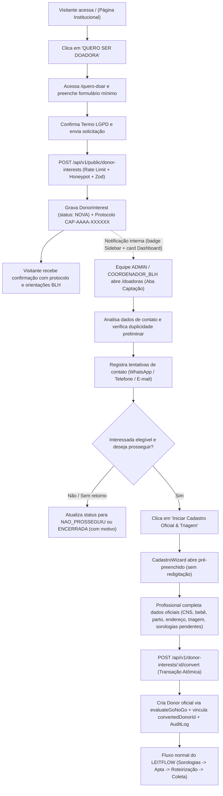

# LEITFLOW — Plano Técnico de Implementação: Sistema de Captação Digital de Novas Doadoras

**Projeto:** LEITFLOW — Sistema de Gestão Logística, Clínica e Rastreabilidade do Banco de Leite Humano de Marília – SP (HCFAMEMA / Hospital Materno Infantil)  
**Repositório oficial:** `https://github.com/lazari-gabriel/LEITE-FLOW-banco-leite-marilia`  
**Escopo deste documento:** Análise arquitetural completa e planejamento técnico detalhado para a funcionalidade de **Captação Digital de Novas Doadoras**, sem alterações de código nesta fase.  
**Normas e referências consideradas:** RDC ANVISA nº 171/2006 e Lei Geral de Proteção de Dados (LGPD — Lei nº 13.709/2018).

---

## 1. Diagnóstico da Arquitetura Atual

A inspeção direta do repositório confirma uma arquitetura full-stack madura, tipada ponta a ponta e pronta para expansão incremental sem refatorações estruturais:

### 1.1 Frontend (SPA React + TypeScript)
- **Stack:** React 18.3, TypeScript 5.6, Vite 5.4, Tailwind CSS 3.4, React Router DOM v6 (`BrowserRouter` único em `src/App.tsx`), TanStack Query v5, `motion/react` e `lucide-react`.
- **Separação de áreas (já consolidada):**
  - **Área Pública (identidade verde-sálvia `#FAF9F6` / `#4A6B5D`, fonte `Playfair Display` via `font-display`):**
    - `/` → `src/components/public/PublicHomePage.tsx` (composta por `PublicHeader`, `BottleExplodedScroll`, `ImpactCalculator`, `InstitutionalFaq`, `PublicFooter`).
    - `/login` → `src/components/modules/auth/LoginView.tsx` protegida por `LoginRouteGuard`.
  - **Área Operacional Autenticada (Layout Route `ProtectedLayout` com `<Outlet />`, `AppProvider` e `AppShell`):**
    - `/dashboard`, `/doadoras` (`RoleGuard` restrito a `ADMIN` e `COORDENADOR_BLH`), `/rotas`, `/mapa`, `/etiquetas`, `/laboratorio`.
- **Camada de rede e estado:**
  - `src/services/apiClient.ts`: cliente HTTP centralizado (`apiFetch`) com `VITE_API_BASE_URL` (padrão `/api/v1`), token Bearer em memória (`accessTokenMemory`), `credentials: 'include'`, rotação automática de refresh token em `401` e deduplicação (`refreshSessionOnce`).
  - `src/context/AuthContext.tsx`: controle de sessão, `hasRole`, `getDefaultRouteForRole`, `canRoleAccessPath`, logout real com limpeza do `QueryClient`.
  - `src/context/AppContext.tsx`: queries TanStack Query (`donors`, `routes`, `bottles`, `dashboard-summary`), toasts (`addToast`) e fluxo de edição de doadoras (`editingDonor`, `startEditDonor`, `cancelEditDonor`).
- **Módulo de Doadoras e Triagem (`src/components/modules/doadoras/`):**
  - `DoadorasView.tsx`: container do módulo com alternância entre lista (`DoadorasTable.tsx`) e formulário em 5 etapas (`CadastroWizard.tsx`), exibindo `GoNoGoVerdictBanner.tsx` após submissão.
  - `CadastroWizard.tsx`: 5 etapas (Identificação, Vacinas e Hábitos, Socioeconômico, Cadeia de Frio, Exames Sorológicos), validações locais (`isValidCNS`, `isValidCPF`, `isValidPhone`, `validateDonorDates`, `findDuplicateDonor`) e geocodificação integrada (`POST /api/v1/geo/geocode`).
  - `DonorProfileModal.tsx`: visão 360º da doadora com atalho de WhatsApp (`buildWhatsAppUrl`) e histórico de coletas.

### 1.2 Backend (Fastify 5 + TypeScript + Prisma 6)
- **Aplicação (`backend/src/app.ts`):**
  - Plugins ativos: `@fastify/helmet`, `@fastify/cors` (credenciais habilitadas), `@fastify/cookie`, `@fastify/jwt`, `@fastify/rate-limit` (global 120 req/min + overrides por rota), `@fastify/swagger` + `@fastify/swagger-ui` (`/docs`).
  - Logger Pino com `redact` automático para `authorization`, `cookie`, `password`, `cpf` e `sus`.
  - Tratamento de erros centralizado no padrão **RFC 7807** (`type`, `title`, `status`, `detail`, `errors`).
  - Rotas versionadas sob `/api/v1`: `authRoutes`, `donorsRoutes`, `routesRoutes`, `bottlesRoutes`, `dashboardRoutes`, `geoRoutes`.
- **Segurança, RBAC e Auditoria:**
  - `backend/src/middlewares/auth.ts`: `authenticate` (JWT Bearer) e `requireRoles(...roles)` para os 4 perfis oficiais (`ADMIN`, `COORDENADOR_BLH`, `COLETOR_CAMPO`, `LABORATORIO`).
  - `backend/src/lib/audit.ts`: `recordAudit()` grava trilha imutável em `AuditLog` com redação automática de campos sensíveis (`SENSITIVE_KEYS`).
  - `backend/src/lib/domain.ts`: motor oficial `evaluateGoNoGo()`, validadores `isValidCPF()`, `isValidCNS()`, `normalizeDigits()`, `extractNeighborhood()` e projeção LGPD `serializeDonorForRole()`.
- **Persistência (`backend/prisma/schema.prisma`):**
  - Schema compatível simultaneamente com **SQLite** (desenvolvimento e testes) e **PostgreSQL** (produção no Render, convertido automaticamente no `backend/Dockerfile` via `npm run db:use:postgres` + `prisma db push`).
  - **Convenção arquitetural importante:** o schema atual utiliza campos `String` em vez de `enum` nativo do Prisma para manter 100% de paridade entre SQLite e PostgreSQL, delegando a validação estrita de domínios ao **Zod** na camada de rotas.
  - Entidades existentes: `User`, `RefreshToken`, `Donor`, `Vehicle`, `StaffMember`, `Route`, `CollectionVisit`, `Bottle`, `LabelPrintLog`, `GlassInventoryMovement`, `AuditLog`.

### 1.3 Testes e Deploy
- **Testes existentes:** 6 suítes Vitest no frontend (23 testes) e 1 suíte de integração completa no backend (7 testes cobrindo auth, RBAC, LGPD, doadoras, rotas, laboratório, etiquetas e auditoria).
- **CI/CD:** `.github/workflows/ci.yml` executa testes e build do frontend, `db:setup` + testes + build do backend e valida `db:use:postgres && prisma generate`.
- **Produção:** Frontend na Vercel (`vercel.json` com CSP estrita) + API Docker no Render (`render.yaml`) + PostgreSQL gerenciado.

---

## 2. Reutilização vs. Adaptação vs. Desenvolvimento Novo

Para evitar duplicação de código e preservar a coesão do LEITFLOW, a tabela abaixo separa explicitamente cada camada:

| Camada | O que JÁ EXISTE (Reutilizar) | O que precisa ser ADAPTADO | O que será DESENVOLVIDO do zero |
| :--- | :--- | :--- | :--- |
| **Interface Pública** | `PublicHeader`, `PublicFooter`, `InstitutionalLogo`, `BottleExplodedScroll`, `PublicHomePage`, paleta verde-sálvia e tipografia `font-display` | Adicionar CTA **"Quero ser doadora"** em `PublicHeader`, `PublicHomePage`, `BottleExplodedScroll` e `PublicFooter`; registrar rota pública `/quero-doar` em `src/App.tsx` | Página `DonorInterestPage.tsx`, formulário validado `DonorInterestForm.tsx` e tela de confirmação com protocolo real |
| **Cliente HTTP & Validações** | `apiFetch`, `ApiError`, `isValidPhone`, `normalizeDigits`, `escapeHtml`, `buildWhatsAppUrl` | Permitir chamada pública sem Bearer no `apiFetch` (já funciona via `skipAuthRetry: true` quando `accessTokenMemory` é `null`) | Serviço `donorInterestService.ts` (tipos, máscaras, validações específicas da captação e chamadas REST) |
| **Módulo de Doadoras & Triagem** | `DoadorasView`, `DoadorasTable`, `CadastroWizard`, `GoNoGoVerdictBanner`, `DonorProfileModal`, `evaluateGoNoGo`, `POST /api/v1/geo/geocode` | Adicionar navegação em abas em `DoadorasView` (**Doadoras Cadastradas** \| **Captação de Doadoras**); aceitar prop `prefillFromInterest` no `CadastroWizard` para pré-preencher dados na conversão | Painel `CaptacaoDoadorasPanel.tsx`, modal/drawer de detalhes `InterestDetailModal.tsx`, registro de contato e modal/fluxo de pré-verificação de duplicidade |
| **Notificações Internas** | `Sidebar`, `DashboardView`, `ToastContainer`, `TanStack Query` | Exibir badge de novas solicitações em `Sidebar` (apenas `ADMIN` / `COORDENADOR_BLH`) e card/atalho operacional em `DashboardView` | Hook `useDonorInterestsSummary()` (query leve com `refetchInterval`) |
| **Backend & Banco** | `app.ts`, `authenticate`, `requireRoles`, `recordAudit`, `evaluateGoNoGo`, `donors.routes.ts`, `@fastify/rate-limit`, `AuditLog` | Registrar novo módulo de rotas em `app.ts`; adicionar campo relacional opcional em `Donor` no `schema.prisma`; ampliar `redact` em `app.ts`/`audit.ts` para proteger dados de contato em logs | Modelos Prisma `DonorInterest` e `DonorInterestEvent`; módulo `backend/src/modules/donor-interests/donorInterests.routes.ts`; serviço de conversão transacional |
| **Testes** | `vitest.config.ts`, `api.integration.test.ts`, `donorService.test.ts` | Manter 100% dos 30 testes atuais passando (regressão) | Testes unitários de validação da captação + testes de integração da API (público, RBAC, rate-limit, anti-spam, fluxo de status, duplicidade e conversão) |

---

## 3. Fluxo Completo da Nova Funcionalidade

### 3.1 Separação de Domínio: Interessada ≠ Doadora Oficial

> **Princípio arquitetural central:** Uma solicitação enviada pelo site público representa um **lead de interesse (`DonorInterest`)**, e **nunca** uma doadora aprovada ou cadastrada (`Donor`). O envio público não cria registro na tabela `Donor`, não entra em rotas de coleta e não altera indicadores clínicos de doadoras aptas.



### 3.2 Análise Crítica dos Campos do Formulário Público (Minimização LGPD)

Seguindo o princípio da **necessidade e minimização de dados (Art. 6º, III da LGPD)** e a experiência de preenchimento mobile:

#### A. Dados Pessoais
| Campo | Incluir no público? | Obrigatório? | Justificativa técnica e LGPD |
| :--- | :---: | :---: | :--- |
| **Nome completo** | Sim | Sim | Essencial para identificação e abordagem acolhedora no primeiro contato. |
| **Data de nascimento** | Sim | Opcional (recomendado) | Auxilia no pré-preenchimento do `CadastroWizard` e validação etária inicial sem travar o interesse. |
| **CPF** | **Não** | — | **Recomendação firme: NÃO solicitar CPF na etapa pública.** O CPF não é necessário para telefonar/enviar WhatsApp; coletá-lo em rota pública não autenticada aumenta exposição a risco LGPD e taxa de abandono. Além disso, no cadastro oficial (`Donor`), o documento obrigatório sanitário é o **Cartão SUS (CNS)**, conferido pela enfermagem durante a triagem oficial. |
| **Cidade** | Sim | Sim (padrão: `Marília`) | Permite identificar rapidamente se a interessada está na área de cobertura domiciliar do BLH Marília ou municípios vizinhos da DRS-IX. |
| **Bairro** | Sim | Sim | Suficiente para estimar a zona logística (Norte, Sul, Oeste, Leste, Rural) já no primeiro contato. |

#### B. Endereço na Etapa Inicial
- **Avaliação:** Solicitar apenas **Cidade**, **Bairro**, **CEP (opcional)** e **Zona aproximada (opcional, com opção "Não sei informar")**.
- **Justificativa:** O endereço completo (rua, número, complemento) não é necessário para o primeiro contato telefônico e só passa a ser indispensável quando a interessada entra na fase de cadastro oficial + geocodificação (`/api/v1/geo/geocode`) para receber kits estéreis em domicílio. Reduz coleta excessiva de dados residenciais em formulário público.

#### C. Informações de Contato
| Campo | Obrigatório? | Observação |
| :--- | :---: | :--- |
| **Telefone celular / WhatsApp** | Sim | Campo principal normalizado (`phoneNormalized`, 10–11 dígitos com DDD) + checkbox `"Este número também é WhatsApp"` (se desmarcado, libera campo secundário `whatsapp`). |
| **E-mail** | Opcional | Útil caso a preferência de contato seja e-mail ou para envio de orientações. |
| **Preferência de contato** | Sim | `WHATSAPP` \| `LIGACAO` \| `EMAIL` (padrão `WHATSAPP`). |
| **Melhor horário para contato** | Sim | `MANHA` \| `TARDE` \| `COMERCIAL` \| `QUALQUER_HORARIO`. |

#### D. Informações Preliminares (Não clínicas)
| Campo | Tipo | Finalidade |
| :--- | :--- | :--- |
| **Já realizou doação de leite humano anteriormente?** | `SIM` \| `NAO` | Ajuda a equipe a adaptar o nível de orientação no primeiro contato e sinalizar possível cadastro legado/inativo. |
| **Conhece o funcionamento da doação?** | `SIM` \| `PARCIALMENTE` \| `NAO` | Direciona o roteiro de acolhimento da enfermagem. |
| **Como conheceu o Banco de Leite?** | Lista fechada + `"Outro"` | Mede eficácia dos canais de captação (`SITE`, `REDES_SOCIAIS`, `MATERNIDADE_HOSPITAL`, `UBS_POSTO_SAUDE`, `INDICACAO`, `CAMPANHA`, `OUTRO`). |
| **Possui alguma dúvida sobre o processo?** | Texto livre (máx. 500 caracteres, opcional) | Permite acolher dúvidas comuns antes mesmo da ligação. |

> **Regra de proteção clínica:** O formulário público **NÃO** deve perguntar sorologias, doenças infecciosas, medicações, tabagismo, consumo de álcool, peso do bebê ou intercorrências obstétricas. Todos esses são dados sensíveis de saúde (LGPD Art. 5º II e Art. 11) e pertencem exclusivamente à triagem oficial autenticada (`CadastroWizard`).

#### E. Consentimento LGPD (Obrigatório)
- Checkbox obrigatório **desmarcado por padrão** com texto claro:
  - Identificação do controlador (Banco de Leite Humano de Marília — HCFAMEMA / Hospital Materno Infantil).
  - Finalidade específica: *"Autorizo o uso dos meus dados de contato para que a equipe do Banco de Leite Humano de Marília entre em contato comigo e realize a avaliação inicial sobre a doação de leite humano."*
  - Aviso explícito de que o envio **não garante aprovação automática** para doação e de que a candidata pode solicitar a exclusão dos dados a qualquer momento pelos canais oficiais do BLH.
- Gravação imutável no banco: `consentAcceptedAt` (timestamp do servidor), `consentVersion` (constante versionada no backend, ex.: `"LGPD-CAPTACAO-v1.0"`).

### 3.3 Análise da Máquina de Estados (Workflow de Atendimento)

Os 8 estados sugeridos fazem sentido operacional e se encaixam muito bem no trabalho real de uma equipe de BLH. Propõe-se formalizá-los com códigos padronizados em `UPPER_SNAKE_CASE` (armazenados como `String` + validados em Zod) e regras claras de transição:

| Código do Estado | Rótulo na UI | Tipo | Quando usar |
| :--- | :--- | :--- | :--- |
| `NOVA` | Nova solicitação | Inicial | Recém-enviada pelo formulário público; ainda não visualizada/triada pela equipe. Conta no badge de pendências. |
| `AGUARDANDO_ANALISE` | Aguardando análise | Ativo | Equipe acusou recebimento, mas precisa checar cobertura de bairro/zona ou duplicidade antes de contatar. |
| `AGUARDANDO_CONTATO` | Aguardando contato | Ativo | Analisada e pronta na fila para primeira tentativa de ligação/WhatsApp. |
| `EM_CONTATO` | Em contato | Ativo | Contato iniciado pela equipe (ao menos 1 tentativa registrada). |
| `AGUARDANDO_RETORNO` | Aguardando retorno | Ativo | Mensagem enviada ou ligação sem resposta; aguardando resposta da interessada (permite definir `nextFollowUpAt`). |
| `ENCAMINHADA_CADASTRO` | Encaminhada / Convertida | Final (sucesso) | Candidata convertida em registro oficial na tabela `Donor` (vinculada via `convertedDonorId`). **Impede reconversão duplicada.** |
| `NAO_PROSSEGUIU` | Não prosseguiu | Final | Interessada desistiu, não reside na área atendida ou informou não estar em fase de lactação (exige `closureReason`). |
| `ENCERRADA` | Encerrada | Final | Encerramento administrativo (ex.: múltiplas tentativas sem resposta, número inexistente ou duplicidade descartada; exige `closureReason`). |

**Ajuste recomendado sobre `ENCAMINHADA_CADASTRO`:**
- Para evitar ambiguidade entre *"cliquei para encaminhar"* e *"cadastro oficial concluído"*, o estado `ENCAMINHADA_CADASTRO` deve ser atribuído **exclusivamente pela operação atômica de conversão** (`POST /donor-interests/:id/convert`), garantindo que toda solicitação nesse estado tenha obrigatoriamente `convertedDonorId`, `convertedAt` e `convertedByUserId` preenchidos. Se a equipe ainda estiver preenchendo os dados, a solicitação permanece em `EM_CONTATO`.
- Solicitações em `NAO_PROSSEGUIU` ou `ENCERRADA` podem ser reabertas para `AGUARDANDO_CONTATO` por `ADMIN` ou `COORDENADOR_BLH` (com justificativa registrada no histórico), caso a interessada volte a procurar o BLH.

---

## 4. Proposta de Estrutura de Dados (Prisma — SQLite & PostgreSQL)

Seguindo exatamente as convenções do [schema.prisma](file:///c:/Users/-/Desktop/Banco_leite/backend/prisma/schema.prisma) atual (`cuid()` para IDs de workflows/eventos, `String` para domínios compatíveis com SQLite e PostgreSQL, índices explícitos e relações com `SetNull`/`Cascade`):

### 4.1 Novos Modelos Propostos

```prisma
model DonorInterest {
  id                   String    @id @default(cuid())
  protocol             String    @unique // Ex.: CAP-2026-000001

  // Dados pessoais mínimos
  fullName             String
  birthDate            String?   // YYYY-MM-DD (opcional)
  city                 String    @default("Marília")
  neighborhood         String
  cep                  String?   // 8 dígitos ou formatado (opcional)
  suggestedZone        String?   // Norte | Sul | Oeste | Leste | Rural | null

  // Contato
  phone                String
  phoneNormalized      String    // 10 ou 11 dígitos (índice de deduplicação)
  isWhatsappSame       Boolean   @default(true)
  whatsapp             String?
  whatsappNormalized   String?
  email                String?
  preferredContact     String    @default("WHATSAPP") // WHATSAPP | LIGACAO | EMAIL
  bestContactTime      String    @default("QUALQUER_HORARIO") // MANHA | TARDE | COMERCIAL | QUALQUER_HORARIO

  // Informações preliminares (não clínicas)
  donatedBefore        Boolean   @default(false)
  knowsProcess         String    @default("NAO") // SIM | PARCIALMENTE | NAO
  hasQuestions         Boolean   @default(false)
  questionsText        String?
  discoveryChannel     String    @default("SITE") // SITE | REDES_SOCIAIS | MATERNIDADE_HOSPITAL | UBS_POSTO_SAUDE | INDICACAO | CAMPANHA | OUTRO
  sourceOrigin         String    @default("SITE_INSTITUCIONAL") // Origem técnica (site, utm, etc.)

  // Consentimento LGPD
  consentAccepted      Boolean   @default(true)
  consentAcceptedAt    DateTime
  consentVersion       String    // Ex.: LGPD-CAPTACAO-v1.0
  consentIpHash        String?   // Hash SHA-256 truncado do IP (nunca IP cru se retido longo prazo)

  // Fluxo de atendimento
  status               String    @default("NOVA") // NOVA | AGUARDANDO_ANALISE | AGUARDANDO_CONTATO | EM_CONTATO | AGUARDANDO_RETORNO | ENCAMINHADA_CADASTRO | NAO_PROSSEGUIU | ENCERRADA
  assignedToUserId     String?
  assignedTo           User?     @relation("InterestAssignedTo", fields: [assignedToUserId], references: [id], onDelete: SetNull)
  contactAttemptsCount Int       @default(0)
  lastContactAt        DateTime?
  nextFollowUpAt       DateTime?
  adminNotes           String?
  closureReason        String?

  // Integração / Conversão para Doadora Oficial
  convertedDonorId     Int?      @unique
  convertedDonor       Donor?    @relation(fields: [convertedDonorId], references: [id], onDelete: SetNull)
  convertedAt          DateTime?
  convertedByUserId    String?
  convertedBy          User?     @relation("InterestConvertedBy", fields: [convertedByUserId], references: [id], onDelete: SetNull)

  // Governança e retenção LGPD
  retentionExpiresAt   DateTime?
  anonymizedAt         DateTime?

  createdAt            DateTime  @default(now())
  updatedAt            DateTime  @updatedAt

  events               DonorInterestEvent[]

  @@index([status, createdAt])
  @@index([phoneNormalized])
  @@index([city, neighborhood])
  @@index([assignedToUserId])
}

model DonorInterestEvent {
  id           String        @id @default(cuid())
  interestId   String
  interest     DonorInterest @relation(fields: [interestId], references: [id], onDelete: Cascade)
  eventType    String        // CREATED | STATUS_CHANGED | CONTACT_ATTEMPT | NOTE_ADDED | CONVERTED | ANONYMIZED
  fromStatus   String?
  toStatus     String?
  channel      String?       // WHATSAPP | LIGACAO | EMAIL | PRESENCIAL
  outcome      String?       // ATENDEU | SEM_RESPOSTA | CAIXA_POSTAL | RETORNO_AGENDADO | NUMERO_INVALIDO
  notes        String?
  userId       String?
  user         User?         @relation(fields: [userId], references: [id], onDelete: SetNull)
  createdAt    DateTime      @default(now())

  @@index([interestId, createdAt])
}
```

### 4.2 Relações Adicionadas aos Modelos Existentes (Zero Quebra Retroativa)
- Em `Donor`: adicionar apenas o campo virtual relacional `interestOrigin DonorInterest?` (não cria coluna física em `Donor`, mantendo 100% de compatibilidade com todos os dados e consultas existentes).
- Em `User`: adicionar apenas os arrays virtuais `assignedInterests`, `convertedInterests` e `interestEvents`.

---

## 5. Proposta de Endpoints (API `/api/v1`)

Todos registrados em `backend/src/modules/donor-interests/donorInterests.routes.ts`, documentados no Swagger (`/docs`) e seguindo RFC 7807 para erros.

### 5.1 Endpoint Público (Acesso Anônimo, Write-Only)

| Método e Rota | Autenticação | Rate Limit | Função e Contrato |
| :--- | :--- | :--- | :--- |
| `POST /api/v1/public/donor-interests` | Nenhuma (público) | **5 req / 15 min por IP** | Recebe e valida o formulário de interesse via Zod. Valida honeypot (`website` vazio) e tempo mínimo de preenchimento. Gera protocolo `CAP-AAAA-XXXXXX`. Em caso de envio repetido recente do mesmo `phoneNormalized` (ex.: últimos 7 dias com status aberto), evita criar duplicata ruidosa e retorna confirmação neutra **sem revelar se o telefone já existe** (anti-enumeração). Retorna `201`: `{ protocol, submittedAt, message }`. |

> **Segurança explícita:** Não existirá nenhum `GET /api/v1/public/donor-interests*` para impedir consulta ou enumeração de dados pessoais de outras candidatas.

### 5.2 Endpoints Administrativos (Restritos a `ADMIN` e `COORDENADOR_BLH`)

Todos protegidos por `preHandler: [requireRoles('ADMIN', 'COORDENADOR_BLH')]` (`COLETOR_CAMPO` e `LABORATORIO` recebem `403 Forbidden`):

| Método e Rota | Finalidade |
| :--- | :--- |
| `GET /api/v1/donor-interests` | Lista paginada (`page`, `pageSize`) com filtros (`status`, `search`, `city`, `zone`, `channel`, `dateFrom`, `dateTo`), ordenação e resumo de contadores por status (`countsByStatus`). |
| `GET /api/v1/donor-interests/summary` | Endpoint leve retornando `{ totalNew, totalPending, totalConverted, lastSubmissionAt }` para alimentar badge da Sidebar e card do Dashboard sem baixar a lista inteira. |
| `GET /api/v1/donor-interests/:id` | Retorna detalhes completos da solicitação, timeline ordenada `events` (com nome do profissional) e pré-análise automática de possíveis duplicidades em `Donor`. |
| `PATCH /api/v1/donor-interests/:id/status` | Atualiza status respeitando transições válidas; exige `closureReason` ao mover para `NAO_PROSSEGUIU` ou `ENCERRADA`; registra `DonorInterestEvent` (`STATUS_CHANGED`) e `AuditLog`. |
| `PATCH /api/v1/donor-interests/:id/notes` | Atualiza observações administrativas, responsável atribuído (`assignedToUserId`), zona sugerida ou `nextFollowUpAt`; registra evento na timeline. |
| `POST /api/v1/donor-interests/:id/contacts` | Registra tentativa de contato (`channel`, `outcome`, `notes`, `nextFollowUpAt`, `nextStatus` opcional), incrementa `contactAttemptsCount`, atualiza `lastContactAt` e cria `DonorInterestEvent` (`CONTACT_ATTEMPT`). |
| `GET /api/v1/donor-interests/:id/duplicate-check` | Consulta candidatos semelhantes na tabela `Donor` por `phoneNormalized` e similaridade de nome, retornando correspondências resumidas (`id`, `code`, `nome`, `statusCadastro`, `aptidao`, `zona`) para conferência antes da conversão. |
| `POST /api/v1/donor-interests/:id/convert` | **Conversão atômica (transação Prisma):** valida payload oficial (`donorFormSchema` compartilhado com `donors.routes.ts`), verifica duplicidade de CNS/CPF (`409`), executa `evaluateGoNoGo()` oficial, cria `Donor`, marca `DonorInterest` como `ENCAMINHADA_CADASTRO` com `convertedDonorId`/`convertedAt`/`convertedByUserId`, grava `DonorInterestEvent` (`CONVERTED`) e `AuditLog` (`DONOR_INTEREST_CONVERTED` + `DONOR_CREATED`). |
| `POST /api/v1/donor-interests/:id/anonymize` | Restrito a `requireRoles('ADMIN')`. Executa anonimização LGPD de PII (`fullName`, `phone`, `whatsapp`, `email`, `questionsText`, `birthDate`) mantendo métricas agregadas (cidade, bairro, canal, datas e status) e gravando auditoria. |

---

## 6. Proposta de Interface (UI/UX)

### 6.1 Área Pública — Captação Digital

1. **Pontos de entrada na página institucional (`/`):**
   - **Header (`PublicHeader.tsx`):** Manter **Acessar sistema** (estilo secundário/contorno ou pill discreto) ao lado do botão de destaque primário **"Quero ser doadora"** (verde-sálvia `#4A6B5D` com ícone `Heart`), ambos responsivos no desktop e drawer mobile.
   - **Hero (`PublicHomePage.tsx`) e encerramento do `BottleExplodedScroll.tsx`:** Botão primário **"Quero ser doadora"** navegando via React Router para `/quero-doar`, acompanhado de **"Acessar sistema"** (`/login`).
   - **Footer (`PublicFooter.tsx`):** Link direto para `/quero-doar` na coluna de acesso/informações.
2. **Página `/quero-doar` (`DonorInterestPage.tsx`):**
   - Visual totalmente coerente com `/` e `/login` (`bg-[#FAF9F6]`, cartões `bg-white rounded-3xl border-[#EFECE6]`, títulos `font-display`, acentos `#4A6B5D` e `#EBF1EE`).
   - Cabeçalho limpo com `"Voltar ao início"` (`<Link to="/">`) e `InstitutionalLogo`.
   - **Banner acolhedor de expectativa:** explica em 3 pontos curtos o que acontece após o envio (1. Equipe do BLH recebe seu contato → 2. Enfermagem entra em contato para tirar dúvidas e realizar triagem → 3. Entrega gratuita de frascos estéreis).
   - **Formulário estruturado em 4 blocos visuais claros** (em coluna única ergonômica para celular, sem sobrecarregar):
     1. *Sobre você e sua região* (Nome completo, Data de nascimento opcional, Cidade, Bairro, CEP opcional, Região/Zona aproximada opcional).
     2. *Como podemos falar com você* (Celular com máscara `(00) 00000-0000`, checkbox "Este número é WhatsApp", WhatsApp alternativo se desmarcado, E-mail opcional, Preferência de contato, Melhor horário).
     3. *Para acolhermos melhor você* (Já doou antes?, Conhece o processo?, Como conheceu o BLH?, Dúvidas opcionais).
     4. *Privacidade e Consentimento (LGPD)* (Resumo transparente + checkbox obrigatório de consentimento + botão **"Enviar interesse em doar"** com spinner de envio).
   - **Tela de confirmação real (pós-HTTP `201`):** exibe o **protocolo oficial retornado pela API** (`CAP-2026-XXXXXX`), resumo do canal escolhido, telefones oficiais do BLH Marília (`(14) 3413-8696` / `(14) 3402-5555`), aviso explícito de que o cadastro oficial será realizado pela equipe após contato, e botão para retornar à página inicial.

### 6.2 Painel Interno — Aba "Captação de Doadoras" dentro de `/doadoras`

Em vez de criar uma nova tela isolada na barra lateral, a captação integra-se diretamente em **[DoadorasView.tsx](file:///c:/Users/-/Desktop/Banco_leite/src/components/modules/doadoras/DoadorasView.tsx)**:

- **Navegação por abas no topo de `/doadoras`:**
  - Aba 1: **`Doadoras Cadastradas`** (com contador total, renderizando `DoadorasTable` atual).
  - Aba 2: **`Captação de Doadoras`** (com badge âmbar/esmeralda indicando quantas solicitações estão em `NOVA`, sincronizável via query string `/doadoras?tab=captacao`).
- **Conteúdo da aba `Captação de Doadoras` (`CaptacaoDoadorasPanel.tsx`):**
  - **Faixa de mini-KPIs:** Novas (`NOVA`), Em atendimento (`AGUARDANDO_ANALISE` + `AGUARDANDO_CONTATO` + `EM_CONTATO` + `AGUARDANDO_RETORNO`), Convertidas (`ENCAMINHADA_CADASTRO`), Taxa de conversão.
  - **Filtros:** Busca por nome/protocolo/bairro/telefone, filtro por status, filtro por cidade/zona, filtro rápido `"Apenas não analisadas"` e período.
  - **Lista responsiva** (cards em mobile / tabela em desktop, seguindo exatamente o padrão de `DoadorasTable.tsx`): protocolo, nome + cidade/bairro, contato + preferência/horário, origem, data de envio, contagem de tentativas, badge de status e ações rápidas.
- **Modal/Drawer de Detalhes da Solicitação (`InterestDetailModal.tsx`):**
  - Dados completos da interessada, canal de origem, dúvidas relatadas e registro do consentimento LGPD (`consentAcceptedAt` + `consentVersion`).
  - **Alerta automático de possível duplicidade** (caso telefone ou nome já exista em `Donor`, com botão para visualizar o cadastro existente).
  - **Botão direto de WhatsApp** (reutilizando `buildWhatsAppUrl` com mensagem acolhedora personalizada do BLH Marília) e botão `tel:`.
  - **Formulário rápido "Registrar tentativa de contato":** canal, resultado (atendeu, sem resposta, etc.), observação, próximo retorno e mudança rápida de status.
  - **Timeline cronológica (`DonorInterestEvent`):** histórico completo de cada interação e profissional responsável.
  - **Botão principal de conversão:** `"Iniciar Cadastro Oficial & Triagem"` (habilitado enquanto não estiver convertida ou anonimizada).

### 6.3 Notificações Internas (Etapa Inicial, Sem Integrações Externas)
1. **Badge na `Sidebar.tsx`:** no item `Doadoras & Triagem` (já restrito a `ADMIN` e `COORDENADOR_BLH`), exibir badge discreto quando `totalNew > 0` (ex.: `3 novas`).
2. **Card de atenção no `DashboardView.tsx`:** para `ADMIN` e `COORDENADOR_BLH`, exibir indicador de novas interessadas aguardando primeiro contato com botão `"Ver captação"` que navega para `/doadoras?tab=captacao`.
3. **Atualização periódica leve:** query dedicada `['donor-interests-summary']` com `staleTime: 30_000` e `refetchInterval: 60_000` (apenas quando `hasRole('ADMIN', 'COORDENADOR_BLH')`).
4. **Ponto de extensão futuro:** encapsular a emissão de evento interno (`onDonorInterestCreated`) no backend para, em fases futuras, plugar envio de e-mail institucional ou webhook WhatsApp sem refatorar a rota.

---

## 7. Integração com o Cadastro Oficial de Doadoras

A integração evita completamente cadastros paralelos e elimina redigitação:

1. **Acionamento na aba Captação:** ao clicar em **"Iniciar Cadastro Oficial & Triagem"** em uma solicitação `DonorInterest`, o frontend chama `GET /api/v1/donor-interests/:id/duplicate-check`.
2. **Prevenção de duplicidade pré-conversão:**
   - Se for encontrada doadora existente com mesmo telefone ou nome muito próximo, exibe-se um **banner de alerta comparativo** mostrando `DOAD-XXX`, `statusCadastro` (`ativa`/`inativa`) e `aptidao`.
   - O profissional pode decidir: (a) abrir/reativar a doadora existente (e encerrar a solicitação como duplicada/reativada) ou (b) confirmar que se trata de outra pessoa e prosseguir para o cadastro.
3. **Pré-preenchimento do `CadastroWizard` existente:**
   - `DoadorasView` mantém um estado `convertingInterest: DonorInterest | null` e passa-o para `CadastroWizard` (`convertingInterest` / `onConverted`).
   - Um banner informativo no topo do wizard indica: *"Convertendo solicitação CAP-2026-XXXXXX — Dados de contato pré-preenchidos. Complete a ficha oficial e a triagem clínica."*
   - Campos pré-preenchidos automaticamente:
     - `nome` ← `interest.fullName`
     - `nascimento` ← `interest.birthDate || ''`
     - `telefone` ← `interest.whatsapp || interest.phone`
     - `zona` ← `interest.suggestedZone || 'Norte'`
     - `endereco` ← sugestão inicial `"— ${interest.neighborhood}, ${interest.city} - SP"` (para o profissional apenas completar logradouro e número e clicar em **"Localizar no mapa"**).
   - Campos obrigatoriamente complementados pela equipe: `bebe`, `sus` (CNS 15 dígitos), `cpf` (opcional, validado), `parto`, logradouro completo, vacinas, hábitos, saneamento, cadeia de frio e sorologias.
4. **Submissão atômica (`POST /api/v1/donor-interests/:id/convert`):**
   - Em vez de fazer 2 requisições soltas (criar `Donor` e depois atualizar `DonorInterest`), o backend executa uma **única transação Prisma** que:
     1. Verifica se `interest.convertedDonorId` ainda é `null` (bloqueia dupla conversão com `409 Conflict`).
     2. Reaproveita o mesmo `donorFormSchema`, validação de CNS/CPF, detecção de duplicidade (`susNormalized`/`cpfNormalized` → `409`) e `evaluateGoNoGo()` já existentes em `donors.routes.ts` (extraindo a função de validação/criação para um helper compartilhado em `backend/src/modules/donors/`).
     3. Cria o registro oficial em `Donor` com `consentAcceptedAt` preservado.
     4. Atualiza `DonorInterest` para `status = 'ENCAMINHADA_CADASTRO'`, `convertedDonorId = donor.id`, `convertedAt = now`, `convertedByUserId = request.user.sub`.
     5. Grava `DonorInterestEvent` (`CONVERTED`) e `AuditLog`.
   - No frontend, invalida as queries `['donors']`, `['donor-interests']`, `['donor-interests-summary']` e `['dashboard-summary']`, exibindo o `GoNoGoVerdictBanner` oficial imediatamente.

---

## 8. Integração com a Triagem Clínica (RDC ANVISA nº 171/2006)

- **Zero alteração nas regras clínicas:** `evaluateGoNoGo()` em [backend/src/lib/domain.ts](file:///c:/Users/-/Desktop/Banco_leite/backend/src/lib/domain.ts) e [src/services/donorService.ts](file:///c:/Users/-/Desktop/Banco_leite/src/services/donorService.ts) permanece intacto.
- **Padrão fail-safe mantido:** ao abrir o `CadastroWizard` a partir de uma solicitação de captação, as 3 amostras sorológicas (`soro1Res`, `soro2Res`, `soro3Res`) permanecem obrigatoriamente inicializadas como `'pendente'`.
- **Consequência segura:** mesmo após a conversão, a nova doadora só se tornará `Apta` (e elegível para aparecer na roteirização de coletas) quando um profissional autorizado registrar e confirmar todos os critérios sanitários e laudos sorológicos normais.
- **Origem preservada no perfil:** opcionalmente, o `DonorProfileModal.tsx` pode exibir um selo discreto `"Origem: Captação Digital (CAP-2026-XXXXXX)"` quando `donor.interestOrigin` existir, preservando rastreabilidade completa da jornada sem poluir o prontuário clínico.

---

## 9. Segurança e Conformidade LGPD

| Dimensão | Medida Planejada |
| :--- | :--- |
| **Minimização de dados (Art. 6º III)** | Coleta pública restrita ao estritamente necessário para o 1º contato. **Sem CPF, sem Cartão SUS, sem logradouro completo e sem dados clínicos sensíveis.** |
| **Consentimento & Transparência (Arts. 7º, 8º e 9º)** | Checkbox explícito desmarcado por padrão; aviso claro da finalidade e controlador (BLH Marília / HCFAMEMA); persistência de `consentAcceptedAt` e `consentVersion`. |
| **Controle de acesso (RBAC)** | Gestão de captação restrita a `ADMIN` e `COORDENADOR_BLH` no backend (`requireRoles`) e no frontend (`RoleGuard` de `/doadoras`). `COLETOR_CAMPO` e `LABORATORIO` não possuem acesso (`403`). |
| **Isolamento público/privado** | API pública limitada a `POST /api/v1/public/donor-interests` (write-only). Nenhum `GET` público, evitando exposição ou enumeração de dados de terceiros. |
| **Anti-spam & Abuso** | (1) Rate limit específico no Fastify (`5 req / 15 min` por IP); (2) campo honeypot oculto (`website`) rejeitado silenciosamente/400 se preenchido por bots; (3) validação de tempo mínimo de preenchimento (`elapsedMs >= 3000`); (4) limite de tamanho em todos os campos de texto no Zod; (5) dedup suave por `phoneNormalized` sem vazar existência prévia. |
| **Prevenção de injeção & XSS** | Validação estrita com Zod no backend, queries 100% parametrizadas pelo Prisma, renderização escapada do React (sem `dangerouslySetInnerHTML`) e sanitização de URLs externas (`buildWhatsAppUrl` + `noopener,noreferrer`). |
| **Proteção de logs & Auditoria** | Adicionar `req.body.phone`, `req.body.whatsapp`, `req.body.email` ao `redact` do Pino em `app.ts` e em `SENSITIVE_KEYS` de `audit.ts`; gravar todas as ações de captação e conversão em `AuditLog` imutável. |
| **Retenção e Exclusão (Arts. 15, 16 e 18)** | Definir `retentionExpiresAt` (ex.: 180 dias após encerramento em `NAO_PROSSEGUIU`/`ENCERRADA`) e disponibilizar endpoint administrativo de anonimização (`POST /donor-interests/:id/anonymize`) para atendimento a pedidos de exclusão da titular. |
| **CSP em Produção (`vercel.json` / `nginx.conf`)** | Não adicionar chamadas diretas do navegador a APIs externas de CEP (ex.: ViaCEP) sem necessidade, preservando a política CSP atual sem relaxar `connect-src`. (Opcionalmente, se desejado no futuro, consulta de CEP pode passar pelo próprio backend `/api/v1/geo/`.) |

---

## 10. Arquivos que Precisarão ser Criados ou Modificados

### 10.1 Arquivos a CRIAR

| Arquivo | Etapa | Justificativa |
| :--- | :---: | :--- |
| `src/types/donorInterest.ts` | 1 | Tipos TypeScript compartilhados (`DonorInterest`, `DonorInterestStatus`, `DonorInterestEvent`, `DonorInterestFormPayload`, `DonorInterestSummary`). |
| `src/services/donorInterestService.ts` | 1 | Validações client-side (telefone, e-mail, CEP, campos obrigatórios), máscaras de input e funções de comunicação com `/api/v1/public/donor-interests` e `/api/v1/donor-interests*`. |
| `src/components/public/DonorInterestForm.tsx` | 1 | Componente modular do formulário público com acessibilidade, máscaras, honeypot, consentimento LGPD e tratamento de estados de envio/erro. |
| `src/components/public/DonorInterestPage.tsx` | 1 | Página pública `/quero-doar` com layout institucional, orientações do processo e tela de confirmação com protocolo. |
| `backend/src/modules/donor-interests/donorInterests.routes.ts` | 2 | Módulo Fastify contendo endpoint público e endpoints administrativos RBAC, schemas Zod, anti-spam, eventos, duplicate-check, conversão transacional e anonimização. |
| `backend/src/modules/donors/donorCreation.service.ts` | 2 / 4 | Helper interno extraído de `donors.routes.ts` (sem alterar comportamento!) para compartilhar `donorFormSchema` e a criação validada de `Donor` entre `POST /donors` e `POST /donor-interests/:id/convert`. |
| `src/components/modules/doadoras/CaptacaoDoadorasPanel.tsx` | 3 | Aba interna **Captação de Doadoras** com KPIs, busca, filtros por status/período, tabela desktop e cards mobile. |
| `src/components/modules/doadoras/InterestDetailModal.tsx` | 3 | Modal/drawer de atendimento da candidata: dados de contato, botão WhatsApp, registro de tentativas de contato, timeline de eventos, alerta de duplicidade e ação de conversão. |
| `src/services/__tests__/donorInterestService.test.ts` | 5 | Testes unitários de validação, máscaras e transições de status no frontend. |
| `backend/src/__tests__/donorInterests.integration.test.ts` | 5 | Testes de integração completos da captação (envio público, anti-spam/rate-limit, RBAC `403`, timeline, duplicidade, conversão atômica e anonimização LGPD). |

### 10.2 Arquivos Existentes a MODIFICAR

| Arquivo | Etapa | Justificativa da Alteração |
| :--- | :---: | :--- |
| `src/App.tsx` | 1 | Registrar a rota pública `<Route path="/quero-doar" element={<DonorInterestPage />} />` (lazy-loaded ou direto). |
| `src/components/public/PublicHeader.tsx` | 1 | Adicionar botão de destaque **"Quero ser doadora"** apontando para `/quero-doar` (desktop e drawer mobile), preservando **"Acessar sistema"**. |
| `src/components/public/PublicHomePage.tsx` | 1 | Adicionar CTA **"Quero ser doadora"** no Hero ao lado de **"Acessar sistema"** e repassar callback/navegação ao `BottleExplodedScroll`. |
| `src/components/public/BottleExplodedScroll.tsx` | 1 | Incluir ação **"Quero ser doadora"** no overlay final do frasco ao lado de **"Acessar sistema"**. |
| `src/components/public/PublicFooter.tsx` | 1 | Adicionar link **"Quero ser doadora"** apontando para `/quero-doar`. |
| `backend/prisma/schema.prisma` | 2 | Adicionar modelos `DonorInterest` e `DonorInterestEvent` e relações virtuais em `Donor` e `User`. |
| `backend/src/app.ts` | 2 | Registrar `donorInterestsRoutes` sob `/api/v1` e adicionar campos de contato ao `redact` do logger Pino. |
| `backend/src/lib/audit.ts` | 2 | Incluir chaves de contato (`phone`, `whatsapp`, `email`) em `SENSITIVE_KEYS` para garantir logs limpos. |
| `backend/src/modules/donors/donors.routes.ts` | 2 / 4 | Reutilizar o helper `donorCreation.service.ts` para garantir uma única fonte de verdade nas regras de cadastro/triagem (zero mudança de contrato HTTP). |
| `src/components/modules/doadoras/DoadorasView.tsx` | 3 / 4 | Adicionar abas (**Doadoras Cadastradas** \| **Captação de Doadoras**), leitura de `?tab=captacao` e estado de conversão (`convertingInterest`) conectado ao `CadastroWizard`. |
| `src/components/layout/Sidebar.tsx` | 3 | Exibir badge discreto de novas solicitações em `Doadoras & Triagem` (somente `ADMIN` e `COORDENADOR_BLH`). |
| `src/components/modules/dashboard/DashboardView.tsx` | 3 | Adicionar indicador/alerta operacional de novas interessadas para `ADMIN` e `COORDENADOR_BLH` com atalho para `/doadoras?tab=captacao`. |
| `src/components/modules/doadoras/CadastroWizard.tsx` | 4 | Aceitar prop opcional `convertingInterest` para pré-preencher Etapa 1 e chamar `/donor-interests/:id/convert` na submissão final quando em modo de conversão. |
| `src/components/modules/doadoras/DonorProfileModal.tsx` | 4 | *(Opcional)* Exibir badge de origem quando a doadora foi convertida a partir de uma solicitação de captação digital. |

---

## 11. Riscos e Possíveis Incompatibilidades

| Risco / Ponto de Atenção | Impacto | Mitigação Planejada |
| :--- | :---: | :--- |
| **Cold start do Render Free (~15–30s)** | Alto na UX pública | Botão de envio com estado claro `"Enviando sua solicitação..."`, timeout generoso no cliente (45s) e mensagem acolhedora em caso de lentidão/falha com retry preservando os dados digitados no formulário. |
| **Paridade SQLite (local/CI) vs. PostgreSQL (Render)** | Médio | Usar exclusivamente tipos Prisma portáveis (`String`, `Boolean`, `Int`, `DateTime`) sem `enum` nativo; validar no CI com `npm run db:use:postgres && npm run prisma:generate`. O `backend/Dockerfile` já roda `prisma db push` no startup, aplicando as novas tabelas automaticamente. |
| **Dupla conversão ou corrida concorrente** | Alto | Garantir constraint `@unique` em `DonorInterest.convertedDonorId` + verificação dentro de `prisma.$transaction` na rota `POST /donor-interests/:id/convert`. |
| **Spam e preenchimento automatizado (bots)** | Médio | Combinar rate limit por IP (5/15min), honeypot oculto, tempo mínimo de preenchimento e validação rígida de formato/tamanho via Zod; se necessário no futuro, é trivial plugar Cloudflare Turnstile sem alterar o banco. |
| **Vazamento de PII por enumeração de duplicidade** | Médio | Na rota pública `POST /public/donor-interests`, nunca responder `"Este telefone já está cadastrado"`. Tratar reenvio recente de forma silenciosa/idempotente retornando protocolo ou confirmação neutra. |
| **Uso acidental de `AppContext` com mutação otimista na conversão** | Médio | Na conversão (`convertingInterest`), aguardar a resposta real da API (`await apiFetch('/donor-interests/:id/convert')`) antes de fechar o wizard e exibir o veredito, evitando divergência em caso de erro `409` (CNS/CPF duplicado). |
| **Política CSP (`vercel.json` / `nginx.conf`)** | Baixo | Não chamar APIs externas de terceiros no browser; toda comunicação permanece em `'self'` e `VITE_API_BASE_URL` (já coberto por `connect-src 'self' https:`). |

---

## 12. Etapas de Implementação

### Etapa 1 — Formulário Público e Ponto de Entrada Institucional
- **Objetivo:** Permitir que a visitante navegue da página inicial até `/quero-doar`, preencha o formulário validado com consentimento LGPD e visualize a tela de confirmação.
- **Entregas:**
  - Botão de destaque **"Quero ser doadora"** em `PublicHeader`, `PublicHomePage`, `BottleExplodedScroll` e `PublicFooter`.
  - Rota pública `/quero-doar` em `src/App.tsx`.
  - Criação de `src/types/donorInterest.ts`, `src/services/donorInterestService.ts`, `src/components/public/DonorInterestForm.tsx` e `src/components/public/DonorInterestPage.tsx`.
  - Máscaras de telefone/WhatsApp e CEP, validação inline acessível, honeypot, consentimento LGPD e tela de confirmação com protocolo real.

### Etapa 2 — Backend, Persistência, Segurança e Auditoria
- **Objetivo:** Persistir solicitações de forma segura, auditada e compatível com SQLite + PostgreSQL, sem alterar endpoints existentes.
- **Entregas:**
  - Adição dos modelos `DonorInterest` e `DonorInterestEvent` em `backend/prisma/schema.prisma` (e validação `db:use:postgres`).
  - Criação de `backend/src/modules/donor-interests/donorInterests.routes.ts` e registro em `backend/src/app.ts`.
  - Implementação do endpoint público com rate limit restrito, honeypot, Zod e geração sequencial de protocolo (`CAP-AAAA-XXXXXX`).
  - Implementação dos endpoints administrativos protegidos por `requireRoles('ADMIN', 'COORDENADOR_BLH')`, auditoria em `AuditLog` e redação de PII nos logs.

### Etapa 3 — Painel Administrativo de Captação e Notificações Internas
- **Objetivo:** Permitir que `ADMIN` e `COORDENADOR_BLH` visualizem, filtrem, contatem e acompanhem solicitações dentro do módulo `/doadoras`.
- **Entregas:**
  - Abas **Doadoras Cadastradas** e **Captação de Doadoras** em `DoadorasView.tsx`.
  - Criação de `CaptacaoDoadorasPanel.tsx` (mini-KPIs, filtros, busca, paginação, visualização desktop e mobile).
  - Criação de `InterestDetailModal.tsx` (detalhes, link rápido WhatsApp, registro de tentativas de contato, atualização de status, observações e timeline cronológica).
  - Badge de novas solicitações em `Sidebar.tsx` e card operacional em `DashboardView.tsx` (visíveis apenas para `ADMIN` e `COORDENADOR_BLH`).

### Etapa 4 — Integração Transacional com Cadastro Oficial e Triagem Clínica
- **Objetivo:** Converter uma interessada em `Donor` oficial sem redigitação, com detecção de duplicidade e respeito integral à triagem Go/No-Go.
- **Entregas:**
  - Extração limpa do helper compartilhado `backend/src/modules/donors/donorCreation.service.ts`.
  - Endpoint `GET /api/v1/donor-interests/:id/duplicate-check` e endpoint transacional `POST /api/v1/donor-interests/:id/convert`.
  - Adaptação de `CadastroWizard.tsx` e `DoadorasView.tsx` para receber `convertingInterest`, pré-preencher a Etapa 1, manter sorologias como `pendente`, executar a conversão atômica e exibir o `GoNoGoVerdictBanner`.
  - Exibição opcional do selo de origem no `DonorProfileModal.tsx`.

### Etapa 5 — Testes Automatizados, Segurança e Regressão
- **Objetivo:** Validar toda a nova funcionalidade e assegurar zero regressão nos módulos atuais do LEITFLOW.
- **Entregas:**
  - Testes unitários frontend (`donorInterestService.test.ts`).
  - Testes de integração backend (`donorInterests.integration.test.ts`).
  - Execução completa de `npm run build`, `npm test`, `npm --prefix backend run build`, `npm run test:api` e validação `db:use:postgres && prisma generate`.
  - Testes reais ponta a ponta no navegador (desktop + mobile) cobrindo envio público, recebimento no painel, registro de contato, bloqueio RBAC para `COLETOR_CAMPO`/`LABORATORIO` e conversão para cadastro oficial.

---

## 13. Critérios de Aceitação

- [ ] A página institucional (`/`) exibe o botão de destaque **"Quero ser doadora"** acessível em desktop e mobile, levando à rota `/quero-doar`.
- [ ] A visitante consegue enviar sua solicitação com validação clara, consentimento LGPD obrigatório e recebe um **protocolo real persistido no banco** (`CAP-AAAA-XXXXXX`).
- [ ] O formulário público **não solicita CPF, CNS nem dados clínicos sensíveis** e **não cria nem aprova** nenhuma doadora na tabela `Donor`.
- [ ] Tentativas de spam/excesso de requisições na rota pública são bloqueadas por rate limit (`429`) e honeypot; nenhum endpoint público expõe dados de outras candidatas.
- [ ] Usuários `COLETOR_CAMPO` e `LABORATORIO` não veem a aba de captação e recebem `403` em qualquer endpoint `/api/v1/donor-interests*`.
- [ ] Usuários `ADMIN` e `COORDENADOR_BLH` visualizam o contador de novas solicitações na Sidebar/Dashboard e conseguem filtrar, detalhar, registrar tentativas de contato, atualizar status e consultar a timeline completa na aba **Captação de Doadoras**.
- [ ] Antes da conversão, o sistema alerta sobre eventuais doadoras já cadastradas com telefone/nome semelhantes.
- [ ] Ao converter, o `CadastroWizard` abre pré-preenchido com os dados da interessada, mantém sorologias em `pendente`, valida CNS/CPF e executa o motor `evaluateGoNoGo()` oficial.
- [ ] A conversão vincula atomicamente `DonorInterest.convertedDonorId` ao `Donor` criado, registra `convertedByUserId`/`convertedAt` e bloqueia reconversões duplicadas (`409`).
- [ ] Todas as ações administrativas e a criação pública ficam registradas na trilha de auditoria (`AuditLog`) sem vazar PII nos logs.
- [ ] Todos os módulos existentes (doadoras, rotas, mapa, etiquetas, laboratório, dashboard, auth/RBAC) e os 30 testes automatizados atuais continuam passando integralmente.

---

## 14. Plano de Testes Necessários

1. **Testes de Formulário (Unitários + UI):**
   - Validação de campos obrigatórios (nome completo com mínimo 2 palavras, cidade, bairro, telefone válido 10–11 dígitos, consentimento LGPD marcado).
   - Comportamento do checkbox `"Este número também é WhatsApp"` (exibição/validação do campo secundário).
   - Tratamento de erro de rede / timeout / `429` sem perder dados digitados.
   - Responsividade mobile (390px) e desktop (1440px).
2. **Testes de API e Persistência (Backend Integration):**
   - `POST /api/v1/public/donor-interests` retorna `201` com protocolo único e grava `DonorInterest` + `DonorInterestEvent(CREATED)` + `AuditLog`.
   - Rejeição (`400`) quando `consentAccepted !== true`, telefone inválido ou campos acima do limite.
   - Deduplicação silenciosa em reenvio recente do mesmo telefone sem expor existência prévia.
   - Paginação, busca e filtros em `GET /api/v1/donor-interests`.
   - Fluxo completo de atualização de status e exigência de `closureReason` em `NAO_PROSSEGUIU`/`ENCERRADA`.
   - Registro de múltiplas tentativas de contato incrementando `contactAttemptsCount` e `lastContactAt`.
3. **Testes de Segurança e Permissões (RBAC + LGPD):**
   - `GET /api/v1/donor-interests` sem token → `401`.
   - `GET/PATCH/POST /api/v1/donor-interests*` com `COLETOR_CAMPO` e `LABORATORIO` → `403`.
   - `POST /api/v1/donor-interests/:id/anonymize` com `COORDENADOR_BLH` → `403`; com `ADMIN` → `200` (confirmando limpeza real de PII no banco).
   - Rate limit na rota pública retornando `429` após exceder limite.
   - Submissão com honeypot preenchido bloqueada.
4. **Testes de Integração com Doadoras e Triagem:**
   - `duplicate-check` detectando doadora já existente por telefone normalizado.
   - `POST /api/v1/donor-interests/:id/convert` criando `Donor` com `aptidao: 'Pendente'` (quando sorologias pendentes) ou `'Inapta'` (quando critério impeditivo), vinculando `convertedDonorId` e marcando status `ENCAMINHADA_CADASTRO`.
   - Segunda tentativa de conversão da mesma solicitação retornando `409 Conflict`.
   - Conversão com CNS já existente na tabela `Donor` retornando `409` sem alterar o status da solicitação (atomicidade garantida).
5. **Testes de Regressão e Deploy:**
   - Execução integral de `npm test`, `npm run build`, `npm --prefix backend run build`, `npm run test:api` e `npm --prefix backend run db:use:postgres && npm --prefix backend run prisma:generate`.

---

## 15. Estimativa de Complexidade por Etapa

| Etapa | Descrição | Complexidade | Esforço Estimado | Dependências | Risco Técnico |
| :--- | :--- | :---: | :---: | :--- | :---: |
| **Etapa 1** | Formulário público (`/quero-doar`), CTAs na home e validações | **Baixa – Média** | 3 a 4 horas | Nenhuma (pode usar contrato definido na Etapa 2) | Baixo |
| **Etapa 2** | Schema Prisma (`DonorInterest` + `DonorInterestEvent`), rotas Fastify, anti-spam e auditoria | **Média** | 4 a 5 horas | Paridade SQLite/PostgreSQL | Baixo – Médio |
| **Etapa 3** | Aba **Captação de Doadoras**, filtros, detalhes, registro de contatos, timeline e badges de notificação | **Média** | 5 a 6 horas | Etapa 2 concluída | Baixo |
| **Etapa 4** | Duplicate-check, pré-preenchimento do `CadastroWizard` e conversão transacional atômica com `evaluateGoNoGo` | **Média – Alta** | 4 a 5 horas | Etapas 2 e 3 concluídas | Médio (consistência transacional e zero regressão em `/donors`) |
| **Etapa 5** | Testes unitários, integração, RBAC/LGPD, regressão e E2E no navegador | **Média** | 3 a 4 horas | Etapas 1 a 4 concluídas | Baixo |
| **Total** | **Implementação completa ponta a ponta** | **Média** | **~19 a 24 horas** | Execução sequencial validada por etapa | **Controlado** |

---

*Aguardando aprovação deste plano técnico para iniciar a implementação (Etapa 1 em diante).*
