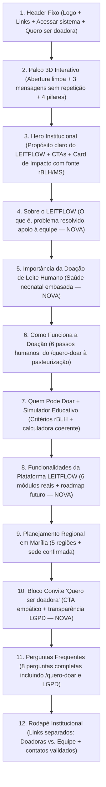

# LEITFLOW — Auditoria Editorial e Plano de Melhoria da Página Inicial Institucional

**Projeto:** LEITFLOW — Plataforma de Gestão Logística, Clínica e Rastreabilidade para o Banco de Leite Humano de Marília – SP  
**Repositório oficial:** `https://github.com/lazari-gabriel/LEITE-FLOW-banco-leite-marilia`  
**Escopo deste documento:** Auditoria editorial completa, diagnóstico de comunicação, estratégia de posicionamento e proposta integral de reescrita e organização da página inicial (`/`), **sem alterações de código nesta etapa**.  
**Referências técnicas consultadas:** Ministério da Saúde, Rede Brasileira de Bancos de Leite Humano (rBLH-BR / Fiocruz), ANVISA (RDC nº 171/2006) e LGPD (Lei nº 13.709/2018).

---

## 1. Diagnóstico Geral da Página Inicial

A página inicial atual ([PublicHomePage.tsx](file:///c:/Users/-/Desktop/Banco_leite/src/components/public/PublicHomePage.tsx) e seus subcomponentes em `src/components/public/`) possui **identidade visual madura, acolhedora e bem executada** (paleta verde-sálvia `#4A6B5D`, fundo natural `#FAF9F6`, tipografia editorial `Playfair Display` e experiência 3D em `<canvas>`).

Entretanto, do ponto de vista **editorial, estratégico e institucional**, o conteúdo atual apresenta **fragmentação de propósito**: parte dos textos foi herdada de uma landing page exclusivamente voltada a campanhas de doação e outra parte foi enxertada com jargão técnico do sistema interno. Como consequência:

1. **A primeira dobra não explica rapidamente o que é o LEITFLOW:** o visitante vê apenas `"LeiteFlow — Cada Gota. Uma Vida."` sobre o frasco animado e precisa rolar quase cinco alturas de tela (`520vh`) para ler a explicação institucional completa.
2. **Os dois públicos principais colidem no mesmo texto:** mães interessadas em doar leem termos operacionais intimidadores (*"protocolo Go/No-Go"*, *"controle patrimonial de retorno"*, *"Code 128"*, *"acidez Dornic"*, *"crematócrito"*), enquanto gestores e profissionais de saúde não encontram uma apresentação estruturada dos módulos reais do sistema.
3. **Repetição excessiva de poucas frases-chave:** dados como *"1 litro alimenta até 10 bebês"* e *"coleta gratuita nas 5 zonas"* aparecem repetidos de 3 a 5 vezes ao longo da página, ocupando espaço que deveria esclarecer como funciona o projeto, o processo de doação e a segurança do leite humano.
4. **Inconsistências factuais e institucionais críticas:** há divergência na grafia da marca (`LeiteFlow` vs. `LEITFLOW` vs. `LEITE FLOW`), mistura de endereços/telefones e vínculos institucionais entre o **BLH de Marília (Secretaria Municipal da Saúde)** e o **Hospital Materno Infantil / HCFAMEMA**, imprecisão na explicação do prazo de congelamento domiciliar (10 dias vs. 15 dias) e inconsistência matemática no simulador de impacto.
5. **Falta clareza na jornada "Quero ser doadora":** embora o botão de captação digital já leve a `/quero-doar`, o FAQ e o fluxo da página inicial ainda não explicam o que acontece após o envio do formulário de interesse.

---

## 2. Inventário de Todas as Seções Existentes

Mapeamento completo dos blocos atualmente renderizados na rota `/` (de cima para baixo):

| # | Componente | Seção / Âncora | Papel Atual na Página | Público Predominante |
| :-: | :--- | :--- | :--- | :--- |
| 1 | `PublicHeader.tsx` | Cabeçalho fixo | Logo, 5 links âncora (`Como Funciona`, `Coleta em Marília`, `Quem Pode Doar`, `Impacto`, `Dúvidas`), botões `Acessar sistema` e `Quero ser doadora`. | Ambos |
| 2 | `BottleExplodedScroll.tsx` (Parte A) | `#historia-leiteflow` (`520vh`) | Animação 3D do frasco em 108 frames com 4 overlays sequenciais: (01) `LeiteFlow / Cada Gota. Uma Vida.`, (02) `Pureza em Movimento`, (03) `Coleta 100% Gratuita`, (04) `Gestão Clínica & Logística` + CTAs. | Misto (muda no meio do scroll) |
| 3 | `BottleExplodedScroll.tsx` (Parte B) | Faixa `Cuidado Clínico em Cada Etapa` | 4 cards (`Coleta Domiciliar`, `Frascos Esterilizados`, `Rastreio Inteligente`, `Impacto Real`) + marquee cinético de fundo. | Misto |
| 4 | `PublicHomePage.tsx` (Bloco 1) | Hero Institucional | Badge, título emocional (`Seu excedente de leite é o recomeço...`), parágrafo sobre o LEITFLOW, CTAs, endereço/telefone e card lateral (`1 Litro = 10 Bebês`, `100% Gratuito`, `5 Zonas`, `ANVISA RDC 171/2006`). | Mães + Institucional |
| 5 | `ImpactCalculator.tsx` | `#calculadora` | Simulador interativo com slider de 30 a 500 ml/dia convertendo em volume semanal e estimativa de bebês alimentados. | Mães doadoras |
| 6 | `PublicHomePage.tsx` (Bloco 2) | `#como-funciona` | 4 cards numerados (`01 Triagem Clínica & Sorologias`, `02 Entrega de Kits Estéreis`, `03 Coleta & Cadeia de Frio`, `04 Pasteurização & UTI Neonatal`). | Profissionais (mas anunciado para doadoras) |
| 7 | `PublicHomePage.tsx` (Bloco 3) | `#coleta-marilia` | Apresentação das 5 zonas de Marília (Norte, Sul, Oeste, Leste, Rural) com dias da semana, bairros e card de sede/telefones. | Mães + Logística |
| 8 | `PublicHomePage.tsx` (Bloco 4) | `#requisitos` | 3 cards de critérios (`Amamentação Saudável`, `Hábitos Saudáveis`, `Exames Atualizados`). | Mães doadoras |
| 9 | `InstitutionalFaq.tsx` | `#duvidas` | 4 perguntas frequentes em acordeão (produção de leite, custo de frascos, tempo de congelamento, higienização). | Mães doadoras |
| 10 | `PublicFooter.tsx` | Rodapé | Logo dark, descrição do LEITFLOW, endereço/telefones/vínculo, links rápidos (`Como Funciona`, `Rotas`, `Critérios`, `Quero ser doadora`, `Acessar sistema`) e aviso de área restrita. | Institucional / Profissionais |

---

## 3. Problemas Encontrados

### 3.1 Problemas Críticos (Credibilidade, Precisão Institucional e Sanitária)
1. **Conflito de vínculo institucional, endereço e telefones:** a página afirma *"Banco de Leite Humano de Marília (HCFAMEMA / Hospital Materno Infantil de Marília)"*, exibindo simultaneamente o endereço `Rua São Luiz, 375` e dois telefones (`(14) 3402-5555` e `(14) 3413-8696`). Em fontes públicas oficiais, o **BLH de Marília** é vinculado à **Secretaria Municipal da Saúde de Marília** (`Rua XV de Novembro, 50`, tel. `(14) 3413-8696`), enquanto o **Hospital Materno Infantil (HCFAMEMA)** é unidade hospitalar distinta que recebe leite pasteurizado. Misturar esses dados sem validação compromete a credibilidade perante o próprio serviço de saúde.
2. **Inconsistência na grafia da marca:** aparecem três nomes diferentes na aplicação e na home: `LeiteFlow` (H1 principal), `LEITFLOW` (marquee, corpo do texto, `<title>`, rodapé) e `LEITE FLOW` (constantes e sistema interno).
3. **Imprecisão sobre prazo de congelamento no FAQ (15 dias vs. 10 dias):** o FAQ afirma que a mãe pode guardar o leite congelado por *"até 15 dias"*. Na prática da **rBLH-Fiocruz / Ministério da Saúde**, orienta-se à doadora o congelamento domiciliar por **até 10 dias** antes da entrega, porque o limite legal de **15 dias da RDC 171/2006** abrange todo o período do leite cru — incluindo transporte, triagem e processamento até a pasteurização no Banco de Leite.
4. **Inconsistência na fórmula da calculadora educativa:** o card do Hero informa `1 litro (1.000 ml) = até 10 bebês por até 24 horas` (100 ml/bebê/dia), mas `ImpactCalculator.tsx` calcula `Math.floor((mlPerDay * 7) / 70)` (`70 ml/semana por bebê`) exibindo *"bebês/semana"* sem explicar a premissa e gerando números desalinhados com a referência oficial do Ministério da Saúde.
5. **Promessa categórica sem ressalva de confirmação local:** frases como *"Plataforma oficial do Banco de Leite Humano de Marília"* e *"Coleta 100% Gratuita nas 5 zonas"* com dias fixos por bairro precisam ser cuidadosamente redigidas como plataforma desenvolvida para apoiar o serviço e com cronograma sujeito à organização operacional da equipe, até validação formal do BLH.

### 3.2 Problemas Editoriais, de Clareza e Hierarquia
6. **Duplo Hero e demora para comunicar a proposta de valor:** a primeira tela mostra apenas um slogan abstrato (`Cada Gota. Uma Vida.`), sem explicar que o LEITFLOW é uma plataforma tecnológica de apoio ao Banco de Leite Humano de Marília e sem exibir a chamada principal logo na dobra inicial (fora da barra de topo).
7. **Repetição excessiva:** *"1 litro alimenta até 10 bebês"* (3×), *"5 zonas de Marília"* (4×) e *"frascos de vidro esterilizados gratuitos"* (5×) se repetem com quase as mesmas palavras.
8. **Jargão técnico fora de lugar:** na seção `#como-funciona` (onde a mãe busca entender o passo a passo da doação), aparecem termos de uso interno como *"protocolo Go/No-Go"*, *"controle patrimonial de retorno"*, *"Code 128 + QR Code"*, *"acidez Dornic"* e *"crematócrito"*.
9. **Seções estratégicas ausentes:**
   - Falta uma seção clara de **Apresentação do Projeto LEITFLOW** (o que é, que problema resolve, como apoia a equipe sem substituir profissionais de saúde).
   - Falta uma seção sobre a **Importância da Doação de Leite Humano** com contexto acolhedor e embasado em fontes oficiais.
   - Falta uma seção de **Funcionalidades da Plataforma** listando honestamente os módulos implementados no sistema (e distinguindo o que é evolução planejada).
   - Falta um bloco dedicado e empático de convite **"Quero ser doadora"** explicando o que ocorre após enviar o formulário.
10. **FAQ incompleto para a jornada atual:** não cobre quem pode manifestar interesse, como funciona o formulário `/quero-doar`, o que acontece depois do envio, como ocorre o primeiro contato, nem a proteção de dados (LGPD).
11. **Pequenos problemas de estilo e gramática:**
    - Uso de `&` comercial em títulos em português (`Triagem Clínica & Sorologias`, `Gestão Clínica & Logística`, `Coleta & Cadeia de Frio`) em vez da conjunção `"e"`.
    - Capitalização excessiva em estilo inglês (*Title Case*) em subtítulos e rótulos (`Cada Gota. Uma Vida.`, `Rota Ativa`, `Padrão Sanitário`, `Quem Pode Doar`, `Entenda o Passo a Passo`).
    - Uso do símbolo `ml` em minúsculas em alguns trechos (`ImpactCalculator.tsx`) e `mL` em outros do sistema (padronizar `mL`, notação do Sistema Internacional adotada na área da saúde).
    - Expressão *"Rastreio Inteligente"* e *"excedente de leite"* (termo correto e mais humano na comunicação da rBLH: *"leite materno excedente"* ou *"leite que sobra após amamentar seu bebê"* — lembrando inclusive que a rBLH destaca que **qualquer quantidade importa**, não apenas grandes excessos!).

---

## 4. Análise da Comunicação Atual

### 4.1 Adequação por Público-Alvo

| Público | Como a página comunica hoje | Lacuna principal |
| :--- | :--- | :--- |
| **Mulheres interessadas em doar** | Tom visual muito acolhedor, mas textos misturam linguagem técnica hospitalar no meio da jornada e não explicam o que acontece após preencher o formulário de interesse. | Falta um passo a passo humano da doadora (do interesse ao contato da equipe) e FAQ completo sobre triagem, rotina e privacidade. |
| **Familiares e rede de apoio** | Pouco contemplados; não há explicação clara de por que o leite humano doado é vital para prematuros e como a família pode apoiar a doadora. | Falta seção dedicada à importância do leite humano na saúde neonatal sem sensacionalismo. |
| **Profissionais de saúde (enfermagem, laboratório, coordenação)** | Termos técnicos aparecem espalhados em cards curtos, sem visão estruturada dos módulos reais do LEITFLOW. | Falta seção de **Funcionalidades da Plataforma** deixando explícito que o software apoia — e nunca substitui — a avaliação clínica. |
| **Instituições, gestores públicos e avaliadores** | Falta apresentação formal do projeto, do problema resolvido (controle manual, rastreabilidade, logística) e da conformidade regulatória (RDC 171/2006 + LGPD). | Falta seção **Sobre o LEITFLOW** com posicionamento claro, transparente e sem exageros comerciais. |

### 4.2 Experiência de Comunicação (Fluxo de Leitura)
- **Compreensão rápida (teste dos 5 segundos):** **Insuficiente.** Na tela inicial (`y = 0`), o visitante vê um frasco e `"LeiteFlow — Cada Gota. Uma Vida."`, mas não entende se se trata de uma campanha, uma clínica, um produto ou um sistema de gestão de Banco de Leite.
- **Ordem das seções:** **Desarticulada.** A calculadora aparece antes mesmo de explicar como a doação funciona; a logística de zonas aparece antes de dizer quem pode doar; e não existe transição natural conduzindo o visitante ao convite final de ação.
- **Equilíbrio de texto:** Alguns cards são superficiais demais (1 frase genérica), enquanto outros acumulam 4 conceitos técnicos em duas linhas.

---

## 5. Posicionamento Institucional Recomendado

> **Declaração de posicionamento:**  
> *O **LEITFLOW** é uma plataforma tecnológica desenvolvida para apoiar a gestão logística, clínica e a rastreabilidade do Banco de Leite Humano de Marília – SP, integrando captação de doadoras, organização de coletas domiciliares, acompanhamento laboratorial e controle de qualidade — sempre sob a condução dos profissionais de saúde e em conformidade com as diretrizes sanitárias nacionais e a LGPD.*

**Pilares obrigatórios de comunicação:**
1. **Tecnologia a serviço do cuidado:** o sistema organiza processos, reduz retrabalho e amplia a rastreabilidade, mas **jamais substitui** a equipe de enfermagem, a avaliação médica ou os protocolos oficiais do Banco de Leite.
2. **Transparência e rigor:** zero estatísticas inventadas, zero promessas de aprovação automática e distinção clara entre o que o software já executa e evoluções futuras.
3. **Acolhimento sem pieguice:** linguagem empática, respeitosa e informativa para mães e famílias, sem apelo emocional exagerado nem marketing comercial.

---

## 6. Tom de Voz Recomendado

| Atributo | Como escrever (FAZER) | O que evitar (NÃO FAZER) |
| :--- | :--- | :--- |
| **Humanizado e acolhedor** | *"Se você está amamentando e tem interesse em doar, nossa equipe está pronta para orientar você com calma e segurança."* | *"Transforme seu excedente em recomeço!"* / frases publicitárias apelativas. |
| **Institucional e confiável** | *"Todo o acompanhamento clínico, a triagem e a liberação para doação são conduzidos exclusivamente por profissionais de saúde do serviço."* | Prometer *"aprovação rápida"*, *"sistema 100% automatizado"* ou *"certificado"*. |
| **Claro e acessível** | Explicar termos sanitários quando usados (ex.: *"pasteurização — tratamento térmico que garante a segurança microbiológica preservando nutrientes"*). | Jogar termos como *"protocolo Go/No-Go"* ou *"controle patrimonial"* para mães leigas. |
| **Objetivo e sem clichês** | Frases diretas em ordem direta, português brasileiro correto, sem abuso de maiúsculas e sem `&` comercial em títulos. | *"Rastreio Inteligente"*, *"Tecnologia de ponta"*, *"Solução inovadora"*. |

---

## 7. Propostas de Novos Títulos e Subtítulos

### 7.1 Primeira Dobra — Abertura Visual (`BottleExplodedScroll.tsx` Overlay 01)
- **TEXTO ATUAL:**  
  `Banco de Leite Humano • Marília` / `LeiteFlow` / `Cada Gota. Uma Vida.`
- **PROBLEMA IDENTIFICADO:**  
  Grafia divergente (`LeiteFlow` vs. `LEITFLOW`), slogan curto e abstrato que não esclarece o papel da plataforma tecnológica nem o propósito do site nos primeiros segundos.
- **NOVA PROPOSTA:**  
  - Eyebrow: `Apoio à gestão do Banco de Leite Humano • Marília – SP`
  - H1: `LEITFLOW` *(ou a grafia oficial única definida na validação)*
  - Subtítulo: `Tecnologia, organização e rastreabilidade a serviço da doação de leite humano.`
- **JUSTIFICATIVA:**  
  Alinha a marca, comunica imediatamente que se trata de uma plataforma aplicada ao Banco de Leite Humano de Marília e equilibra tecnologia e saúde pública sem poluir o palco visual 3D.

### 7.2 Overlays Intermediários do Palco 3D (`BottleExplodedScroll.tsx` Overlays 02, 03 e 04)
- **TEXTO ATUAL (Overlay 02):**  
  `Pureza em Movimento` — *"Rico em anticorpos vivos e nutrientes insubstituíveis — 1 litro doado alimenta até 10 bebês prematuros na UTI Neonatal."*
- **PROBLEMA IDENTIFICADO:**  
  Título genérico/publicitário (*"Pureza em Movimento"*) e repetição do dado de 1 litro que já aparece no card de impacto.
- **NOVA PROPOSTA (Overlay 02):**  
  `Alimento essencial para recém-nascidos` — *"O leite humano doado oferece proteção imunológica e nutrição adequada para bebês prematuros ou de baixo peso internados em unidades neonatais."*
- **JUSTIFICATIVA:**  
  Mais fiel à linguagem da rBLH/Ministério da Saúde, informativo, humanizado e sem repetir o mesmo número três vezes na página.

- **TEXTO ATUAL (Overlay 03):**  
  `Coleta 100% Gratuita` — *"O Banco de Leite Humano de Marília entrega frascos esterilizados e realiza a coleta domiciliar gratuita nas 5 zonas do município."*
- **PROBLEMA IDENTIFICADO:**  
  Redundante com o Hero e a seção de Zonas; afirmação absoluta sem mencionar a orientação prévia da equipe.
- **NOVA PROPOSTA (Overlay 03):**  
  `Logística organizada com cuidado` — *"Da orientação inicial à coleta domiciliar em cadeia de frio monitorada, cada etapa é planejada para dar praticidade à doadora e segurança ao leite coletado."*
- **JUSTIFICATIVA:**  
  Valoriza o papel logístico do serviço e da plataforma sem repetir a mesma frase das seções seguintes.

- **TEXTO ATUAL (Overlay 04):**  
  `Gestão Clínica & Logística` — *"Plataforma oficial de rastreabilidade, roteirização de coletas e controle laboratorial do Banco de Leite Humano de Marília."*
- **PROBLEMA IDENTIFICADO:**  
  Usa `&` comercial, afirma *"Plataforma oficial"* sem confirmação formal e muda abruptamente de tom.
- **NOVA PROPOSTA (Overlay 04):**  
  `Cuidado acompanhado de ponta a ponta` — *"Acompanhe como funciona a doação de leite humano ou acesse a área restrita para a equipe técnica do serviço."*
- **JUSTIFICATIVA:**  
  Faz uma ponte natural entre os dois botões do overlay (`Quero ser doadora` e `Acessar sistema`), servindo igualmente a visitantes e profissionais.

### 7.3 Hero Institucional (`PublicHomePage.tsx`)
- **TEXTO ATUAL:**  
  - Badge: `Gestão Logística, Clínica e Rastreabilidade · Marília-SP`
  - Título: `Seu excedente de leite é o recomeço de uma vida recém-nascida.`
  - Texto: *"O LEITFLOW integra a gestão operacional do Banco de Leite Humano de Marília (HCFAMEMA / Hospital Materno Infantil de Marília), conectando triagem clínica, coleta domiciliar gratuita em frascos esterilizados, processamento laboratorial e dispensação segura à UTI Neonatal."*
- **PROBLEMA IDENTIFICADO:**  
  Título focado apenas em *"excedente"* (pode afastar mães que acham que produzem "pouco", quando a rBLH reforça que qualquer volume importa); parágrafo mistura vínculos institucionais não confirmados (HCFAMEMA / HMI / BLH) e acumula termos técnicos demais em uma só frase.
- **NOVA PROPOSTA:**  
  - Badge: `Plataforma de apoio ao Banco de Leite Humano · Marília – SP`
  - Título (Opção A — Institucional e humana, recomendada): `Doação de leite humano com acolhimento, organização e segurança.`
  - Título (Opção B — Foco em impacto neonatal): `Cada doação de leite humano fortalece o cuidado aos recém-nascidos.`
  - Subtítulo / Apresentação: *"O LEITFLOW apoia a gestão logística, o acompanhamento de doadoras e a rastreabilidade de frascos do Banco de Leite Humano de Marília — conectando o gesto solidário de quem doa ao cuidado técnico prestado pelos profissionais de saúde."*
- **JUSTIFICATIVA:**  
  Comunica com precisão o papel do LEITFLOW como tecnologia de apoio, elimina conflitos de vínculo institucional não validados e acolhe qualquer mãe em fase de amamentação.

---

## 8. Versões Reescritas dos Textos (Por Seção)

### 8.1 Faixa de 4 Pilares (`BottleExplodedScroll.tsx` — Parte B)
- **TEXTO ATUAL:**  
  Título: `Cuidado Clínico em Cada Etapa` / Subtítulo: `Tecnologia e acolhimento humano conectados ao Banco de Leite de Marília.`  
  Cards: `Coleta Domiciliar`, `Frascos Esterilizados`, `Rastreio Inteligente`, `Impacto Real`.
- **PROBLEMA IDENTIFICADO:**  
  Expressão *"Rastreio Inteligente"* soa como marketing genérico; *"Impacto Real"* repete novamente `"1 litro = 10 bebês"`; *"Cuidado Clínico"* pode sugerir que o software realiza atendimento clínico.
- **NOVA PROPOSTA:**  
  - Título: `Organização e segurança em cada etapa`
  - Subtítulo: `Como a estrutura do serviço e o apoio tecnológico atuam juntos para proteger o leite doado.`
  - Card 1 — **Acolhimento à doadora:** *"Orientação clara desde a manifestação de interesse até o acompanhamento contínuo pela equipe de saúde."*
  - Card 2 — **Logística de coleta:** *"Planejamento de rotas nas regiões atendidas em Marília, com monitoramento térmico durante todo o transporte."*
  - Card 3 — **Qualidade e pasteurização:** *"Registro organizado das análises laboratoriais, do processo de pasteurização e do controle de estoque."*
  - Card 4 — **Rastreabilidade completa:** *"Identificação individual de cada frasco com código de barras e QR Code, acompanhando o histórico da coleta à dispensação."*
- **JUSTIFICATIVA:**  
  Remove clichês e duplicações, diferencia claramente os 4 pilares reais do projeto e evita sugerir que o software substitui o cuidado humano.

### 8.2 Card Lateral de Impacto no Hero (`PublicHomePage.tsx`)
- **TEXTO ATUAL:**  
  `1 Litro de Leite Materno` / `Pode alimentar até 10 Bebês` / `Prematuros na UTI Neonatal do HCFAMEMA por até 24 horas.` / `100% Gratuito em Casa` / `5 Zonas Atendidas em Marília` / `Padrão Sanitário: ANVISA RDC 171/2006 · HCFAMEMA`.
- **PROBLEMA IDENTIFICADO:**  
  Cita `"UTI Neonatal do HCFAMEMA"` como destino único (o BLH municipal pode atender mais de uma unidade neonatal na cidade — precisa confirmação); falta atribuição de fonte pública confiável ao dado de 1 litro.
- **NOVA PROPOSTA:**  
  - Destaque: `Até 10 recém-nascidos`
  - Texto: *"Segundo o Ministério da Saúde e a Rede Brasileira de Bancos de Leite Humano (rBLH), 1 litro de leite humano doado pode alimentar até 10 bebês prematuros ou de baixo peso por dia, conforme prescrição clínica."*
  - Mini-card 1: `Gratuito` / `Doação e atendimento sem custo (SUS)`
  - Mini-card 2: `RDC 171/2006` / `Referência sanitária ANVISA`
  - Rodapé do card: `Proteção de dados conforme a LGPD (Lei nº 13.709/2018)`
- **JUSTIFICATIVA:**  
  Embasa o único dado quantitativo em fonte oficial verificável, remove afirmação não confirmada sobre unidade receptora específica e reforça transparência regulatória.

### 8.3 Simulador Educativo de Impacto (`ImpactCalculator.tsx`)
- **TEXTO ATUAL:**  
  Título: `Calcule o impacto da doação em frascos`  
  Subtítulo: *"Bebês prematuros iniciam com apenas 1 ml a 5 ml por mamada. Veja como poucos mililitros fazem toda a diferença na UTI Neonatal."*  
  Resultado: `Math.floor((mlPerDay * 7) / 70)` exibido como `X bebês/semana (Dieta inicial prematura)`.
- **PROBLEMA IDENTIFICADO:**  
  A conta `/ 70` não tem referência pública declarada e contradiz a referência de `1.000 mL ≈ até 10 bebês/dia` usada logo acima; usa `ml` em vez de `mL`.
- **NOVA PROPOSTA:**  
  - Eyebrow: `Referência educativa`
  - Título: `Veja como cada volume doado faz diferença`
  - Subtítulo: *"Recém-nascidos prematuros podem iniciar a alimentação com volumes muito pequenos, a partir de 1 mL por mamada. Qualquer quantidade doada com segurança contribui."*
  - Nota metodológica transparente abaixo do resultado: *"Estimativa ilustrativa baseada na referência divulgada pelo Ministério da Saúde e pela rBLH (1 litro pode atender até 10 recém-nascidos por dia). O volume prescrito varia conforme o peso e o quadro clínico de cada bebê."*
  - Cálculo sugerido para coerência: exibir o **volume estimado em 1 semana (`mL`)** e a equivalência ilustrativa em **dias de alimentação neonatal** (`Math.max(1, Math.round(weeklyMl / 100))`, baseado na razão oficial `1.000 mL = até 10 bebês/dia`).
- **JUSTIFICATIVA:**  
  Mantém o engajamento interativo do componente, mas com rigor técnico, coerência matemática e transparência absoluta.

### 8.4 Como Funciona a Doação (`PublicHomePage.tsx` — `#como-funciona`)
- **TEXTO ATUAL:**  
  Título: `Como funciona a coleta e o processamento`  
  4 passos com termos internos: `01 Triagem Clínica & Sorologias ("protocolo Go/No-Go")`, `02 Entrega de Kits Estéreis ("controle patrimonial de retorno")`, `03 Coleta & Cadeia de Frio ("etiquetas Code 128 + QR Code")`, `04 Pasteurização & UTI Neonatal ("acidez Dornic, crematócrito")`.
- **PROBLEMA IDENTIFICADO:**  
  Mistura processo da mãe doadora com processo interno do software; pula a etapa real de **manifestação de interesse (`/quero-doar`)** e **contato inicial da equipe**; apresenta todas as etapas com vocabulário técnico que afasta o público geral.
- **NOVA PROPOSTA (6 etapas centradas na jornada real da doadora):**  
  - Eyebrow: `Passo a passo para doar`
  - Título: `Como funciona o processo de doação`
  - Subtítulo: *"Todo o acompanhamento é gratuito e conduzido pela equipe do Banco de Leite Humano, com orientações claras em cada fase."*
  1. **01 · Manifestação de interesse:** *"Você preenche o formulário 'Quero ser doadora' com seus dados de contato e bairro, sem necessidade de enviar exames ou informações clínicas nesta etapa."*
  2. **02 · Primeiro contato da equipe:** *"Profissionais do Banco de Leite entram em contato pelo canal e horário escolhidos para tirar dúvidas e explicar o funcionamento do serviço."*
  3. **03 · Cadastro oficial e avaliação clínica:** *"Caso deseje prosseguir, a equipe realiza o cadastro oficial e avalia o histórico de saúde e os exames do pré-natal ou pós-parto, conforme protocolos sanitários."*
  4. **04 · Orientações para ordenha e armazenamento:** *"A doadora recebe orientações detalhadas de higienização, extração e conservação segura do leite, além dos frascos de vidro adequados conforme a rotina do serviço."*
  5. **05 · Entrega ou coleta agendada:** *"O leite congelado é encaminhado ao Banco de Leite conforme a logística combinada com a equipe (entrega na unidade ou coleta domiciliar nas áreas atendidas)."*
  6. **06 · Processamento e destinação segura:** *"No Banco de Leite, o leite passa por análises de qualidade, pasteurização e controle microbiológico antes de ser liberado mediante prescrição para recém-nascidos que necessitam."*
- **JUSTIFICATIVA:**  
  Fiel à jornada real implementada (incluindo `/quero-doar`), acolhedora para leigos, sem apresentar etapas não confirmadas como garantias absolutas e transferindo os termos técnicos do software para a nova seção **Funcionalidades da Plataforma**.

### 8.5 Logística de Coleta em Marília (`PublicHomePage.tsx` — `#coleta-marilia`)
- **TEXTO ATUAL:**  
  Título: `Atendimento em todas as 5 zonas de Marília-SP`  
  Texto: *"A frota refrigerada do Banco de Leite percorre semanalmente as rotas urbanas e rurais do município..."* + 5 cards com `Rota Ativa` e dia fixo (`Segunda-feira` ... `Sexta-feira`) + endereço `Rua São Luiz, 375` e dois telefones.
- **PROBLEMA IDENTIFICADO:**  
  Exibe dias fixos por zona e lista de bairros como garantia pública sem ressalva de variação operacional; afirma *"frota refrigerada"* (verificar se há mais de um veículo ou caixa térmica/veículo específico); endereço/telefone conflitante.
- **NOVA PROPOSTA:**  
  - Eyebrow: `Organização regional`
  - Título: `Planejamento de rotas por região em Marília`
  - Texto: *"Para facilitar a rotina das doadoras cadastradas, o sistema organiza o planejamento de atendimentos por regiões do município. A disponibilidade de coleta domiciliar, os dias de visita e os horários são confirmados diretamente pela equipe do Banco de Leite após o cadastro oficial."*
  - Nos cards das 5 regiões: substituir o selo `"Rota Ativa"` por `"Região mapeada"` (ou `"Referência semanal"`, após confirmação com o BLH) e incluir nota discreta: *"*Cronograma de referência sujeito à programação semanal da equipe."*
  - No box da sede: exibir exclusivamente endereço, telefone e horário **formalmente confirmados** pela coordenação do BLH de Marília.
- **JUSTIFICATIVA:**  
  Preserva o valor informativo do mapeamento das 5 zonas sem gerar expectativa falsa de visita automática antes da triagem ou fora do cronograma vigente do BLH.

### 8.6 Quem Pode Doar (`PublicHomePage.tsx` — `#requisitos`)
- **TEXTO ATUAL:**  
  Título: `Quem pode ser uma doadora?`  
  Subtítulo: *"A doação é segura para a mãe e para o bebê. Confira os critérios oficiais da ANVISA e do Ministério da Saúde."*  
  Card 1: *"Estar amamentando o próprio filho com boa produção e apresentar excedente de leite materno de forma confortável."*  
  Card 2: *"Não fazer uso de medicamentos incompatíveis com a amamentação, não consumir bebidas alcoólicas e não ser fumante."*  
  Card 3: *"Apresentar cartão de gestante ou laudos sorológicos recentes (HIV, Sífilis, Hepatite B/C) avaliados pelo BLH."*
- **PROBLEMA IDENTIFICADO:**  
  O texto está em boa direção, mas não explicita que **a avaliação individual é sempre feita pelos profissionais de saúde do BLH** (há situações específicas, como uso de certos medicamentos ou tatuagens recentes, que apenas a triagem profissional avalia com segurança) e não reforça que **pequenas quantidades também ajudam**.
- **NOVA PROPOSTA:**  
  - Eyebrow: `Orientações iniciais`
  - Título: `Quem pode demonstrar interesse em doar?`
  - Subtítulo: *"De acordo com o Ministério da Saúde e a Rede Brasileira de Bancos de Leite Humano (rBLH), toda mulher saudável que está amamentando pode se candidatar à doação."*
  - Card 1 — **Mulher saudável em amamentação:** *"Estar amamentando e possuir leite além da necessidade do próprio bebê. Mesmo pequenos volumes contribuem para a nutrição de recém-nascidos."*
  - Card 2 — **Cuidados com hábitos e medicações:** *"Não fumar, não consumir bebidas alcoólicas ou substâncias ilícitas e não utilizar medicamentos contraindicados para a amamentação."*
  - Card 3 — **Avaliação clínica e exames:** *"Apresentar exames do pré-natal ou pós-parto para análise da equipe do Banco de Leite. A confirmação final de aptidão é sempre realizada por profissionais de saúde."*
- **JUSTIFICATIVA:**  
  Respeita estritamente as diretrizes da rBLH/ANVISA, esclarece que o site orienta mas quem avalia é a equipe de saúde, e incentiva mães que doam volumes menores.

### 8.7 Perguntas Frequentes (`InstitutionalFaq.tsx` — `#duvidas`)
- **TEXTO ATUAL:**  
  Apenas 4 perguntas (faltar leite, custo de frascos, prazo de 15 dias no congelador, higienização antes da ordenha).
- **PROBLEMA IDENTIFICADO:**  
  (1) Imprecisão no prazo domiciliar (15 dias vs. 10 dias recomendados pela rBLH para congelamento em casa); (2) ausência total de perguntas sobre o **formulário de interesse (`/quero-doar`)**, primeiro contato, triagem oficial e proteção de dados (LGPD); (3) falta ressalva de que o FAQ não substitui orientação da equipe de saúde.
- **NOVA PROPOSTA (8 perguntas organizadas e completas):**
  1. **Quem pode demonstrar interesse em ser doadora?**  
     *"Toda mulher saudável que está amamentando pode manifestar interesse pelo formulário do site. A confirmação final de aptidão é feita pela equipe do Banco de Leite após o contato e a avaliação dos exames e critérios sanitários."*
  2. **O que acontece depois que envio o formulário "Quero ser doadora"?**  
     *"Você recebe um número de protocolo e sua solicitação fica registrada na fila de atendimento do Banco de Leite. O envio não aprova nem agenda a coleta automaticamente: a equipe entra em contato pelo canal e horário escolhidos para tirar dúvidas e combinar os próximos passos."*
  3. **Como funciona o primeiro contato e a avaliação oficial?**  
     *"No primeiro contato, profissionais do Banco de Leite explicam todo o processo, verificam se há interesse em prosseguir e orientam sobre o cadastro oficial e os exames de pré-natal ou pós-parto exigidos pelas normas sanitárias."*
  4. **Doar leite pode fazer faltar leite para o meu próprio bebê?**  
     *"Não. Segundo a Rede Brasileira de Bancos de Leite Humano (rBLH), a produção de leite responde ao estímulo: quanto mais a mama é esvaziada de forma adequada, mais leite o organismo produz. Doa-se apenas o volume que sobra após amamentar o próprio filho."*
  5. **Como funciona a coleta e os frascos para armazenamento?**  
     *"O leite destinado à doação deve ser armazenado em frascos de vidro com tampa plástica devidamente higienizados e esterilizados. A forma de fornecimento dos frascos e a entrega ou coleta domiciliar são combinadas diretamente com a equipe do Banco de Leite de Marília."*
  6. **Por quanto tempo o leite pode ficar congelado em casa antes de ir ao Banco de Leite?**  
     *"A Rede Brasileira de Bancos de Leite Humano (rBLH / Ministério da Saúde) orienta manter o leite cru congelado por até 10 dias em casa (a partir da data da primeira ordenha), garantindo que ele chegue ao Banco de Leite e passe pela pasteurização dentro do limite sanitário de 15 dias previsto na RDC ANVISA nº 171/2006. Siga sempre o prazo informado pela equipe local."*
  7. **Como meus dados pessoais são protegidos?**  
     *"O formulário público solicita apenas informações básicas de contato e região, sem dados clínicos sensíveis. O acesso é restrito a profissionais autorizados do serviço, com registro de consentimento e conformidade com a LGPD (Lei nº 13.709/2018)."*
  8. **Como obter mais informações ou tirar dúvidas específicas de saúde?**  
     *"Dúvidas sobre amamentação, uso de medicamentos ou condições clínicas individuais devem sempre ser esclarecidas diretamente com os profissionais do Banco de Leite Humano de Marília ou pelo Disque Saúde (136). As informações desta página têm caráter educativo e não substituem avaliação profissional."*
- **JUSTIFICATIVA:**  
  Resolve a imprecisão de 10 vs. 15 dias, integra completamente a nova funcionalidade de captação digital (`/quero-doar`), reforça LGPD e posiciona o site com responsabilidade clínica.

### 8.8 Rodapé (`PublicFooter.tsx`)
- **TEXTO ATUAL:**  
  Descrição: *"Plataforma institucional de gestão logística, clínica e rastreabilidade do Banco de Leite Humano de Marília (HCFAMEMA / Hospital Materno Infantil de Marília)."*  
  Contatos: `Rua São Luiz, 375 — Centro, Marília - SP` / `(14) 3402-5555 · BLH Marília (14) 3413-8696` / `Vinculado ao HCFAMEMA · Conformidade ANVISA RDC 171/2006 & LGPD`.
- **PROBLEMA IDENTIFICADO:**  
  Mistura dados de unidades distintas sem validação; coluna `"Acesso Profissional"` mistura links para mães (`Como Funciona`, `Critérios de Doação`, `Quero ser doadora`) com o login técnico (`Acessar sistema`).
- **NOVA PROPOSTA:**  
  - Descrição institucional: *"LEITFLOW — Plataforma tecnológica desenvolvida para apoiar a gestão logística, o acompanhamento de doadoras e a rastreabilidade de frascos do Banco de Leite Humano de Marília – SP. Uso operacional restrito a profissionais autorizados."*
  - Separar claramente duas colunas de navegação (ou dois grupos visuais):
    - **Para quem deseja doar:** *Sobre o LEITFLOW*, *Como Funciona*, *Quem Pode Doar*, *Perguntas Frequentes*, **Quero ser doadora**.
    - **Acesso Institucional:** **Acessar sistema** (equipe autorizada), referência regulatória (*ANVISA RDC nº 171/2006 · LGPD*).
  - **Bloco de endereço e telefone:** manter placeholder claramente validado com a equipe local (ver Seção 12) para não publicar endereço ou vínculo institucional divergente.
- **JUSTIFICATIVA:**  
  Organiza a navegação por perfil de visitante e evita qualquer afirmação de endereço ou subordinação institucional que ainda dependa de confirmação oficial.

---

## 9. Novas Seções Recomendadas

Para que a página cumpra seu papel institucional, humano e tecnológico de ponta a ponta, recomenda-se adicionar **4 seções estratégicas** (enxutas, escaneáveis e na mesma identidade visual):

### 9.1 Seção Nova A — "Sobre o LEITFLOW" (`#sobre-projeto`)
- **Objetivo:** Explicar em linguagem acessível o que é o sistema, qual desafio operacional resolve e como a tecnologia fortalece o serviço público de saúde sem substituir os profissionais.
- **Proposta de conteúdo:**
  - Eyebrow: `Tecnologia aplicada à saúde pública`
  - Título: `O que é o LEITFLOW e por que ele existe`
  - Texto (2 parágrafos curtos):
    1. *"A rotina de um Banco de Leite Humano envolve etapas críticas que exigem precisão: acolher novas doadoras, acompanhar exames sorológicos, planejar visitas domiciliares, manter a cadeia de frio, controlar análises laboratoriais e rastrear cada frasco até o destino final."*
    2. *"O LEITFLOW foi desenvolvido para apoiar a equipe do Banco de Leite Humano de Marília na organização dessas rotinas em um único ambiente seguro — reduzindo registros manuais, ampliando a rastreabilidade e liberando mais tempo para o acolhimento humano de mães e recém-nascidos."*
  - Destaque institucional discreto: *"A plataforma atua como ferramenta de apoio operacional e rastreabilidade; todas as decisões clínicas, triagens e liberações sanitárias permanecem sob responsabilidade exclusiva dos profissionais de saúde."*

### 9.2 Seção Nova B — "Importância da Doação de Leite Humano" (`#importancia`)
- **Objetivo:** Conectar emocional e cientificamente mães e familiares ao valor real do leite humano para recém-nascidos vulneráveis, sem exageros nem dados inventados.
- **Proposta de conteúdo:**
  - Eyebrow: `Saúde neonatal`
  - Título: `Por que doar leite humano é tão importante?`
  - 3 pontos objetivos (embasados na rBLH-Fiocruz e Ministério da Saúde):
    - **Proteção imunológica única:** *"O leite humano fornece anticorpos e nutrientes que favorecem o desenvolvimento e ajudam a proteger recém-nascidos prematuros ou de baixo peso contra infecções."*
    - **Apoio quando a mãe não pode amamentar:** *"Em situações de internação em UTI Neonatal, o leite humano pasteurizado doado e prescrito por equipe médica ou de nutrição é uma alternativa segura e gratuita pelo SUS."*
    - **Qualquer quantidade importa:** *"Para um bebê prematuro extremo, poucos mililitros por mamada já representam nutrição essencial. Doar o leite que excede a necessidade do seu bebê ajuda diversas famílias."*

### 9.3 Seção Nova C — "Funcionalidades da Plataforma" (`#plataforma`)
- **Objetivo:** Mostrar com transparência, para profissionais de saúde, gestores e instituições, o que o LEITFLOW **realmente já entrega hoje**, diferenciando do que está em planejamento.
- **Módulos IMPLEMENTADOS (confirmados no repositório atual):**
  1. **Captação Digital de Doadoras:** formulário público LGPD (`/quero-doar`), fila interna de atendimento, registro de contatos e conversão integrada ao cadastro oficial.
  2. **Cadastro de Doadoras e Triagem Clínica:** ficha completa com validação de CNS/CPF, controle de duplicidade, histórico de sorologias (padrão fail-safe) e critérios sanitários da RDC 171/2006.
  3. **Roteirização e Coleta Domiciliar:** organização de rotas multi-veículo por zona, otimização de trajeto, mapa interativo e registro de coletas recorrentes com múltiplos frascos.
  4. **Etiquetagem e Rastreabilidade:** geração real de código de barras **Code 128**, **QR Code** (sem dados pessoais expostos) e exportação térmica ZPL, acompanhando cada frasco da coleta à dispensação.
  5. **Processamento Laboratorial e Estoque:** registro de acidez Dornic, crematócrito, controle microbiológico, status de pasteurização, dispensação para UTI Neonatal e controle patrimonial de frascos de vidro.
  6. **Painel Operacional, RBAC e Auditoria:** indicadores reais em tempo real, controle de acesso por perfil (`ADMIN`, `COORDENADOR_BLH`, `COLETOR_CAMPO`, `LABORATORIO`), mascaramento LGPD para equipe de campo e trilha imutável de auditoria.
- **Evoluções PLANEJADAS (claramente sinalizadas como futuras):**
  - Integrações futuras de notificação automatizada por WhatsApp/e-mail para acompanhamento de coletas e lembretes.
  - Exportação de relatórios gerenciais periódicos para indicadores da rede de Bancos de Leite.

### 9.4 Seção Nova D — Bloco de Convite Empático "Quero ser doadora" (antes do FAQ)
- **Objetivo:** Criar um ponto de conversão acolhedor após o visitante entender o processo e os critérios, explicando exatamente o que acontece ao clicar.
- **Proposta de conteúdo:**
  - Título: `Está amamentando e gostaria de ajudar?`
  - Texto: *"Manifestar interesse leva menos de dois minutos e não exige envio de exames neste momento. Você informa seus dados de contato e nossa equipe retorna com calma para tirar dúvidas e orientar cada etapa."*
  - CTA principal: **Quero ser doadora** (`/quero-doar`)
  - Nota de transparência: *"Atendimento gratuito • Dados protegidos conforme a LGPD • Avaliação clínica conduzida pela equipe do BLH."*

---

## 10. Proposta de Organização da Página

### 10.1 Diagnóstico de Otimização da Jornada
- **Unir / enxugar redundâncias:** consolidar as repetições de *"1 litro = 10 bebês"*, *"frascos gratuitos"* e *"5 zonas"* em seus locais naturais, evitando que o leitor releia a mesma frase 4 vezes.
- **Separar as duas narrativas com fluidez:**
  1. **Bloco Humano / Doadora:** Abertura → Hero + Impacto → Importância da Doação → Como Funciona a Doação → Quem Pode Doar → Simulador Educativo → Convite "Quero ser doadora" → Perguntas Frequentes.
  2. **Bloco Institucional / Plataforma:** O que é o LEITFLOW → Funcionalidades Reais da Plataforma → Planejamento Regional em Marília → Rodapé com Acesso Profissional.
- *(Nota: essa ordem pode priorizar a jornada da doadora no topo — pois é o público mais numeroso da página pública — e posicionar "Sobre o LEITFLOW" e "Funcionalidades" logo após ou integrados antes do FAQ, conduzindo tanto mães quanto gestores naturalmente.)*

### 10.2 Sequência Recomendada das Seções

### 10.3 Links do Menu Superior (`PublicHeader.tsx`)
- **TEXTO ATUAL:** `Como Funciona` · `Coleta em Marília` · `Quem Pode Doar` · `Impacto` · `Dúvidas`
- **NOVA PROPOSTA:** `Sobre o LEITFLOW` · `Como Doar` · `Quem Pode Doar` · `A Plataforma` · `Dúvidas`
- **JUSTIFICATIVA:** 5 itens enxutos que contemplam igualmente gestores/profissionais (`Sobre o LEITFLOW`, `A Plataforma`) e candidatas à doação (`Como Doar`, `Quem Pode Doar`, `Dúvidas`).

---

## 11. Melhorias nas Chamadas para Ação (CTAs)

| Local | TEXTO ATUAL | PROBLEMA IDENTIFICADO | NOVA PROPOSTA | JUSTIFICATIVA |
| :--- | :--- | :--- | :--- | :--- |
| **Header Desktop (primário)** | `Quero ser doadora` | Adequado, já claro e acolhedor. | `Quero ser doadora` *(manter)* | Alinhado exatamente ao pedido institucional e fácil de identificar. |
| **Header Mobile (primário)** | `Quero doar` | Levemente menos específico que o desktop. | `Quero doar` *(manter por espaço em 390px)* | Evita quebra de linha em telas estreitas; drawer completo exibe `Quero ser doadora`. |
| **Header (secundário)** | `Acessar sistema` | Pode gerar dúvida se é para doadoras ou para equipe do hospital. | `Área da equipe` *(ou `Acessar sistema` com `title="Acesso restrito a profissionais autorizados"`)* | Mantém o rótulo conhecido `Acessar sistema` se desejado, ou deixa ainda mais explícito que é login profissional — reduzindo tentativas de mães tentarem fazer login sem conta. |
| **Overlay final 3D** | `Quero ser doadora` + `Acessar sistema` | Adequado, mas o título acima (`Gestão Clínica & Logística`) não conversa com `Quero ser doadora`. | Título `Cuidado acompanhado de ponta a ponta` + `Quero ser doadora` + `Acessar sistema` | Cria coerência entre headline e botões. |
| **Hero Institucional** | `Quero ser doadora` + `Acessar sistema` | O botão secundário compete com o do header e não oferece opção de exploração para quem ainda quer ler antes de agir. | `Quero ser doadora` + `Como funciona a doação` *(âncora suave)* | Reduz fricção para visitantes que desejam se informar antes de preencher o formulário (mantendo `Acessar sistema` sempre acessível no header fixo). |
| **Bloco Convite (antes do FAQ)** | *(inexistente)* | Visitante lê todo o processo e não encontra um botão dedicado de ação naquela altura da página. | `Quero ser doadora` + microtexto *"Leva menos de 2 minutos · Sem envio de exames agora"* | Converte no pico de confiança, imediatamente após explicar critérios e funcionamento. |
| **Rodapé** | `Quero ser doadora` + `Acessar sistema` dentro de `Acesso Profissional` | Mistura CTA público de doadora dentro do título `Acesso Profissional`. | Separar coluna `Para Doadoras` (`Quero ser doadora`) e coluna `Para a Equipe` (`Acessar sistema`) | Elimina ambiguidade entre público geral e profissionais credenciados. |

---

## 12. Informações que Precisam de Confirmação Institucional

Antes de publicar a versão revisada em produção, os itens abaixo **DEVEM ser confirmados junto à equipe do Banco de Leite Humano de Marília**:

| # | Item a Confirmar | Situação Atual no Código | Pergunta Objetiva para a Equipe do BLH |
| :-: | :--- | :--- | :--- |
| 1 | **Grafia oficial do sistema** | Alterna entre `LEITFLOW`, `LeiteFlow` e `LEITE FLOW`. | Qual grafia única deve ser adotada em todo o site e no sistema? (Sugestão: `LEITFLOW` em textos institucionais, ou `LeiteFlow` em alinhamento ao logotipo). |
| 2 | **Vínculo institucional oficial** | Cita `HCFAMEMA / Hospital Materno Infantil de Marília`. | O BLH de Marília deve ser referenciado como vinculado à **Secretaria Municipal da Saúde de Marília**, ao **HCFAMEMA / HMI**, ou em parceria entre ambos? |
| 3 | **Endereço oficial de atendimento ao público** | Código usa `Rua São Luiz, 375 — Centro`, enquanto registros públicos citam `Rua XV de Novembro, 50`. | Qual é o endereço oficial atual da sede do BLH de Marília para exibição pública? |
| 4 | **Telefones, WhatsApp, e-mail e horário** | Exibe `(14) 3402-5555` e `(14) 3413-8696`; não exibe horário nem e-mail. | Quais canais públicos oficiais devem constar na página (telefone fixo, WhatsApp institucional, e-mail `bancodeleite@marilia.sp.gov.br` e horário de funcionamento)? |
| 5 | **Cronograma semanal por zonas e distritos** | Lista fixa: Seg Norte, Ter Sul, Qua Oeste, Qui Leste, Sex Rural (Maracá, Padre Nóbrega, Avencas, Rosália). | Esse cronograma corresponde à operação real atual do BLH ou deve ser exibido apenas como referência sujeita a agendamento? A área rural/distritos tem coleta domiciliar regular? |
| 6 | **Fornecimento de frascos e kits** | Afirma entrega gratuita de frascos esterilizados com tampa plástica na residência. | O BLH fornece frascos esterilizados para todas as doadoras ou também orienta reutilização de frascos de vidro fervidos pela própria doadora? |
| 7 | **Prazo de congelamento orientado às doadoras** | FAQ atual informa *"até 15 dias"*. | A equipe orienta **até 10 dias** em domicílio (padrão rBLH/MS) para garantir margem de pasteurização dentro dos 15 dias da RDC 171/2006? |
| 8 | **Status de homologação institucional** | Texto atual diz *"Plataforma oficial"*. | O projeto já está formalmente adotado como plataforma oficial pelo BLH ou deve se apresentar como *"plataforma desenvolvida para apoiar a gestão do BLH de Marília"*? |
| 9 | **Unidades neonatais atendidas** | Cita apenas *"UTI Neonatal do HCFAMEMA"*. | O texto deve falar de forma abrangente (*"unidades neonatais atendidas pelo serviço"*) ou citar hospitais específicos autorizados? |

---

## 13. Fontes Institucionais Utilizadas

Todas as referências técnicas e recomendações sanitárias deste plano foram consultadas em fontes públicas oficiais:

1. **ANVISA — Resolução da Diretoria Colegiada (RDC) nº 171, de 4 de setembro de 2006:** *Dispõe sobre o Regulamento Técnico para o funcionamento de Bancos de Leite Humano.* Base para triagem de doadoras, processamento, pasteurização (`62,5 °C` por 30 min), controle de acidez Dornic e microbiológico, validade do leite cru congelado (15 dias até pasteurização), rastreabilidade e vedação à comercialização.
2. **Rede Brasileira de Bancos de Leite Humano (rBLH-BR / Fiocruz) e Ministério da Saúde:** diretrizes oficiais de aleitamento materno e doação de leite humano — critérios de doação (*toda mulher saudável que amamenta*), estímulo à doação de qualquer volume, orientação de armazenamento domiciliar congelado (até 10 dias em frasco de vidro com tampa plástica esterilizado), referência pública de impacto (*1 litro pode alimentar até 10 recém-nascidos prematuros/dia*) e canal nacional **Disque Saúde 136**.
3. **Lei Geral de Proteção de Dados Pessoais (LGPD — Lei nº 13.709/2018):** princípios de finalidade, adequação, necessidade/minimização (Art. 6º), consentimento (Arts. 7º e 8º) e proteção reforçada de dados sensíveis de saúde (Art. 11).
4. **Prefeitura Municipal de Marília (Secretaria Municipal da Saúde) / HCFAMEMA:** verificação pública de dados institucionais da rede local de saúde de Marília – SP (identificando a divergência de endereço/vínculo listada na Seção 12 para confirmação formal).

---

## 14. Priorização das Melhorias e Plano em 5 Etapas

### 14.1 Matriz de Priorização

| Prioridade | Ação Editorial | Impacto | Esforço | Depende de confirmação externa? |
| :---: | :--- | :---: | :---: | :---: |
| **P0 (Crítico)** | Padronizar grafia da marca (`LEITFLOW`) e corrigir/validar endereço, telefone e vínculo institucional (BLH Marília vs. HCFAMEMA/HMI). | Muito alto | Baixo | **Sim** (Seção 12) |
| **P0 (Crítico)** | Corrigir orientação de prazo de congelamento no FAQ (10 dias domiciliar rBLH / teto legal 15 dias RDC 171) e ajustar aviso metodológico da calculadora. | Muito alto | Baixo | Parcial (item 7) |
| **P0 (Crítico)** | Ajustar posicionamento de *"Plataforma oficial"* para *"plataforma de apoio à gestão"* (com ressalva explícita de que decisões clínicas são exclusivas da equipe de saúde). | Muito alto | Baixo | Sim (item 8) |
| **P1 (Alto)** | Reescrever primeira dobra (Overlays 3D + Hero), eliminar repetições e remover jargões técnicos da seção `Como Funciona` (6 passos humanos). | Alto | Médio | Não |
| **P1 (Alto)** | Expandir FAQ para 8 perguntas integrando `/quero-doar`, primeiro contato, triagem oficial e LGPD. | Alto | Baixo | Não |
| **P1 (Alto)** | Criar novas seções **Sobre o LEITFLOW**, **Importância da Doação**, **Funcionalidades Reais da Plataforma** e bloco convite **"Quero ser doadora"**. | Alto | Médio | Não |
| **P2 (Médio)** | Reorganizar links do Header e separar colunas do Rodapé (`Para Doadoras` vs. `Para a Equipe`) + revisar microtextos de CTAs e regiões de Marília. | Médio | Baixo | Parcial (item 5) |

### 14.2 Execução em 5 Etapas (Após Autorização)
1. **Etapa 1 — Alinhamento e Confirmação Institucional:** validar os 9 pontos da Seção 12 (marca, endereço, telefone, vínculo, cronograma de zonas).
2. **Etapa 2 — Correções Críticas de Precisão (P0):** atualizar grafia, dados de contato confirmados, posicionamento institucional, FAQ (10/15 dias) e transparência da calculadora.
3. **Etapa 3 — Reescrita Editorial das Seções Existentes (P1):** aplicar os novos textos revisados em `BottleExplodedScroll.tsx`, `PublicHomePage.tsx`, `ImpactCalculator.tsx`, `InstitutionalFaq.tsx`, `PublicHeader.tsx` e `PublicFooter.tsx`.
4. **Etapa 4 — Inclusão das Novas Seções e Reorganização da Jornada (P1/P2):** adicionar os componentes modulares `AboutProjectSection.tsx`, `DonationImportanceSection.tsx`, `PlatformFeaturesSection.tsx` e `BecomeDonorCtaSection.tsx` mantendo a paleta e a identidade visual atuais.
5. **Etapa 5 — Revisão Final e Validação:** revisão ortográfica completa, teste de leitura em desktop e mobile, checagem de acessibilidade/hierarquia de headings (`h1` → `h2` → `h3`), build e testes de regressão.

---

## 15. Critérios para Validar o Resultado

A revisão editorial da página inicial só deverá ser considerada concluída quando atender a todos os critérios abaixo:

- [ ] **Clareza em 5 segundos:** ao abrir `/`, um visitante entende imediatamente o que é o LEITFLOW, a quem se destina e qual ação pode tomar (`Quero ser doadora` ou `Acessar sistema`).
- [ ] **Consistência de marca:** uma única grafia oficial da marca utilizada em todos os títulos, textos, `<title>`, marquee e rodapé.
- [ ] **Precisão institucional:** endereço, telefones, horário e vínculo (BLH Marília / Secretaria da Saúde / HCFAMEMA) 100% confirmados e sem contradições.
- [ ] **Responsabilidade clínica e sanitária:** nenhum texto sugere que o software substitui profissionais de saúde, aprova doadoras automaticamente ou faz promessas não comprovadas; referências técnicas alinhadas à rBLH/MS e RDC 171/2006.
- [ ] **Separação de linguagens:** linguagem acolhedora e sem jargão técnico nas seções voltadas a doadoras; precisão funcional e transparência (implementado vs. planejado) na seção da plataforma.
- [ ] **Zero redundância excessiva:** cada informação-chave (impacto de 1 L, gratuidade, logística regional, critérios) apresentada em sua seção própria sem repetições mecânicas.
- [ ] **Coerência do simulador:** cálculo e texto do `ImpactCalculator` coerentes com a referência oficial do Ministério da Saúde / rBLH e com nota educativa clara.
- [ ] **FAQ completo:** responde dúvidas de amamentação/coleta e também todo o fluxo digital de `/quero-doar`, primeiro contato e LGPD.
- [ ] **Qualidade linguística:** português brasileiro impecável, sem `&` comercial em títulos, unidades padronizadas (`mL`), sem capitalização excessiva em estilo inglês e com hierarquia semântica correta de cabeçalhos (`h1`/`h2`/`h3`).
- [ ] **Zero regressão técnica:** todas as animações 3D, rotas (`/`, `/quero-doar`, `/login`, área interna), responsividade mobile, builds e testes automatizados preservados integralmente.

---

*Documento pronto para revisão. Nenhuma alteração foi realizada no código-fonte. Aguardando validação dos pontos da Seção 12 e sua autorização para iniciar a implementação editorial.*
